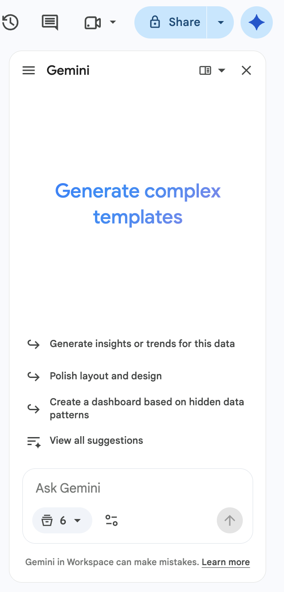
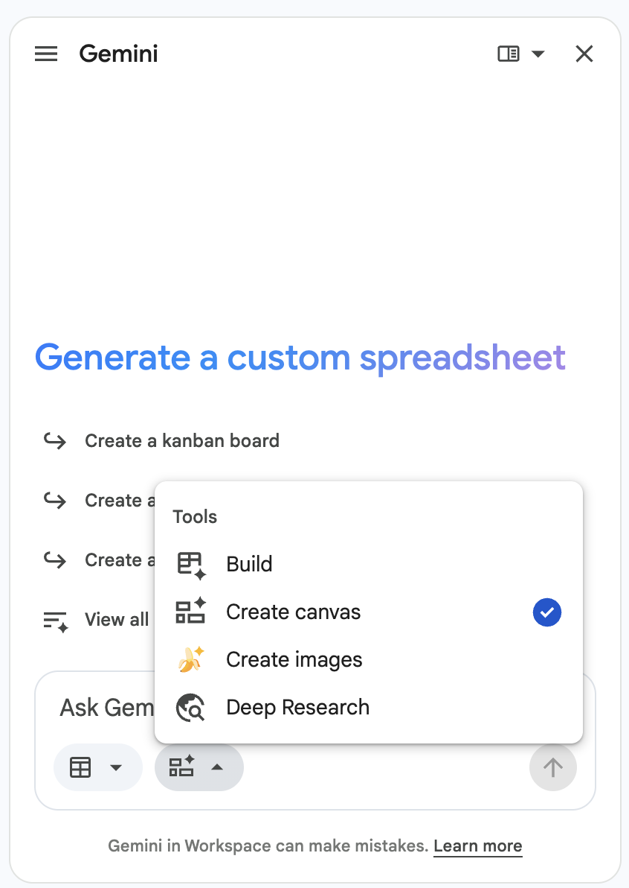
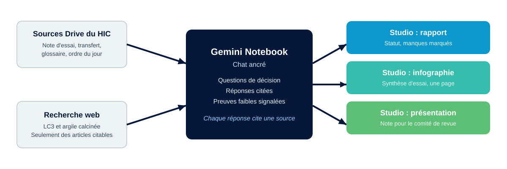
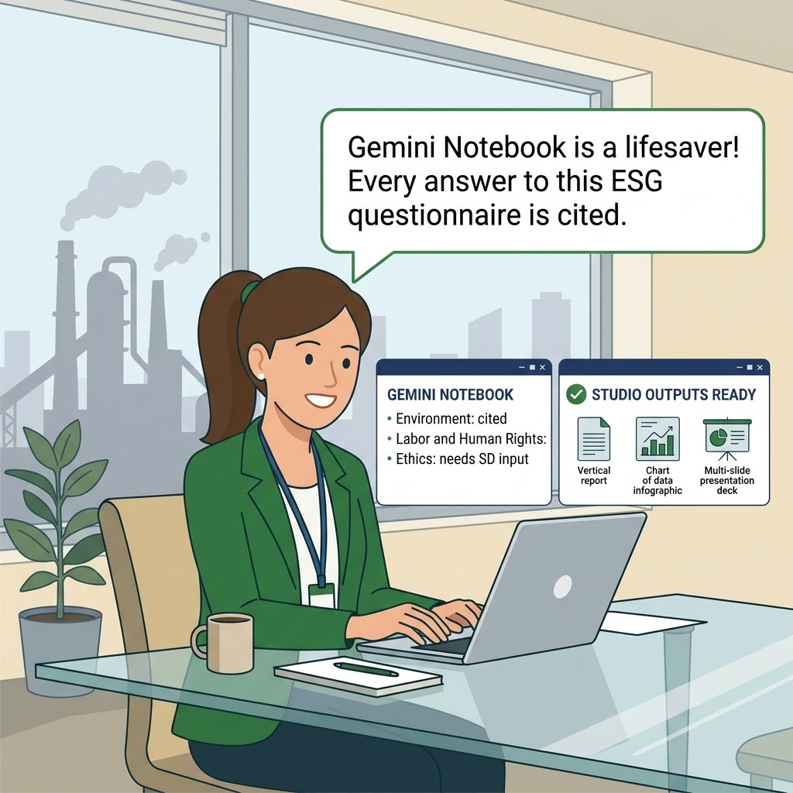

<!-- course-title: L’IA pour le Holcim Innovation Centre -->
<!-- course-theme: holcim-theme -->

<!-- layout: full-bleed -->
# L’IA pour le Holcim Innovation Centre


---
<!-- layout: panel-right -->
# Bienvenue !

- ROI est un leader de la conception et de l’animation de formations sur mesure en technologie et en management
- Votre formateur
  - Nom
  - Parcours
  - Coordonnées
- C’est parti !


---
# Objectifs du cours

- Utiliser Gemini dans Google Workspace pour optimiser les activités quotidiennes du HIC
- Élaborer des prompts avancés, ancrés dans des sources fiables
- Résumer des échanges, effectuer des recherches, planifier des réunions et rédiger des réponses dans Gmail
- Créer et modifier des présentations dans Google Slides, en respectant la charte graphique de Holcim
- Analyser des données et créer des canvas interactifs dans Google Sheets
- Élaborer des notes de synthèse sourcées et citées dans Gemini Notebook
---
<!-- layout: panel-left -->
# Programme

- Ingénierie de prompts avancée
- Gemini dans Gmail
- Présentations conformes à la charte Holcim dans Slides
- Gemini dans Sheets
- Gemini Notebook


---
<!-- layout: panel-right -->
# Public visé

- Scientifiques et techniciens du HIC qui mènent des essais
- Responsables de laboratoire qui rédigent des notes d’essai et relisent des présentations
- Spécialistes qui préparent le transfert des essais vers l’usine
- Responsables innovation qui présentent en revue interne


---
<!-- layout: panel-left -->
# Prérequis

- Un compte Holcim Workspace avec Gemini activé
- Savoir rédiger des prompts Gemini simples
- Bien maîtriser Drive, Sheets et Slides
- Aucune compétence en science des données n’est requise


---
<!-- layout: stacked -->
# Cinq compétences, un après-midi

Vous utilisez déjà ces outils au quotidien. Aujourd’hui, vous apprenez à tirer parti de Gemini dans ces mêmes outils.


---
<!-- layout: 2-column -->
# Règles de la session

### Données

- Utilisez les fichiers synthétiques HIC-LC3-24 fournis dans chaque atelier
- Les résultats non publiés, les fiches formule et les noms de partenaires ne doivent jamais figurer dans un prompt
- Vous êtes responsable de chaque chiffre qui sort de cette salle

### Fonctionnalités

- Les fonctionnalités Gemini sont déployées à des dates différentes selon les environnements
- S’il manque un bouton présenté dans une diapositive ou un atelier, signalez-le. Chaque atelier prévoit une solution de repli
- Les libellés de l’interface évoluent. Suivez l’objectif de l’étape, pas une capture d’écran à l’identique
---
<!-- layout: navigation -->
# Au programme

- **Ingénierie de prompts avancée**
- Gemini dans Gmail
- Présentations conformes à la charte Holcim dans Slides
- Gemini dans Sheets
- Gemini Notebook
---
# À vous de jouer : demander une note d’essai

Essayez ceci avant d’aborder la technique.

1. Ouvrez Gemini et démarrez une nouvelle conversation :

   ```text
   https://gemini.google.com
   ```

2. Envoyez ce prompt, sans fichier joint :

   ```text
   Rédigez une courte note sur notre essai de liant LC3
   pour l'équipe de l'usine.
   ```

3. Lisez la réponse.
---
# Qu’est-ce qui ne va pas dans ce prompt ?

- Aucun fichier n’était joint : chaque chiffre a donc été inventé
- Gemini ne peut pas deviner votre lecteur, vos sources ni ce qu’il faut exclure
- La solution : une structure, des sources et une règle pour les informations manquantes
- Si un chiffre ne figure pas dans la source, il n’a pas sa place dans la réponse.


---
<!-- layout: 2-column -->
# Rôle, tâche, étapes et exemples

### Prompt faible

```text
Rédigez une note d'essai sur le LC3
pour l'usine.
```

- Ni lecteur, ni source, ni limites
- Gemini comble chaque manque avec du contenu plausible

### Prompt structuré

```text
Rôle : vous êtes scientifique des liants
au HIC et vous écrivez pour l'équipe
qualité de Loire Plant.
Tâche : rédigez une note d'une page
sur HIC-LC3-24.
Étapes : utilisez uniquement le protocole
et les résultats joints. Sections : Objet,
Besoins de l'usine, Méthodes et résultats,
Questions ouvertes.
Exemple de ton : "M12 dépasse 42,5 MPa
à 28 jours. Cubes à 90 jours en attente."
```
---
<!-- layout: card-layout -->
# Quatre techniques avancées

### Listes de contraintes

- Regroupez toutes les limites dans un seul bloc et collez-le à la fin du prompt.

### Ancrage sur plusieurs fichiers

- Indiquez à Gemini quel fichier fait foi pour les méthodes, pour les chiffres et pour les réserves.

### Boucles de critique

- Demandez à Gemini de vérifier son brouillon par rapport aux sources avant toute relecture humaine.

### Méta-prompting

- Demandez à Gemini d’améliorer votre prompt et de vous poser des questions avant de commencer.
---
# Listes de contraintes

```text
Public : équipe qualité de Loire Plant
Longueur : une page, 250 mots maximum
Unités : MPa et jours ; facteur de clinker au format 0,00
Sources : méthodes dans le protocole, chiffres dans le PDF de résultats
Interdit : allégations ECOPlanet ou ECOPact ; moyennes entre formules
Si absent : écrire Non trouvé
```

- Chaque ligne ferme une porte que Gemini aurait sinon franchie
- Si Gemini s’écarte du sujet lors d’une relance, recollez la liste. Ne recommencez pas avec un prompt flou ou sans contexte
---
# Ancrage sur plusieurs fichiers

```text
Utilisez les trois PDF joints :
- hic-lc3-24-trial-protocol.pdf fait foi pour les méthodes
- hic-lc3-24-interim-results.pdf fait foi pour les chiffres
- hic-lc3-24-limitations.pdf fait foi pour les réserves
Pour chaque formule, renvoyez un tableau Markdown :
Formule | Âge (jours) | Résistance (MPa) | Spéc. (MPa) | Fichier source
Écrivez Non trouvé dans chaque cellule vide. N'estimez pas.
```

> [!TIP]
> `Non trouvé` est une réponse acceptable. Un mégapascal inventé ne l’est pas. Le tableau rend les manques visibles d’un coup d’œil.
---
<!-- layout: 3-column -->
# Boucles de critique et réécriture selon le public

### 1. Rédiger

- Rédigez la note d’essai avec votre rôle, votre tâche et votre liste de contraintes
- Gardez les fichiers sources joints

### 2. Critiquer

- « Vérifiez ce brouillon par rapport aux fichiers joints. Associez chaque affirmation à son fichier source. Marquez toute affirmation sans source comme INVENTÉ. »

### 3. Réécrire

- « Réécrivez ce texte en cinq lignes pour un dirigeant. Mêmes faits. N’ajoutez rien. »
- Recommencez pour un scientifique, puis pour un lecteur de l’usine
---
<!-- layout: 2-column -->
# Prompts d’image sans chiffres inventés

### Prompt simple

- « Créez une infographie sur un essai LC3 du HIC. »
- Le rendu est soigné
- Mais il invente des pourcentages, des graphiques et des logos superflus

### Prompt verrouillé

- Joignez l’image du logo Holcim
- Fournissez le texte exact : titre, en-têtes, lignes, pied de page
- Précisez le style : palette, mise en page, format d’image
- Interdisez les pourcentages inventés, les faux graphiques et les logos superflus

<!-- below-columns -->

> [!WARNING]
> Le texte d’une image générée peut contenir des fautes. Relisez chaque mot.
---
# Méta-prompting : laissez Gemini écrire le prompt

```text
Je veux une infographie sur HIC-LC3-24 pour l'équipe
qualité de Loire Plant. Avant de créer une image,
réécrivez mon prompt pour le rendre plus clair et plus
précis. Si des informations manquent, posez-moi jusqu'à
trois questions. Puis attendez mes réponses.
```

- La réécriture de Gemini est généralement plus précise que votre premier jet
- Relisez la réécriture, corrigez les faits, puis relancez le prompt édité
- Fonctionne aussi pour les prompts de texte. Enregistrez la version finale comme modèle réutilisable
---
<!-- layout: stacked -->
# Atelier 1 : Ingénierie de prompts avancée

**Durée :** 30 minutes

[Ouvrir l’atelier 1](https://labv.roitraining.com/?lab=https%3A%2F%2Fgithub.com%2Froitraining%2Fholcim-department-ai-training-labs%2Fblob%2Fmain%2Flabs%2Finnovation-centre-fr%2Flab-01-advanced-prompt-engineering%2Flab.md)


---
<!-- layout: navigation -->
# Au programme

- Ingénierie de prompts avancée
- **Gemini dans Gmail**
- Présentations conformes à la charte Holcim dans Slides
- Gemini dans Sheets
- Gemini Notebook
---
# Gemini dans Gmail : la boîte à outils complète

| Fonction | Où | Utilité |
| :--- | :--- | :--- |
| Résumer | Panneau latéral **Ask Gemini**, ou **Summarize this email** dans un fil de conversation | Rattraper un long échange sur le transfert |
| Interroger votre messagerie | Panneau latéral **Ask Gemini** | « Qu’a demandé l’usine la semaine dernière ? » |
| Rechercher dans Gmail, Chat et Drive | Panneau latéral **Ask Gemini** | Retrouver le protocole, la décision, le fichier |
| Help me write | Fenêtre de rédaction ou panneau latéral | Rédiger une réponse, puis la rendre plus formelle, la développer ou la raccourcir |
| Réponses suggérées | En bas d’un e-mail reçu | Réponses courtes rédigées à partir de tout le fil de conversation |
| Help me schedule | En bas d’un brouillon ou d’une réponse | Proposer des créneaux compatibles avec l’agenda de chacun |
---
<!-- layout: panel-right -->
# Rechercher dans Gmail, Chat et Drive

- Formulez votre demande en langage courant : « Trouvez le protocole HIC-LC3-24 et la dernière décision prise dans Chat sur l’attribution des silos. »
- Gemini cherche uniquement dans les sources sélectionnées dans le panneau. Vérifiez-les avant de conclure que la réponse est fausse
- Nommez précisément le fichier ou le fil de conversation. « Trouvez mes documents LC3 » est trop vague et renvoie le mauvais PDF
- Les résultats de Chat dépendent de la configuration de votre Workspace. Si Chat ne renvoie rien, ouvrez le fichier Drive cité dans la réponse et poursuivez à partir de celui-ci


---
# Help me schedule

- Répondez dans le fil de conversation, ou rédigez un nouvel e-mail en ajoutant les destinataires concernés
- Cliquez sur **Help me schedule** en bas du message. Si le bouton n’apparaît pas, ouvrez **More options**
- Gemini propose quatre créneaux à partir de votre agenda et des agendas des invités auxquels vous avez accès
- Ajustez les créneaux avec l’icône crayon, puis cliquez sur **Send**
- Rien n’est réservé tant qu’un destinataire n’a pas choisi de créneau


---
<!-- layout: 2-column -->
# Réponses suggérées et Help me write

### Réponses suggérées

- Gemini détecte qu’une réponse est attendue et propose de courts brouillons en bas de l’e-mail
- Rédigées à partir de tout le fil de conversation, pas seulement du dernier message
- Utiles pour « Bien reçu. Je relirai le protocole d’ici vendredi. »
- Relisez avant d’envoyer : le ton est assuré, même quand les faits sont inexacts

### Help me write

- Vous décrivez la réponse : responsables, dates et prochaines étapes
- Affinez le brouillon : plus formel, plus développé ou plus court
- Utile pour une réponse qui acte trois décisions sur le transfert
- Vous restez responsable de vérifier chaque réponse proposée par Gemini. Aucun chiffre absent du fil de conversation
---
<!-- layout: 2-column -->
# Discussion : que faut-il toujours faire avant d’envoyer une réponse suggérée ?

### Situation

Un responsable d’usine demande si la formule M13 est prête pour le transfert. Gemini propose une réponse en un clic : « Oui, M13 est en bonne voie. »

### À discuter

- En quoi cette réponse pourrait-elle être incorrecte ?
- Quels e-mails du HIC faut-il toujours rédiger soi-même plutôt qu’envoyer en un clic ?
- Qui est responsable si la réponse est incorrecte : Gemini ou vous ?
---
<!-- layout: stacked -->
# Atelier 2 : Gemini dans Gmail

**Durée :** 30 minutes

[Ouvrir l’atelier 2](https://labv.roitraining.com/?lab=https%3A%2F%2Fgithub.com%2Froitraining%2Fholcim-department-ai-training-labs%2Fblob%2Fmain%2Flabs%2Finnovation-centre-fr%2Flab-02-gemini-in-gmail%2Flab.md)


---
<!-- layout: navigation -->
# Au programme

- Ingénierie de prompts avancée
- Gemini dans Gmail
- **Présentations conformes à la charte Holcim dans Slides**
- Gemini dans Sheets
- Gemini Notebook
---
<!-- layout: panel-right -->
# Créer une présentation Google Slides avec Gemini

1. Ouvrez une nouvelle présentation et cliquez sur **Ask Gemini**
2. Décrivez la présentation. Ajoutez des fichiers avec **Add sources → Add from Drive**
3. Facultatif : utilisez **Match presentation style** avec une présentation Holcim approuvée, qui sert de modèle
4. Cliquez sur **Next** et relisez le plan : un sujet par diapositive
5. Modifiez, ajoutez ou supprimez des sujets, puis cliquez sur **Approve**
6. Gardez l’onglet ouvert pendant que Gemini génère les diapositives


---
<!-- layout: 2-column -->
# Générer à partir de Google Docs ou de Google Sheets

### Le document fournit le récit

- Un modèle de point d’avancement : statut, risques, demande au comité de revue
- Donne à Gemini l’ordre des diapositives et l’argumentaire

### Le tableau fournit les chiffres

- Les résultats à 28 jours : résistance, spécification, facteur de clinker
- Donne à Gemini les seuls chiffres qu’il peut citer

<!-- below-columns -->

> [!IMPORTANT]
> Précisez à Gemini dans quel fichier se trouve chaque type d’information. Sinon, il risque de mélanger les sources et de combler lui-même les manques.
---
# Un prompt qui attribue un rôle à chaque fichier

```text
Créez une présentation de revue de six diapositives pour le
comité d'innovation du HIC.
Utilisez @HIC-LC3-24 Project Update pour l'ordre des
diapositives et le récit.
Utilisez @HIC-LC3-24 28-day Results pour tous les chiffres.
Si un chiffre ne figure pas dans ces fichiers, ne l'affichez pas.
Les titres énoncent le constat, par exemple
"M12 dépasse la spécification à 28 jours".
```

- Tapez `@` suivi du nom du fichier pour référencer un fichier Drive, ou ajoutez-le avec **Add sources**
- Le plan est votre point de contrôle. Supprimez tout sujet qui invente un KPI, un client ou une usine
---
# Démo : générer une présentation de revue de six diapositives

1. Créez une nouvelle présentation et cliquez sur **Ask Gemini**. Aucune pièce jointe n’est nécessaire.

2. Envoyez ce prompt. Le point d’avancement et les résultats y sont collés : ce sont les seules sources.

   ```text
   Créez une présentation de revue de six diapositives pour le
   comité de revue du Holcim Innovation Centre.
   Utilisez uniquement le point d'avancement et les résultats
   ci-dessous. Si un chiffre n'y figure pas, ne l'affichez pas.
   Les titres énoncent le constat, par exemple
   "M12 dépasse la spécification à 28 jours".

   Diapositives :
   1. Titre : HIC-LC3-24, vers le transfert à Loire Plant
   2. Pourquoi cet essai
   3. Résultats à 28 jours
   4. Risques et points ouverts avec l'usine
   5. La demande au comité de revue
   6. Les 30 prochains jours

   POINT D'AVANCEMENT (données de formation synthétiques)
   Projet : HIC-LC3-24, liant à faible teneur en clinker,
   à base d'argile calcinée (LC3)
   Usine cible : Loire Plant
   Objectif : atteindre la spécification de 42,5 MPa à 28 jours
   (classe CEM 42,5) avec un facteur de clinker inférieur à celui
   du témoin CEM I, et transférer une fiche formule prête pour
   l'usine.
   Étape : passage à l'échelle. Résultats à 90 jours en attente
   pour huit formules.
   Cette période :
   - Spécification à 28 jours fixée à 42,5 MPa dans le protocole
     d'essai
   - Formule M13 signalée sous la spécification à 28 jours
   - Échanges engagés avec l'usine sur l'attribution du silo
     d'argile calcinée
   Risques :
   - Demande en eau du LC3 environ 8 % plus élevée que celle
     du CEM I
   - Capacité de calcination d'argile de Loire Plant : 80 t/jour
   - Finesse de l'argile calcinée variable ; cible : 4 200 cm2/g
     Blaine
   Demande au comité : garder M12 parmi les formules prêtes pour
   Loire Plant ? Reformuler ou abandonner M13 ?
   30 prochains jours :
   1. Terminer les cubes à 90 jours
   2. Convenir avec Loire Plant de l'attribution des silos et
      d'un seuil de finesse
   3. N'émettre de fiches formule que pour les formules conformes
      à 28 jours et prêtes pour l'usine

   RÉSULTATS À 28 JOURS (spécification : 42,5 MPa)
   Formule | Liant | Facteur de clinker | Résistance (MPa) | Résultat
   M01 | CEM I | 0,95 | 52,4 | Conforme (témoin)
   M12 | LC3-50 | 0,52 | 44,8 | Conforme
   M13 | LC3-50 | 0,50 | 41,2 | Non conforme
   M21 | LC3-35 | 0,65 | 47,1 | Conforme

   Règles : indiquer les travaux à 90 jours comme en attente.
   Ne pas mentionner ECOPlanet ni ECOPact. N'ajouter ni clients,
   ni tonnages, ni autres usines. Ne pas calculer de moyennes
   entre formules.
   ```

3. Répondez aux éventuelles questions de Gemini, puis cliquez sur **Next**.

4. Relisez le plan des diapositives, puis cliquez sur **Approve**.

5. Une fois la présentation générée, faites défiler les diapositives.
---
<!-- layout: panel-left -->
# Modifier des diapositives à l’aide de documents de référence

- Gardez le brouillon initial ouvert et poursuivez dans la même conversation Gemini
- Joignez les documents sources et les règles de la charte graphique Holcim
- Dans le prompt, utilisez le verbe « modifier » et non « créer » : « Modifiez les diapositives 3 et 4 à l’aide de ces fichiers. N’ajoutez pas de diapositives. »
- Corrigez une diapositive à la fois en indiquant son numéro
- Demandez à Gemini de remplacer ou de modifier une image qui ne convient pas


---
<!-- layout: 2-column -->
# Contraintes de style

### Aspect

- Fond blanc, texte bleu marine
- Couleurs d’accent bleu et vert du logo Holcim
- Logo dans un coin, à l’écart du titre
- Pas plus de quatre éléments de liste par diapositive

### Contenu

- N’utilisez que les chiffres qui figurent clairement dans les fichiers joints
- Présentez les objectifs comme des objectifs, pas comme des résultats
- Présentez à part les résultats à 90 jours, encore en attente
- Aucune hallucination : pas d’usines, de clients ni de tonnages inventés

<!-- below-columns -->

> [!TIP]
> Le moyen le plus rapide d’obtenir le style Holcim est d’utiliser **Match presentation style** avec un modèle Holcim approuvé. Les prompts ne servent ensuite qu’à corriger les exceptions.
---
<!-- layout: stacked -->
# Atelier 3 : Présentations conformes à la charte Holcim avec Gemini <br>dans Google Slides

**Durée :** 30 minutes

[Ouvrir l’atelier 3](https://labv.roitraining.com/?lab=https%3A%2F%2Fgithub.com%2Froitraining%2Fholcim-department-ai-training-labs%2Fblob%2Fmain%2Flabs%2Finnovation-centre-fr%2Flab-03-presentations-from-docs-and-sheets%2Flab.md)


---
<!-- layout: navigation -->
# Au programme

- Ingénierie de prompts avancée
- Gemini dans Gmail
- Présentations conformes à la charte Holcim dans Slides
- **Gemini dans Sheets**
- Gemini Notebook
---
# Gemini dans Sheets : six tâches

| Tâche | Où | Exemple de demande |
| :--- | :--- | :--- |
| Importer | **File → Import**, puis **Ask Gemini** | « Décrivez les colonnes de cet onglet et signalez les cellules vides. » |
| Mise en forme automatique | Panneau latéral **Ask Gemini** | « Mettez en gras et figez la ligne d’en-tête, activez les filtres et affichez les nombres avec une décimale. » |
| Analyser | Panneau latéral **Ask Gemini** | « Quelles sont les trois usines dont la résistance moyenne est la plus élevée ? Indiquez les lignes utilisées. » |
| Formules | Panneau latéral **Ask Gemini** | « Ajoutez une colonne qui signale les valeurs non conformes à la spécification, à l’aide d’une formule de feuille de calcul. » |
| Chercher des documents | Panneau latéral **Ask Gemini** | « Recherchez le dernier point d’avancement dans Google Drive et résumez les risques associés au projet. » |
| Canvas | **Ask Gemini → Tools → Create canvas** | « Créez un tableau de bord avec un indicateur par région et un filtre par statut. » |
---
<!-- layout: 2-column -->
# Importer et mettre en forme

### Importer

- **File → Import**, puis choisissez un fichier CSV ou Excel depuis Drive ou votre ordinateur
- Choisissez **Insert new sheet(s)** pour conserver l’onglet d’origine intact
- Demandez à Gemini de décrire les colonnes avant d’effectuer toute analyse

### Mettre en forme en un prompt

```text
Formatez cette feuille de calcul :
figez la ligne d'en-tête et mettez-la
en gras, ajustez la largeur des colonnes,
affichez les nombres avec une décimale
et activez les filtres. N'ajoutez ni ne
supprimez aucune ligne.
```
---
<!-- layout: 2-column -->
# Analyser une question à la fois

### Question vague

- « Analysez ces données. »
- Vous obtenez un résumé générique des colonnes
- Rien que vous puissiez vérifier

### Question ciblée

- « Comparez la résistance moyenne par famille de liants. Utilisez uniquement les données de cette feuille de calcul et indiquez les lignes prises en compte. »
- Précise les colonnes, le regroupement et la source des données
- Chaque chiffre correspond à des lignes que vous pouvez filtrer et vérifier

<!-- below-columns -->

> [!TIP]
> Poursuivez dans la même conversation : « Affichez maintenant ce résultat sous forme de graphique. » Gemini conserve le contexte.
---
<!-- layout: 2-column -->
# Formules écrites par Gemini

### Écrire une formule

```text
Dans la première colonne vide, ajoutez
Below_Spec : Yes si
Compressive_Strength_MPa est inférieur à
Spec_Strength_MPa, sinon No. Utilisez une
formule et recopiez-la jusqu'à la dernière
ligne de données.
```

```text
=IF(I2<J2,"Yes","No")
```

### Expliquer une formule

```text
Expliquez en langage simple la formule
de la cellule N2, étape par étape.
```

- La formule est intégrée dans les cellules : elle se met à jour automatiquement quand les données changent
- Vérifiez manuellement trois lignes avant de vous fier à la colonne
---
<!-- layout: default -->
# Rechercher des documents depuis le panneau

Interrogez vos fichiers Google Drive sans quitter votre feuille de calcul :

1. Nommez le fichier : « Trouvez le dernier point d’avancement du projet LC3 dans Google Drive et listez les risques encore ouverts. »
2. Si la recherche échoue, ajoutez le fichier avec **Add sources → Add from Drive**
3. Reliez-le ensuite à vos données : « Quelles lignes de cet onglet correspondent aux risques mentionnés dans ce fichier ? »


---
<!-- layout: 2-column -->
# Graphique ou canvas ?

### Graphique

- Une vue des données, insérée dans la grille
- Utile pour une seule tendance ou comparaison
- Collé dans Slides, il devient un instantané

### Canvas

- Une vue interactive : tableaux de bord, tableaux Kanban, galeries et calendriers
- Modifiez les données dans le canvas : l’onglet est mis à jour
- S’affine par des prompts de suivi, sans tout reconstruire
---
<!-- layout: panel-right -->
# Créer un canvas

- Ouvrez **Ask Gemini**, cliquez sur le bouton **Tools** dans la zone de prompt, puis choisissez **Create canvas**. Une coche indique que l’option est activée
- Décrivez ensuite vos besoins dans le champ de saisie du prompt
- Modifiez les données dans le canvas : la feuille est mise à jour

> [!NOTE]
> La création de canvas nécessite des données dans l’onglet, une interface en anglais, un ordinateur (pas l’application mobile) et un droit de modification. Elle n’est pas disponible si le téléchargement, la copie et l’impression sont désactivés pour le fichier.


---
# À vous de jouer : créer un canvas

1. Créez une nouvelle feuille de calcul :

   ```text
   https://sheets.new
   ```

2. Cliquez sur la cellule **A1** et collez cette liste synthétique de projets :

   ```text
   Project,Owner,Region,Status,Stage,Due_Date,Budget_kEUR
   Low-clinker binder scale-up,A. Martin,Europe,On track,Scale-up,2027-03-31,420
   Calcined clay fineness study,L. Dubois,Europe,At risk,Lab,2027-01-15,85
   Recycled aggregate concrete,S. Patel,Asia Pacific,On track,Pilot,2027-06-30,260
   Carbon-cured block trial,M. Rossi,Europe,Not started,Concept,2027-09-30,150
   Admixture dosing model,J. Silva,Latin America,On track,Lab,2027-02-28,60
   3D-printed formwork,K. Nakamura,Asia Pacific,At risk,Pilot,2027-04-30,310
   Low-carbon mortar range,E. Novak,Europe,Done,Handover,2026-10-31,190
   Kiln fuel substitution trial,R. Haddad,Middle East Africa,On track,Scale-up,2027-05-31,540
   Insulating concrete panel,T. Keller,North America,At risk,Pilot,2027-03-15,230
   Mineral carbonation screening,P. Okafor,Middle East Africa,Not started,Concept,2027-08-31,95
   Self-healing concrete coating,C. Moreau,Europe,On track,Lab,2027-07-31,120
   Fly ash replacement study,D. Kim,North America,Done,Handover,2026-09-30,140
   ```

3. Si tout s’affiche dans la colonne A, sélectionnez la colonne **A**, puis cliquez sur **Data → Split text to columns**. Vous devez obtenir 7 colonnes et 13 lignes, avec les en-têtes en ligne 1.

4. Ouvrez **Ask Gemini**. Dans la zone de prompt, cliquez sur le bouton **Tools** (à côté du bouton des sources), puis choisissez **Create canvas**. Vérifiez qu’une coche s’affiche.

5. Envoyez ce prompt :

   ```text
   Construisez un tableau de bord de gestion de projets à partir
   de cet onglet. Ajoutez des indicateurs clés : nombre total de
   projets, nombre de projets au statut At risk et budget total.
   Ajoutez un graphique en barres du budget par Region, un filtre
   par Status et un tableau des projets trié par Due_Date.
   ```

6. Vérifiez les indicateurs par rapport à l’onglet : 12 projets, 3 au statut At risk et un budget total de 2 600 kEUR.

7. Créez un nouvel onglet dans votre feuille de calcul. Cet onglet étant actif, sélectionnez de nouveau **Tools → Create canvas** dans le panneau latéral Gemini, puis saisissez le prompt suivant :

   ```text
   Construisez un tableau Kanban qui regroupe les projets par Status.
   Affichez Owner et Due_Date sur chaque carte.
   ```

8. Faites glisser une carte de **At risk** vers **On track**. Cliquez sur l’onglet de données et vérifiez que la cellule Status a changé.
---
<!-- layout: stacked -->
# Atelier 4 : Analyser les données d’essai avec Sheets et Gemini

**Durée :** 30 minutes

[Ouvrir l’atelier 4](https://labv.roitraining.com/?lab=https%3A%2F%2Fgithub.com%2Froitraining%2Fholcim-department-ai-training-labs%2Fblob%2Fmain%2Flabs%2Finnovation-centre-fr%2Flab-04-analyzing-trial-data-with-sheets-and-gemini%2Flab.md)


---
<!-- layout: navigation -->
# Au programme

- Ingénierie de prompts avancée
- Gemini dans Gmail
- Présentations conformes à la charte Holcim dans Slides
- Gemini dans Sheets
- **Gemini Notebook**
---
# Gemini Notebook


---
# Du chat à la recherche ancrée

- Une conversation ordinaire peut s’écarter du sujet ou inventer des détails. Un notebook s’appuie uniquement sur les sources que vous lui fournissez
- Vous choisissez les contenus à intégrer : notes d’essai du HIC, notes de transfert et recherche web ciblée
- Chaque réponse peut être retracée jusqu’à une source que vous avez sélectionnée
- Un outil conçu pour une revue d’innovation dont vous devez assumer la responsabilité
---
<!-- layout: stacked -->
# Sources en entrée, constats en sortie


---
# Poser des questions plus précises

- Demandez au notebook de comparer vos résultats d’essai à la littérature publiée, en citant les deux sources
- Demandez des arguments étayés par des citations pour le comité de revue, et faites signaler tout élément non ancré dans une source
- Si les sources ne permettent pas de répondre, le notebook le signale plutôt que d’inventer un chiffre
- Enregistrez les meilleures réponses sous forme de notes, puis convertissez-les en sources


---
# Gemini Notebook Studio

- Enregistrez les réponses du chat sous forme de notes, puis convertissez ces notes en sources
- Limitez les sources à votre propre contenu avant de générer des résultats
- Créez des supports soignés dans le notebook : rapports, infographies et ébauches de présentations


---
<!-- layout: stacked -->
# Atelier 5 : Note de synthèse sur l’essai de liant avec Gemini Notebook

**Durée :** 30 minutes

[Ouvrir l’atelier 5](https://labv.roitraining.com/?lab=https%3A%2F%2Fgithub.com%2Froitraining%2Fholcim-department-ai-training-labs%2Fblob%2Fmain%2Flabs%2Finnovation-centre-fr%2Flab-05-binder-trial-briefing-with-gemini-notebook%2Flab.md)


---
# À essayer demain

| Outil | Une action à mener sur votre propre travail |
| :--- | :--- |
| Prompts | Réécrivez un prompt que vous utilisez chaque semaine en ajoutant un rôle, des sources et une liste de contraintes. Enregistrez-le |
| Gmail | Demandez à Gemini ce que vous avez manqué cette semaine, puis utilisez **Help me schedule** pour planifier les actions de suivi |
| Slides | Élaborez votre prochain point d’avancement en vous appuyant sur des sources fiables et vérifiables |
| Sheets | Ouvrez une feuille de calcul que vous utilisez déjà et créez-en un canvas |
| Gemini Notebook | Regroupez les fichiers de votre prochaine revue dans un seul notebook. Posez la question que le comité vous posera |
---
# Ce que vous avez appris à faire

- Utiliser Gemini dans Google Workspace pour optimiser les activités quotidiennes du HIC
- Élaborer des prompts avancés, ancrés dans des sources fiables
- Résumer des échanges, effectuer des recherches, planifier des réunions et rédiger des réponses dans Gmail
- Créer et modifier des présentations dans Google Slides, en respectant la charte graphique de Holcim
- Analyser des données et créer des canvas interactifs dans Google Sheets
- Élaborer des notes de synthèse sourcées et citées dans Gemini Notebook
---
# Quiz 1 sur 3

**Vous joignez le protocole d’essai et le PDF contenant les résultats, puis vous demandez à Gemini de créer un tableau présentant la résistance pour chaque formule et chaque âge. Or, les résultats à 90 jours ne figurent dans aucun des deux documents. Quelle instruction de votre prompt permet le mieux d’éviter que Gemini ne renseigne ces cellules avec des valeurs inventées ?**

- A. « Soyez précis et professionnel. »
- B. « Écrivez Non trouvé dans chaque cellule vide. N’estimez pas. »
- C. « Limitez le tableau à 20 lignes. »
- D. « Vous êtes un scientifique des liants expérimenté. »
---
# Quiz 1 : réponse

**Vous joignez le protocole d’essai et le PDF contenant les résultats, puis vous demandez à Gemini de créer un tableau présentant la résistance pour chaque formule et chaque âge. Or, les résultats à 90 jours ne figurent dans aucun des deux documents. Quelle instruction de votre prompt permet le mieux d’éviter que Gemini ne renseigne ces cellules avec des valeurs inventées ?**

**Bonne réponse : B.** « Écrivez Non trouvé dans chaque cellule vide. N’estimez pas. »

- **B.** Cette instruction indique explicitement à Gemini comment réagir lorsque les sources ne contiennent pas l’information recherchée, afin que les données manquantes restent visibles
- **A.** « Soyez précis » exprime une intention, mais ne constitue pas une règle concrète. Gemini peut considérer sa réponse comme suffisamment précise
- **C. et D.** L’attribution d’un rôle et la limitation du nombre de lignes influencent le format de la réponse, mais n’empêchent pas Gemini d’inventer des données
---
# Quiz 2 sur 3

**Vous demandez à Gemini, dans Google Slides, de créer une présentation de revue de six diapositives à partir du document de suivi de l’avancement et du tableau de résultats. Vous cliquez sur Next et découvrez que le plan proposé contient une diapositive intitulée « Économies projetées par usine ». Or, aucun des deux fichiers ne contient ces données. Que devez-vous faire ?**

- A. Cliquez sur Approve, puis supprimez la diapositive une fois la présentation générée
- B. Supprimez ou reformulez ce sujet dans le plan, puis cliquez sur Approve
- C. Cliquez sur Approve et ajoutez une note précisant que les chiffres sont des estimations
- D. Fermez le panneau et recommencez avec un prompt plus court
---
# Quiz 2 : réponse

**Vous demandez à Gemini, dans Google Slides, de créer une présentation de revue de six diapositives à partir du document de suivi de l’avancement et du tableau de résultats. Vous cliquez sur Next et découvrez que le plan proposé contient une diapositive intitulée « Économies projetées par usine ». Or, aucun des deux fichiers ne contient ces données. Que devez-vous faire ?**

**Bonne réponse : B.** Supprimez ou reformulez ce sujet dans le plan, puis cliquez sur Approve

- **A.** Supprimer la diapositive plus tard est facile à oublier, et les chiffres inventés peuvent aussi apparaître sur d’autres diapositives
- **B.** Le plan est le point de contrôle : le corriger à ce stade coûte moins cher que de corriger une présentation finie
- **C.** Une note de bas de page ne rend pas un chiffre inventé acceptable
- **D.** Recommencer revient à jeter un plan presque correct
---
<!-- layout: 2-column -->
# Quiz 3 sur 3 : discussion

### Situation

Vous pilotez l’essai HIC-LC3-24. Dans deux semaines, vous présentez au comité de revue. Pour l’instant, vous disposez de :

- Un fil de conversation de 40 messages avec Loire Plant sur le transfert
- Les derniers résultats dans un tableau Google Sheets
- Trois articles publiés sur l’argile calcinée
- Un document de suivi de l’avancement et un modèle de présentation approuvé par Holcim

### À discuter

- Quels outils utiliseriez-vous ? Pour quelles tâches, et dans quel ordre ?
- Lorsque deux outils peuvent accomplir la même tâche, comment choisir le plus approprié ?
- À quel moment une personne doit-elle vérifier le travail généré par Gemini avant de l’utiliser ?
---
<!-- layout: 2-column -->
# Quiz 3 : points de discussion

**Vous devez présenter HIC-LC3-24 au comité de revue dans deux semaines. Vous disposez d’un long fil de conversation avec l’usine, d’un tableau Google Sheets de résultats, de trois articles de référence, d’un document de suivi de l’avancement et d’un modèle de présentation.**

### Les bonnes réponses mentionnent

- **Gmail :** résumer le fil de conversation, retrouver les décisions et utiliser Help me schedule pour organiser une répétition de la présentation
- **Sheets :** poser des questions ciblées, vérifier les formules et créer un canvas pour visualiser les données de façon dynamique
- **Gemini Notebook :** regrouper les articles et la note d’essai, avec des réponses citées qui listent les écarts entre résultats et publications
- **Slides :** générer la présentation à partir du document et du tableau avec Match presentation style, puis relire le plan
- **Conversation Gemini :** établir une liste de contraintes pour toute note rédigée

### Points de vigilance

- Tout coller dans une seule conversation en espérant que cela suffise
- Des sources web encore sélectionnées quand le notebook génère le livrable pour le comité
- Une réponse suggérée utilisée pour répondre à une question technique
- Approuver le plan Slides sans le lire
- Un chiffre que personne n’a vérifié dans le tableau Sheets
---
<!-- layout: stacked -->
# Questions et réponses


