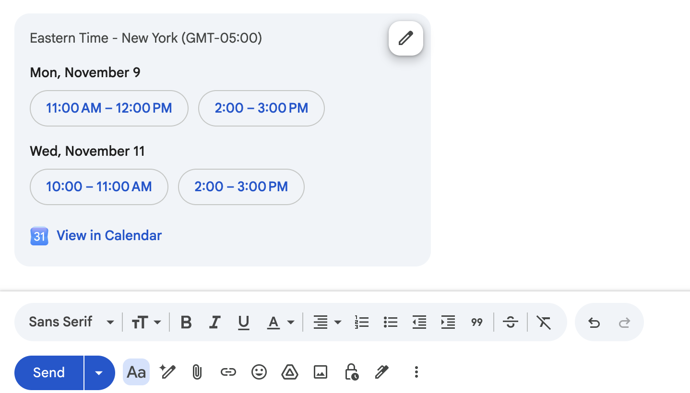
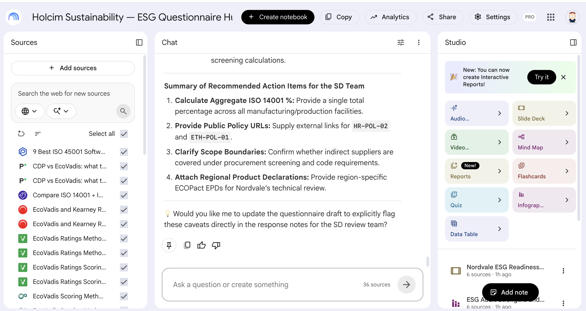
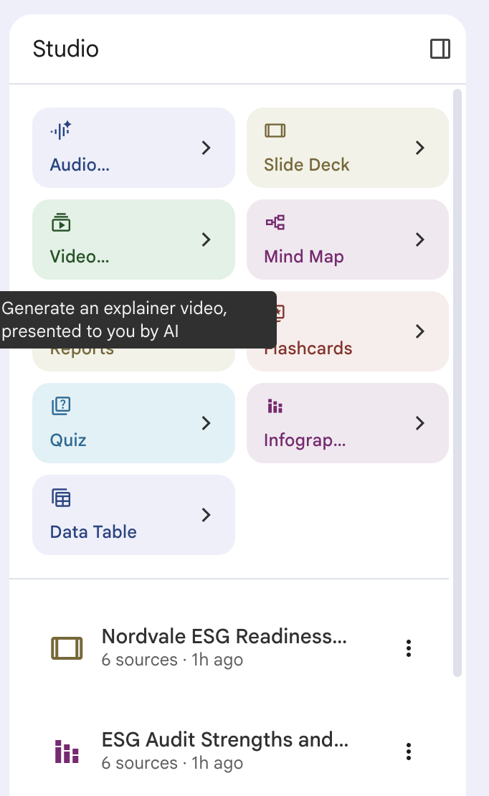

<!-- course-title: L’IA pour le Holcim Innovation Centre -->
<!-- course-theme: holcim-theme -->

<!-- layout: full-bleed -->
# L’IA pour le Holcim Innovation Centre


---
<!-- layout: panel-right -->
# Bienvenue !

- ROI est le leader du secteur pour la conception et la réalisation de formations sur mesure en technologie et en management
- Rencontrez votre formateur
  - Nom
  - Parcours
  - Coordonnées
- C’est parti !


---
# Objectifs du cours

- Utiliser Gemini dans Workspace pour accélérer le travail quotidien du HIC
- Rédiger des prompts avancés ancrés dans vos sources
- Résumer, rechercher, planifier et répondre dans Gmail
- Créer et modifier des présentations au style Holcim dans Slides
- Analyser des données et créer un canvas dans Sheets
- Constituer une note de synthèse citée dans Gemini Notebook
---
<!-- layout: panel-left -->
# Ordre du jour

- Ingénierie de prompts avancée
- Gemini dans Gmail
- Présentations au style Holcim dans Slides
- Gemini dans Sheets
- Gemini Notebook


---
<!-- layout: panel-right -->
# Public visé

- Scientifiques et techniciens du HIC qui mènent des essais
- Responsables de laboratoire qui rédigent les notes d’essai et relisent les présentations
- Spécialistes qui préparent le transfert des essais vers l’usine
- Responsables innovation qui briefent les revues internes


---
<!-- layout: panel-left -->
# Prérequis

- Un compte Holcim Workspace avec Gemini activé
- De l’expérience dans la rédaction de prompts Gemini simples
- L’aisance avec Drive, Sheets et Slides
- Aucune formation en science des données n’est requise


---
<!-- layout: stacked -->
# Cinq compétences, un après-midi

Vous travaillez déjà dans ces outils. Aujourd’hui, vous rendez Gemini utile à l’intérieur.


---
<!-- layout: 2-column -->
# Règles du jour

### Données

- Utilisez les fichiers de cours synthétiques HIC-LC3-24 dans chaque labo
- Les résultats non publiés, les fiches formule et les noms de partenaires restent hors des prompts
- Vous répondez de chaque chiffre qui sort de la salle

### Fonctions

- Les fonctions Gemini arrivent chez les clients à des moments différents
- Si un bouton d’une diapositive ou d’un labo manque, dites-le. Chaque labo a une solution de repli
- Les libellés bougent. Cherchez l’intention de l’étape, pas une capture identique
---
<!-- layout: navigation -->
# Sections du jour

- **Ingénierie de prompts avancée**
- Gemini dans Gmail
- Présentations au style Holcim dans Slides
- Gemini dans Sheets
- Gemini Notebook
---
# À faire maintenant : demander une note d’essai

Essayez ceci avant de parler de technique.

1. Ouvrez Gemini et démarrez une nouvelle conversation :

   ```text
   https://gemini.google.com
   ```

2. Envoyez ce prompt, sans fichier joint :

   ```text
   Rédigez une courte note d’essai sur notre essai de liant LC3 pour l’équipe de l’usine.
   ```

3. Lisez les résultats.
---
# Qu’est-ce qui ne va pas dans le prompt précédent ?

- Vous n’avez donné aucun fichier, donc chaque chiffre a été inventé
- Gemini ne peut pas deviner votre lecteur, vos sources, ni ce qui doit rester dehors
- La solution, c’est une structure, plus des sources, plus une règle pour ce qui manque
- Si un chiffre n’est pas dans la source, il n’a pas sa place dans la réponse.


---
<!-- layout: 2-column -->
# Rôle, tâche, étapes et exemples

### Faible

```text
Rédigez une note d’essai sur le LC3 pour l’usine.
```

- Pas de lecteur, pas de source, pas de limites
- Gemini comble chaque vide avec quelque chose de plausible

### Structuré

```text
Rôle : vous êtes un scientifique des liants du HIC et vous écrivez
pour le personnel qualité de Loire Plant.
Tâche : rédigez une note d’une page sur HIC-LC3-24.
Étapes : utilisez uniquement le protocole et les
résultats joints. Sections : Objet, Ce dont l’usine
a besoin, Méthodes et résultats, Questions ouvertes.
Exemple de ton : "M12 a passé 42.5 MPa à 28 jours.
Cubes à 90 jours en attente."
```
---
<!-- layout: card-layout -->
# Quatre techniques avancées

### Piles de contraintes

- Écrivez chaque limite une seule fois, dans un seul bloc, et collez-le à la fin du prompt.

### Ancrage sur plusieurs fichiers

- Dites à Gemini quel fichier porte les méthodes, quel fichier porte les chiffres, et quel fichier porte les réserves.

### Boucles de critique

- Faites vérifier le brouillon par Gemini contre les sources avant que quelqu’un d’autre le lise.

### Méta-prompt

- Demandez à Gemini d’améliorer votre prompt et de vous poser des questions avant de faire le travail.
---
# Piles de contraintes

```text
Public : équipe qualité de Loire Plant
Longueur : une page, 250 mots maximum
Unités : MPa et jours ; facteur de clinker au format 0.00
Sources : protocole pour les méthodes, PDF de résultats pour les chiffres
Interdit : allégations ECOPlanet ou ECOPact ; moyennes entre formules
Si absent : écrire Non trouvé
```

- Chaque ligne ferme une porte que Gemini franchirait autrement
- Quand Gemini dérive dans un suivi, collez de nouveau la pile. Ne recommencez pas avec un prompt vague
---
# Ancrage sur plusieurs fichiers

```text
Utilisez les trois PDF joints :
- hic-lc3-24-trial-protocol.pdf porte les méthodes
- hic-lc3-24-interim-results.pdf porte les chiffres
- hic-lc3-24-limitations.pdf porte les réserves
Pour chaque formule, renvoyez un tableau Markdown :
Formule | Âge (jours) | Résistance (MPa) | Spec (MPa) | Fichier source
Écrivez Non trouvé dans chaque cellule vide. N’estimez pas.
```

> [!TIP]
> `Non trouvé` est une réponse valide. Un mégapascal inventé ne l’est pas. Le tableau rend les manques visibles d’un coup d’œil.
---
<!-- layout: 3-column -->
# Boucles de critique et réécritures selon le public

### 1. Produire

- Rédigez la note d’essai avec votre rôle, votre tâche et votre pile de contraintes
- Gardez les fichiers sources joints

### 2. Critiquer

- « Vérifiez ce brouillon contre les fichiers joints. Listez chaque affirmation avec son fichier source. Marquez toute affirmation sans source comme INVENTÉ. »

### 3. Réécrire

- « Réécrivez ceci pour un dirigeant en cinq lignes. Les mêmes faits. N’ajoutez rien. »
- Recommencez pour un scientifique et pour un lecteur de l’usine
---
<!-- layout: 2-column -->
# Prompts d’image sans chiffres inventés

### Prompt simple

- « Créez une infographie sur un essai LC3 du HIC. »
- Le résultat a l’air soigné
- Il invente des pourcentages, des graphiques et des logos en plus

### Prompt verrouillé

- Joignez l’image du logo Holcim
- Donnez le texte exact : titre, en-têtes, lignes, pied de page
- Ajoutez le style : palette, mise en page, rapport hauteur/largeur
- Interdisez les pourcentages inventés, les faux graphiques et les logos en plus

<!-- below-columns -->

> [!WARNING]
> Le texte à l’intérieur d’une image générée peut encore être mal orthographié. Relisez chaque mot.
---
# Méta-prompt : laissez Gemini écrire le prompt

```text
Je veux une infographie pour le personnel qualité de Loire Plant
sur HIC-LC3-24. Avant de créer une image, réécrivez mon prompt
pour qu’il soit plus clair et plus précis. Posez-moi jusqu’à trois
questions si quelque chose manque. Puis attendez-moi.
```

- La réécriture de Gemini est en général plus précise que votre premier brouillon
- Relisez la réécriture, corrigez les faits, puis lancez-la
- Cela marche aussi pour les prompts de texte. Enregistrez la version finale comme modèle réutilisable
---
<!-- layout: stacked -->
# Labo 1 : Ingénierie de prompts avancée

**Temps :** 30 minutes

[Ouvrir le labo 1](https://labv.roitraining.com/?lab=https%3A%2F%2Fgithub.com%2Froitraining%2Fholcim-department-ai-training-labs%2Fblob%2Fmain%2Flabs%2Finnovation-centre-fr%2Flab-01-advanced-prompt-engineering%2Flab.md)


---
<!-- layout: navigation -->
# Sections du jour

- Ingénierie de prompts avancée
- **Gemini dans Gmail**
- Présentations au style Holcim dans Slides
- Gemini dans Sheets
- Gemini Notebook
---
# Gemini dans Gmail : la boîte à outils complète

| Fonction | Où | À quoi ça sert |
| :--- | :--- | :--- |
| Résumer | Panneau latéral **Ask Gemini**, ou **Summarize this email** sur un fil | Rattraper un long fil de transfert |
| Interroger le courrier | Panneau latéral **Ask Gemini** | « Qu’est-ce que l’usine a demandé la semaine dernière ? » |
| Chercher dans Gmail, Chat et Drive | Panneau latéral **Ask Gemini** | Trouver le protocole, la décision, le fichier |
| Help me write | Fenêtre de rédaction ou panneau latéral | Rédiger une réponse, puis la formaliser, la développer ou la raccourcir |
| Réponses suggérées | Bas d’un e-mail reçu | Courtes réponses rédigées à partir de tout le fil |
| Help me schedule | Bas d’un brouillon ou d’une réponse | Proposer des horaires qui conviennent à tous les agendas |
---
<!-- layout: panel-right -->
# Chercher dans Gmail, Chat et Drive

- Demandez en langage clair : « Trouvez le protocole HIC-LC3-24 et la dernière décision Chat sur l’attribution des silos. »
- Gemini cherche dans les sources sélectionnées dans le panneau. Vérifiez-les avant de mettre en cause la réponse
- Nommez le fichier ou le fil. « Trouvez mes documents LC3 » renvoie le mauvais PDF
- Les résultats Chat dépendent de votre configuration Workspace. Si Chat ne renvoie rien, ouvrez le fichier Drive depuis la réponse et continuez


---
# Help me schedule

- Répondez dans le fil, ou rédigez avec les destinataires ajoutés
- Cliquez sur **Help me schedule** en bas. Si vous ne le voyez pas, ouvrez **More options**
- Gemini propose quatre créneaux à partir de votre agenda et des agendas des invités que vous pouvez voir
- Ajustez les créneaux avec l’icône crayon, puis cliquez sur **Send**
- Rien n’est réservé tant qu’un destinataire n’a pas choisi un créneau


---
<!-- layout: 2-column -->
# Réponses suggérées et Help me write

### Réponses suggérées

- Gemini détecte qu’une réponse est attendue et propose de courts brouillons en bas de l’e-mail
- Rédigés à partir de tout le fil, pas seulement du dernier message
- Utiles pour « Bien reçu. Je relirai le protocole d’ici vendredi. »
- Lisez avant d’envoyer. Elles énoncent les faits avec assurance

### Help me write

- Vous décrivez la réponse : responsables, dates et prochaines étapes
- Affinez le brouillon : formaliser, développer ou raccourcir
- Utile pour la réponse de transfert qui tranche trois décisions
- C’est toujours à vous de vérifier. Aucun chiffre qui n’est pas dans le fil
---
<!-- layout: 2-column -->
# Discussion : que doit-il toujours se passer avant l’envoi d’une réponse suggérée ?

### Prompt

Un responsable d’usine demande si la formule M13 est prête pour le transfert. Gemini propose une réponse en un clic : « Oui, M13 est en bonne voie. »

### À discuter

- Qu’est-ce que cette réponse pourrait avoir faux ?
- Quels e-mails du HIC doivent toujours être écrits, et non cliqués ?
- Qui répond si la réponse est fausse ?
---
<!-- layout: stacked -->
# Labo 2 : Gemini dans Gmail

**Temps :** 30 minutes

[Ouvrir le labo 2](https://labv.roitraining.com/?lab=https%3A%2F%2Fgithub.com%2Froitraining%2Fholcim-department-ai-training-labs%2Fblob%2Fmain%2Flabs%2Finnovation-centre-fr%2Flab-02-gemini-in-gmail%2Flab.md)


---
<!-- layout: navigation -->
# Sections du jour

- Ingénierie de prompts avancée
- Gemini dans Gmail
- **Présentations au style Holcim dans Slides**
- Gemini dans Sheets
- Gemini Notebook
---
<!-- layout: panel-right -->
# Créer une présentation Google Slides avec Gemini

1. Ouvrez une nouvelle présentation et cliquez sur **Ask Gemini**
2. Décrivez la présentation. Ajoutez des fichiers avec **Add sources → Add from Drive**
3. Facultatif : **Match presentation style** avec une présentation Holcim approuvée
4. Cliquez sur **Next** et relisez le plan : une étape par diapositive
5. Modifiez, ajoutez ou supprimez des étapes, puis cliquez sur **Approve**
6. Gardez l’onglet ouvert pendant que Gemini construit les diapositives


---
<!-- layout: 2-column -->
# Générer depuis un Doc ou un Sheet

### Le Doc porte le récit

- Un modèle de point d’avancement : statut, risques, la demande au comité de revue
- Donne à Gemini l’ordre des diapositives et l’argument

### Le Sheet porte les chiffres

- Les résultats à 28 jours : résistance, spécification, facteur de clinker
- Donne à Gemini les seuls chiffres qu’il peut citer

<!-- below-columns -->

> [!IMPORTANT]
> Dites quel fichier porte quoi. Sinon Gemini les mélange et comble les vides lui-même.
---
# Un prompt qui attribue la responsabilité

```text
Créez une présentation de revue de six diapositives pour le comité d’innovation du HIC.
Utilisez @HIC-LC3-24 Project Update pour l’ordre des diapositives et le récit.
Utilisez @HIC-LC3-24 28-day Results pour chaque chiffre.
Si un chiffre n’est pas dans ces fichiers, ne le mettez pas sur la diapositive.
Les titres énoncent le constat, par exemple "M12 passe la spec à 28 jours".
```

- Tapez `@` et le nom du fichier pour référencer un fichier Drive, ou ajoutez-le avec **Add sources**
- Le plan est votre point de contrôle. Supprimez toute étape qui invente un KPI, un client ou une usine
---
# Démo : générer une présentation de revue de six diapositives

1. Ouvrez une présentation vide et cliquez sur **Ask Gemini**. Aucune pièce jointe n’est nécessaire.

2. Envoyez ce prompt. Le point d’avancement et les résultats sont collés dedans : ce sont les seules sources :

   ```text
   Créez une présentation de revue de six diapositives pour le comité de revue
   du Holcim Innovation Centre.
   Utilisez uniquement le point d’avancement et les résultats ci-dessous. Si un
   chiffre n’est pas ci-dessous, ne le mettez pas sur la diapositive. Les titres
   énoncent le constat, par exemple "M12 passe la spec à 28 jours".

   Diapositives :
   1. Titre : HIC-LC3-24 vers le transfert à Loire Plant
   2. Pourquoi cet essai existe
   3. Résultats à 28 jours
   4. Risques et points usine ouverts
   5. La demande au comité de revue
   6. Les 30 prochains jours

   POINT D’AVANCEMENT (données de formation synthétiques)
   Projet : HIC-LC3-24, liant à faible taux de clinker, argile calcinée (LC3)
   Usine cible : Loire Plant
   Objectif : atteindre la spec de 42.5 MPa à 28 jours (classe CEM 42.5) avec un
   facteur de clinker plus bas que le témoin CEM I, et transférer une fiche formule prête pour l’usine.
   Étape : montée en échelle. Les résultats à 90 jours sont en attente pour huit formules.
   Cette période :
   - Spec à 28 jours verrouillée à 42.5 MPa dans le protocole d’essai
   - Formule M13 signalée sous la spec à 28 jours
   - Conversation usine ouverte sur l’attribution du silo d’argile calcinée
   Risques :
   - La demande en eau du LC3 est d’environ 8 pour cent plus haute que le CEM I
   - La capacité de calcination d’argile de Loire Plant est de 80 t/jour
   - La finesse de l’argile calcinée a varié ; la cible est 4200 cm2/g Blaine
   Demande au comité : garder M12 dans l’ensemble prêt pour l’usine à Loire ?
   Refondre ou abandonner M13 ?
   30 prochains jours :
   1. Terminer les cubes à 90 jours
   2. Convenir de l’attribution des silos et d’un seuil de finesse avec Loire Plant
   3. Émettre des fiches formule seulement pour les formules qui passent la spec à 28 jours et sont prêtes pour l’usine

   RÉSULTATS À 28 JOURS (spec 42.5 MPa)
   Formule | Liant       | Facteur de clinker | Résistance (MPa) | Résultat
   M01 | CEM I       | 0.95           | 52.4           | Réussi (témoin)
   M12 | LC3-50      | 0.52           | 44.8           | Réussi
   M13 | LC3-50      | 0.50           | 41.2           | Échec
   M21 | LC3-35      | 0.65           | 47.1           | Réussi

   Règles : marquer le travail à 90 jours comme en attente. Ne pas mentionner ECOPlanet ni ECOPact.
   Ne pas ajouter de clients, de tonnages ni d’autres usines. Ne pas moyenner les formules.
   ```

3. Répondez aux questions qui vous sont posées, puis cliquez sur **Next**.

4. Relisez le plan de diapositives, puis cliquez sur **Approve**.

5. Quand la présentation est prête, faites défiler les diapositives.
---
<!-- layout: panel-left -->
# Modifier des diapositives avec des documents de référence

- Après le premier brouillon, restez dans la même conversation Gemini
- Joignez les sources documentaires et les contraintes de marque
- Dites modifier, pas créer : « Modifiez les diapositives 3 et 4 avec ces fichiers. N’ajoutez pas de diapositives. »
- Corrigez une diapositive à la fois et nommez son numéro
- Demandez à Gemini de remplacer ou de modifier une image quand l’image est fausse


---
<!-- layout: 2-column -->
# Contraintes de style

### Aspect

- Fond blanc, texte bleu marine
- Accents bleu et vert du logo Holcim
- Logo dans un coin, à l’écart du titre
- Pas plus de quatre puces par diapositive

### Contenu

- Citez un chiffre seulement s’il est dans les fichiers joints
- Marquez les cibles comme des cibles, pas comme des résultats
- Marquez les résultats à 90 jours en attente comme en attente
- Pas d’usines, de clients ni de tonnages inventés

<!-- below-columns -->

> [!TIP]
> Le chemin le plus court vers le look Holcim est **Match presentation style** avec un modèle Holcim approuvé. Les prompts ne corrigent ensuite que les exceptions.
---
<!-- layout: stacked -->
# Labo 3 : Présentations au style Holcim avec Gemini <br>dans Google Slides

**Temps :** 30 minutes

[Ouvrir le labo 3](https://labv.roitraining.com/?lab=https%3A%2F%2Fgithub.com%2Froitraining%2Fholcim-department-ai-training-labs%2Fblob%2Fmain%2Flabs%2Finnovation-centre-fr%2Flab-03-presentations-from-docs-and-sheets%2Flab.md)


---
<!-- layout: navigation -->
# Sections du jour

- Ingénierie de prompts avancée
- Gemini dans Gmail
- Présentations au style Holcim dans Slides
- **Gemini dans Sheets**
- Gemini Notebook
---
# Gemini dans Sheets : six tâches

| Tâche | Où | Essayez de demander |
| :--- | :--- | :--- |
| Importer | **File → Import**, puis **Ask Gemini** | « Décrivez les colonnes de cet onglet et signalez les cellules vides. » |
| Mise en forme automatique | Panneau latéral **Ask Gemini** | « Mettez la ligne d’en-tête en gras et figez-la, activez les filtres, et utilisez 1 décimale pour les nombres. » |
| Analyser | Panneau latéral **Ask Gemini** | « Quelles sont les trois usines avec la résistance moyenne la plus haute ? Montrez les lignes utilisées. » |
| Formules | Panneau latéral **Ask Gemini** | « Ajoutez une colonne qui signale les lignes sous la spec. Utilisez une vraie formule. » |
| Chercher des documents | Panneau latéral **Ask Gemini** | « Trouvez le dernier point d’avancement dans Drive et résumez les risques. » |
| Canvas | **Ask Gemini → Tools → Create canvas** | « Construisez un tableau de bord avec un indicateur par région et un filtre par statut. » |
---
<!-- layout: 2-column -->
# Importer et mettre en forme

### Importer

- **File → Import**, choisissez un fichier CSV ou Excel depuis Drive ou votre ordinateur
- Choisissez **Insert new sheet(s)** pour laisser l’onglet d’origine intact
- Demandez à Gemini de décrire les colonnes avant d’analyser quoi que ce soit

### Mettre en forme en un prompt

```text
Mettez cette feuille en forme : figez et mettez en gras la
ligne d’en-tête, ajustez la largeur des colonnes, utilisez
1 décimale pour les nombres, et activez les
filtres. N’ajoutez ni ne supprimez de lignes.
```
---
<!-- layout: 2-column -->
# Analyser une question à la fois

### Vague

- « Analysez ces données. »
- Vous obtenez un résumé générique des colonnes
- Rien que vous puissiez vérifier contre une ligne

### Ciblé

- « Comparez la résistance moyenne par famille de liant. Utilisez uniquement cette feuille et montrez les lignes utilisées. »
- Nomme les colonnes, le regroupement et la source
- Chaque chiffre remonte à des lignes que vous pouvez filtrer

<!-- below-columns -->

> [!TIP]
> Poursuivez dans la même conversation : « Montrez maintenant cela sous forme de graphique. » Gemini garde le contexte.
---
<!-- layout: 2-column -->
# Formules écrites par Gemini

### Écrire une formule

```text
Dans la prochaine colonne vide, ajoutez Below_Spec :
Yes si Compressive_Strength_MPa est inférieur à
Spec_Strength_MPa, sinon No. Utilisez une
vraie formule et remplissez vers le bas.
```

```text
=IF(I2<J2,"Yes","No")
```

### Expliquer une formule

```text
Expliquez la formule de la cellule N2 en langage
clair, une étape à la fois.
```

- La formule vit dans les cellules, donc elle se met à jour quand les données changent
- Vérifiez trois lignes à la main avant de vous appuyer sur la colonne
---
<!-- layout: default -->
# Chercher des documents depuis le panneau latéral

- Interrogez des fichiers Drive sans quitter la feuille
- Nommez le fichier : « Trouvez le dernier point d’avancement LC3 dans Drive et listez ses risques ouverts »
- Si la recherche échoue, ajoutez le fichier avec **Add sources → Add from Drive**
- Puis reliez-le aux données : « Quelles lignes de cet onglet correspondent aux risques de ce fichier ? »


---
<!-- layout: 2-column -->
# Graphique ou canvas ?

### Graphique

- Une vue des données, insérée dans la grille
- Utile pour une seule tendance ou comparaison
- Collé dans Slides, il devient un instantané

### Canvas

- Une vue interactive
  - Tableaux de bord, tableaux Kanban, galeries et calendriers
- Modifiez les données dans le canvas, et l’onglet change aussi
- Affiné par des prompts de suivi, pas reconstruit
---
<!-- layout: panel-right -->
# Créer un canvas

- Ouvrez **Ask Gemini**, cliquez sur le bouton **Tools** dans la zone de prompt, et choisissez **Create canvas**. Une coche montre qu’il est actif
- Décrivez ensuite ce que vous voulez dans la zone de prompt
- Modifiez les données dans le canvas, et la feuille change aussi

> [!NOTE]
> Canvas exige des données dans l’onglet, la langue English, un ordinateur (pas l’application mobile) et un droit de modification. Il n’est pas disponible quand le téléchargement, la copie et l’impression sont désactivés pour le fichier.


---
# À faire maintenant : créer un canvas

1. Créez une nouvelle feuille de calcul :

   ```text
   https://sheets.new
   ```

2. Cliquez sur la cellule **A1** et collez cette liste de projets synthétique :

   ```text
   Project,Owner,Region,Status,Stage,Due_Date,Budget_kEUR
   Low-clinker binder scale-up,A. Martin,Europe,On track,Scale-up,2027-03-31,420
   Calcined clay fineness study,L. Dubois,Europe,At risk,Lab,2027-01-15,85
   Recycled aggregate concrete,S. Patel,Asia Pacific,On track,Pilot,2027-06-30,260
   Carbon-cured block trial,M. Rossi,Europe,Not started,Concept,2027-09-30,150
   Admixture dosing model,J. Silva,Latin America,On track,Lab,2027-02-28,60
   3D-printed formwork,K. Nakamura,Asia Pacific,At risk,Pilot,2027-04-30,310
   Low-carbon mortar range,E. Novak,Europe,Done,Handover,2026-10-31,190
   Kiln fuel substitution trial,R. Haddad,Middle East Africa,On track,Scale-up,2027-05-31,540
   Insulating concrete panel,T. Keller,North America,At risk,Pilot,2027-03-15,230
   Mineral carbonation screening,P. Okafor,Middle East Africa,Not started,Concept,2027-08-31,95
   Self-healing concrete coating,C. Moreau,Europe,On track,Lab,2027-07-31,120
   Fly ash replacement study,D. Kim,North America,Done,Handover,2026-09-30,140
   ```

3. Si tout arrive dans la colonne A, sélectionnez la colonne **A**, puis cliquez sur **Data → Split text to columns**. Vous devez avoir 7 colonnes et 13 lignes, avec les en-têtes en ligne 1.

4. Ouvrez **Ask Gemini**. Dans la zone de prompt, cliquez sur le bouton **Tools** (à côté du bouton de source) et choisissez **Create canvas**. Vérifiez qu’une coche s’affiche.

5. Envoyez ce prompt :

   ```text
   Construisez un tableau de bord de projets à partir de cet onglet. Ajoutez des indicateurs pour le nombre total de projets,
   les projets au statut At risk, et le budget total. Ajoutez un graphique en barres du budget par Region,
   un filtre par Status, et un tableau des projets trié par Due_Date.
   ```

6. Vérifiez les indicateurs contre l’onglet : 12 projets, 3 au statut At risk, et un budget total de 2,600 kEUR.

7. Créez un nouvel onglet dans votre Sheet. Avec cet onglet actif, dans le panneau latéral Gemini, sélectionnez de nouveau **Tools → Create canvas**, et ajoutez le prompt suivant :

   ```text
   Construisez un tableau Kanban qui regroupe les projets par Status. Montrez Owner et Due_Date sur chaque carte.
   ```

8. Faites glisser une carte de **At risk** vers **On track**. Cliquez sur l’onglet de données et vérifiez que la cellule Status a changé.
---
<!-- layout: stacked -->
# Labo 4 : Analyser les données d’essai avec Sheets et Gemini

**Temps :** 30 minutes

[Ouvrir le labo 4](https://labv.roitraining.com/?lab=https%3A%2F%2Fgithub.com%2Froitraining%2Fholcim-department-ai-training-labs%2Fblob%2Fmain%2Flabs%2Finnovation-centre-fr%2Flab-04-analyzing-trial-data-with-sheets-and-gemini%2Flab.md)


---
<!-- layout: navigation -->
# Sections du jour

- Ingénierie de prompts avancée
- Gemini dans Gmail
- Présentations au style Holcim dans Slides
- Gemini dans Sheets
- **Gemini Notebook**
---
# Gemini Notebook


---
# Du chat à la recherche ancrée

- Une conversation ordinaire peut dériver ou inventer des détails. Un notebook répond seulement à partir de ses sources
- Vous choisissez ce qui entre : notes d’essai du HIC, notes de transfert, plus une recherche web ciblée
- Chaque réponse remonte à une source que vous avez sélectionnée
- Conçu pour une revue d’innovation que vous devez assumer
---
<!-- layout: stacked -->
# Sources à l’entrée, constats à la sortie


---
# Poser des questions plus nettes

- Demandez au notebook de comparer vos résultats d’essai à la littérature publiée, en citant les deux
- Demandez des arguments cités pour un comité de revue, et faites signaler tout ce qui n’est pas ancré dans une source
- Si les sources ne répondent pas à une question, le notebook le dit. Il n’invente pas de chiffre
- Enregistrez les meilleures réponses comme notes, puis convertissez-les en sources


---
# Gemini Notebook Studio

- Enregistrez les réponses du chat comme notes, puis convertissez les notes en sources
- Restreignez vos sources à votre propre contenu avant de générer des sorties
- Créez des supports soignés dans le notebook : rapports, infographies et brouillons de présentations


---
<!-- layout: stacked -->
# Labo 5 : Note de synthèse sur le liant avec Gemini Notebook

**Temps :** 30 minutes

[Ouvrir le labo 5](https://labv.roitraining.com/?lab=https%3A%2F%2Fgithub.com%2Froitraining%2Fholcim-department-ai-training-labs%2Fblob%2Fmain%2Flabs%2Finnovation-centre-fr%2Flab-05-binder-trial-briefing-with-gemini-notebook%2Flab.md)


---
# À essayer demain

| Outil | Une chose à faire avec votre propre travail |
| :--- | :--- |
| Prompt | Réécrivez un prompt que vous utilisez chaque semaine avec un rôle, des sources et une pile de contraintes. Enregistrez-le |
| Gmail | Demandez à Gemini ce que vous avez manqué cette semaine, puis utilisez Help me schedule pour le suivi |
| Slides | Construisez votre prochain point d’avancement à partir de sources réelles |
| Sheets | Ouvrez une feuille que vous utilisez déjà et créez-en un canvas |
| Gemini Notebook | Mettez les fichiers de votre prochaine revue dans un seul notebook. Posez la question que le comité posera |
---
# Ce que vous avez appris

- Utilisé Gemini dans Workspace pour accélérer le travail quotidien du HIC
- Rédigé des prompts avancés ancrés dans vos sources
- Résumé, cherché, planifié et répondu dans Gmail
- Créé et modifié des présentations au style Holcim dans Slides
- Analysé des données et créé un canvas dans Sheets
- Constitué une note de synthèse citée dans Gemini Notebook
---
# Quiz 1 sur 3

**Vous joignez le protocole d’essai et le PDF de résultats, et vous demandez à Gemini un tableau de résistance par formule et par âge. Les résultats à 90 jours ne sont dans aucun des deux fichiers. Quelle ligne de votre prompt empêche le mieux Gemini de remplir ces cellules ?**

- A. « Soyez précis et professionnel. »
- B. « Écrivez Non trouvé dans chaque cellule vide. N’estimez pas. »
- C. « Gardez le tableau sous 20 lignes. »
- D. « Vous êtes un scientifique des liants expérimenté. »
---
# Quiz 1 : réponse

**Vous joignez le protocole d’essai et le PDF de résultats, et vous demandez à Gemini un tableau de résistance par formule et par âge. Les résultats à 90 jours ne sont dans aucun des deux fichiers. Quelle ligne de votre prompt empêche le mieux Gemini de remplir ces cellules ?**

**Bonne réponse : B.** « Écrivez Non trouvé dans chaque cellule vide. N’estimez pas. »

- Elle dit à Gemini quoi faire quand la source se tait, donc les manques restent visibles
- « Soyez précis » est un souhait, pas une règle. Gemini pense déjà être précis
- Un rôle et une limite de lignes façonnent la réponse, mais ni l’un ni l’autre n’empêche un chiffre inventé
---
# Quiz 2 sur 3

**Vous demandez à Gemini dans Slides une présentation de revue de six diapositives à partir du Doc de point d’avancement et du Sheet de résultats. Vous cliquez sur Next, et le plan contient une diapositive intitulée « Économies projetées par usine ». Aucun des deux fichiers n’a ces données. Que faites-vous ?**

- A. Cliquez sur Approve, puis supprimez la diapositive une fois la présentation construite
- B. Supprimez ou réécrivez cette étape dans le plan, puis cliquez sur Approve
- C. Cliquez sur Approve et ajoutez une note que les chiffres sont des estimations
- D. Fermez le panneau et recommencez avec un prompt plus court
---
# Quiz 2 : réponse

**Vous demandez à Gemini dans Slides une présentation de revue de six diapositives à partir du Doc de point d’avancement et du Sheet de résultats. Vous cliquez sur Next, et le plan contient une diapositive intitulée « Économies projetées par usine ». Aucun des deux fichiers n’a ces données. Que faites-vous ?**

**Bonne réponse : B.** Supprimez ou réécrivez cette étape dans le plan, puis cliquez sur Approve

- Le plan est le point de contrôle. Le corriger là coûte moins cher que de corriger une présentation finie
- Supprimer la diapositive plus tard est facile à oublier, et les chiffres inventés peuvent aussi apparaître sur d’autres diapositives
- Une note de bas de page ne rend pas un chiffre inventé acceptable
- Recommencer jette un plan qui est presque juste
---
<!-- layout: 2-column -->
# Quiz 3 sur 3 : discussion

### Prompt

Vous pilotez l’essai HIC-LC3-24. Dans deux semaines, vous présentez au comité de revue. Pour l’instant vous avez :

- Un fil de transfert de 40 messages avec Loire Plant
- Les derniers résultats dans un Sheet
- Trois articles publiés sur l’argile calcinée
- Un Doc de point d’avancement et un modèle de présentation Holcim approuvé

### À discuter

- Lesquels des outils du jour utiliseriez-vous pour chaque tâche, et dans quel ordre ?
- Où deux outils peuvent-ils faire le même travail ? Comment choisissez-vous ?
- Où une personne doit-elle vérifier avant que quoi que ce soit avance ?
---
<!-- layout: 2-column -->
# Quiz 3 : points de discussion

**Vous présentez HIC-LC3-24 au comité de revue dans deux semaines. Vous avez un long fil usine, un Sheet de résultats, trois articles, un Doc de point d’avancement et un modèle de présentation.**

### Les bonnes réponses mentionnent

- **Gmail :** résumer le fil, chercher les décisions, et Help me schedule pour une répétition
- **Sheets :** questions ciblées, formules vérifiées, et un canvas pour une vue en direct
- **Gemini Notebook :** les articles plus la note d’essai, avec des réponses citées sur leurs désaccords
- **Slides :** générer depuis le Doc et le Sheet avec Match presentation style, et lire le plan
- **Conversation Gemini :** une pile de contraintes pour toute note écrite

### Points de vigilance

- Tout coller dans une seule conversation en espérant
- Des sources web encore sélectionnées quand le notebook produit la sortie pour le comité
- Une réponse suggérée utilisée pour une réponse technique
- Approuver le plan Slides sans le lire
- Un chiffre que personne n’a vérifié contre le Sheet
---
<!-- layout: stacked -->
# Questions et réponses


