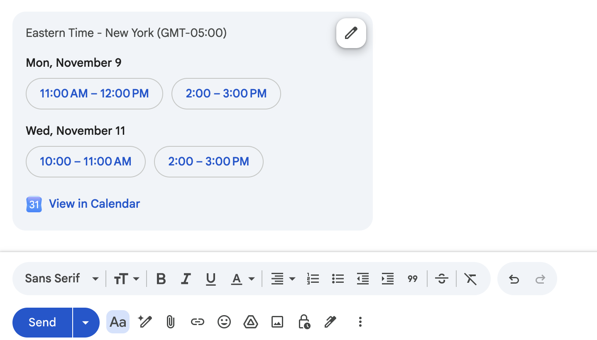
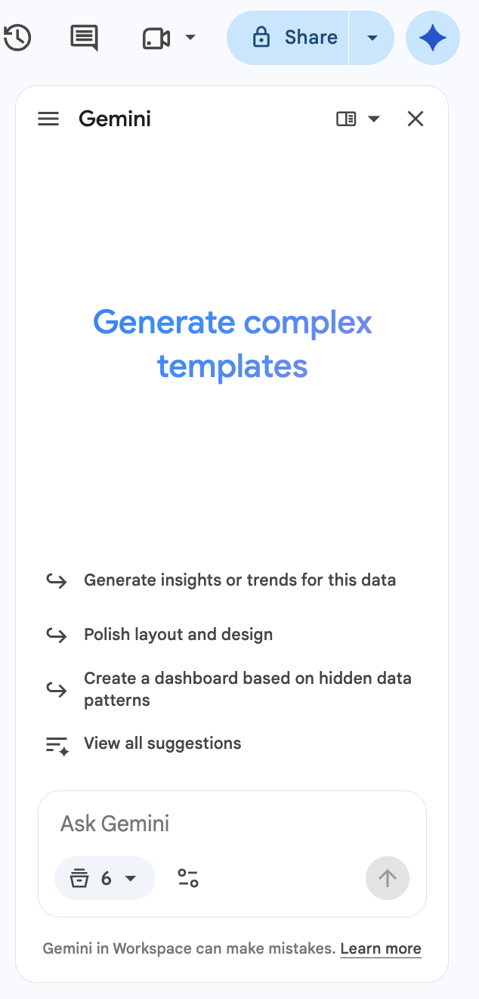
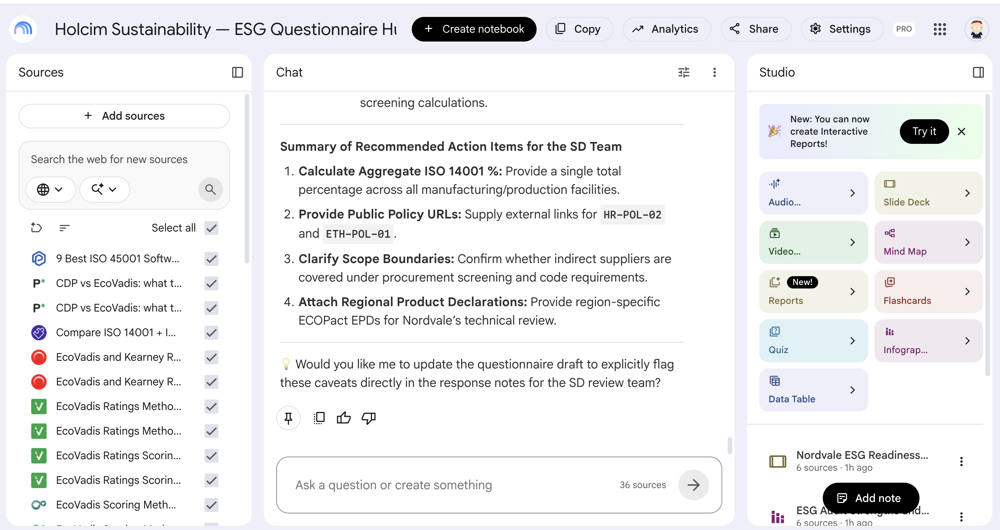
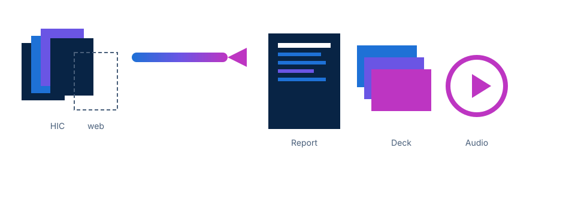
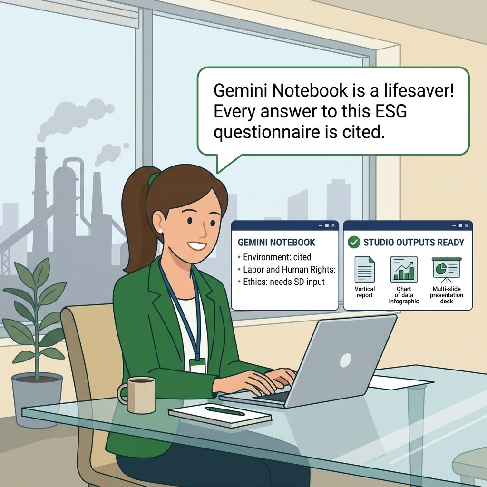
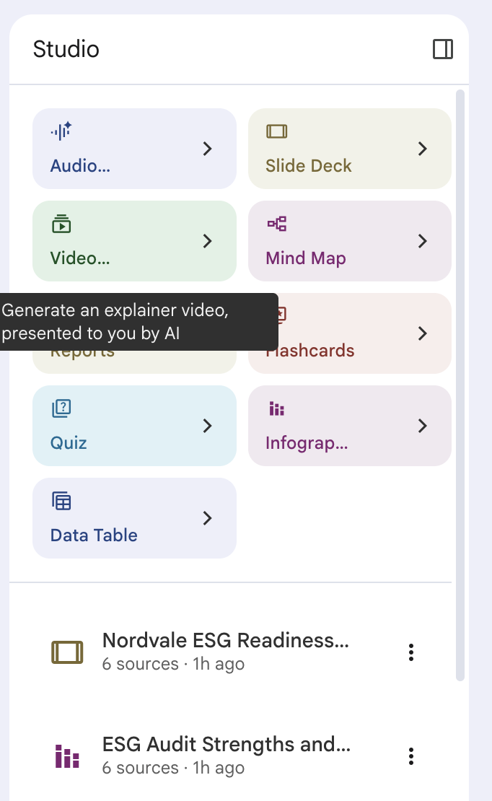

<!-- course-title: AI for the Holcim Innovation Centre -->
<!-- course-theme: holcim-theme -->

<!-- layout: full-bleed -->
# AI for the Holcim Innovation Centre


---
<!-- layout: panel-right -->
# Welcome!

- ROI leads the industry in designing and delivering customized technology and management training solutions
- Meet your instructor
  - Name
  - Background
  - Contact info
- Let’s get started!


---
# Course Objectives

- Use Gemini across Workspace to speed up everyday HIC work
- Write advanced prompts grounded in your sources
- Summarize, search, schedule, and reply in Gmail
- Build and edit Holcim-style decks in Slides
- Analyze data and build a canvas in Sheets
- Build a cited briefing in Gemini Notebook
---
<!-- layout: panel-left -->
# Agenda

- Advanced Prompt Engineering
- Gemini in Gmail
- Holcim-Style Presentations in Slides
- Gemini in Sheets
- Gemini Notebook


---
<!-- layout: panel-right -->
# Who Should Attend

- HIC scientists and technicians running trials
- Lab leads who write trial notes and review decks
- Specialists preparing trials for plant handover
- Innovation managers who brief internal reviews


---
<!-- layout: panel-left -->
# Prerequisites

- A Holcim Workspace account with Gemini enabled
- Experience writing basic Gemini prompts
- Comfort with Drive, Sheets, and Slides
- No data-science background required


---
<!-- layout: stacked -->
# Five Skills, One Afternoon

You already work in these tools. Today you make Gemini useful inside them.


---
<!-- layout: 2-column -->
# Ground Rules for Today

### Data

- Use the synthetic HIC-LC3-24 class files in every lab
- Unpublished results, mix cards, and partner names stay out of prompts
- You are accountable for every number that leaves the room

### Features

- Gemini features roll out to tenants at different times
- If a button in a slide or lab is missing, say so. Each lab has a fallback
- Labels move. Look for the intent of the step, not an identical screenshot
---
<!-- layout: navigation -->
# Today’s Sections

- **Advanced Prompt Engineering**
- Gemini in Gmail
- Holcim-Style Presentations in Slides
- Gemini in Sheets
- Gemini Notebook
---
# Do Now: Ask for a Trial Note

Try this before we talk about technique.

1. Open Gemini and start a new chat:

   ```text
   https://gemini.google.com
   ```

2. Send this prompt, with no files attached:

   ```text
   Write a short trial note about our LC3 binder trial for the plant team.
   ```

3. Read the results.
---
<!-- layout: panel-right -->
# What Is Wrong With the Previous Prompt?

- You gave Gemini no file, so every number in that note was invented
- Fluent text hides the invention. That is the dangerous part
- Gemini cannot guess your reader, your sources, or what must stay out
- The fix is structure, plus sources, plus a rule for what is missing

> [!IMPORTANT]
> If a number is not in the source, it does not belong in the answer.


---
<!-- layout: 2-column -->
# Role, Task, Steps, Examples Is the Floor

### Weak

```text
Write a trial note about LC3 for the plant.
```

- No reader, no source, no limits
- Gemini fills every gap with something plausible

### Structured

```text
Role: You are an HIC binder scientist writing
for Loire Plant quality staff.
Task: Write a one-page note on HIC-LC3-24.
Steps: Use only the attached protocol and
results. Sections: Purpose, What the plant
needs, Methods versus results, Open questions.
Example tone: "M12 cleared 42.5 MPa at 28 days.
90-day cubes pending."
```
---
<!-- layout: card-layout -->
# Four Advanced Techniques

### Constraint stacks

- List every limit once, in one block, and paste it at the end of the prompt.

### Multi-file grounding

- Tell Gemini which file owns methods, which owns numbers, and which owns caveats.

### Critique loops

- Make Gemini check its own draft against the sources before anyone else reads it.

### Meta-prompting

- Ask Gemini to improve your prompt and ask you questions before it does the work.
---
# Constraint Stacks

```text
Audience: Loire Plant quality team
Length: one page, 250 words maximum
Units: MPa and days; clinker factor as 0.00
Sources: protocol for methods, results PDF for numbers
Banned: ECOPlanet or ECOPact claims; averages across mixes
If missing: write Not found
```

- Each line closes one door Gemini would otherwise walk through
- When Gemini drifts on a follow-up, paste the stack again. Do not start over with a vague prompt
---
# Multi-File Grounding

```text
Use the three attached PDFs:
- hic-lc3-24-trial-protocol.pdf owns methods
- hic-lc3-24-interim-results.pdf owns numbers
- hic-lc3-24-limitations.pdf owns caveats
For each mix, return a Markdown table:
Mix | Age (days) | Strength (MPa) | Spec (MPa) | Source file
Write Not found in any empty cell. Do not estimate.
```

> [!TIP]
> `Not found` is a valid answer. A made-up megapascal is not. The table makes the gaps visible at a glance.
---
<!-- layout: 3-column -->
# Critique Loops and Audience Rewrites

### 1. Generate

- Draft the trial note with your role, task, and constraint stack
- Keep the source files attached

### 2. Critique

- “Check this draft against the attached files. List every claim with its source file. Mark any claim with no source as INVENTED.”

### 3. Rewrite

- “Rewrite this for an executive in five lines. Same facts. Add nothing.”
- Repeat for a scientist and a plant reader
---

<!-- layout: 2-column -->
# Image Prompts Without Invented Numbers

### Simple prompt

- “Create an infographic about an HIC LC3 trial.”
- The result looks polished
- It invents percentages, charts, and extra logos

### Locked prompt

- Attach the Holcim logo image
- Give the exact text: title, headers, lines, footer
- Add style: palette, layout, aspect ratio
- Ban invented percentages, fake charts, and extra logos

<!-- below-columns -->

> [!WARNING]
> Text inside a generated image can still be misspelled. Proofread every word.
---
# Meta-Prompting: Let Gemini Write the Prompt

```text
I want an infographic for Loire Plant quality staff about
HIC-LC3-24. Before you create any image, rewrite my prompt
to be clearer and more specific. Ask me up to three
questions if something is missing. Then wait for me.
```

- Gemini’s rewrite is usually more specific than your first draft
- Review the rewrite, fix any facts, then run it
- Works for text prompts too. Save the final version as a reusable template
---
<!-- layout: stacked -->
# Lab 1: Advanced Prompt Engineering

**Time:** 30 minutes

[Open Lab 1](https://labv.roitraining.com/?lab=https%3A%2F%2Fgithub.com%2Froitraining%2Fholcim-department-ai-training-labs%2Fblob%2Fmain%2Flabs%2Finnovation-centre%2Flab-01-advanced-prompt-engineering%2Flab.md)


---
<!-- layout: navigation -->
# Today’s Sections

- Advanced Prompt Engineering
- **Gemini in Gmail**
- Holcim-Style Presentations in Slides
- Gemini in Sheets
- Gemini Notebook
---
# Gemini in Gmail: The Full Toolkit

| Feature | Where | Use it for |
| :--- | :--- | :--- |
| Summarize | **Ask Gemini** side panel, or **Summarize this email** on a thread | Catch up on a long handover thread |
| Ask about your mail | **Ask Gemini** side panel | “What did the plant ask for last week?” |
| Search Gmail, Chat, and Drive | **Ask Gemini** side panel | Find the protocol, the decision, the file |
| Help me write | Compose window or side panel | Draft a reply, then formalize, elaborate, or shorten it |
| Suggested replies | Bottom of an email you received | Short replies drafted from the whole thread |
| Help me schedule | Bottom of a draft or reply | Offer meeting times that fit everyone’s calendar |
---

<!-- layout: panel-right -->
# Search Gmail, Chat, and Drive

- Ask in plain language: “Find the HIC-LC3-24 protocol and the last Chat decision on silo allocation.”
- Gemini searches the sources that are selected in the panel. Check them before you blame the answer
- Name the file or the thread. “Find my LC3 stuff” returns the wrong PDF
- Chat results depend on your Workspace setup. If Chat returns nothing, open the Drive file from the answer and keep going


---
# Help Me Schedule

- Reply to the thread, or compose with recipients added
- Click **Help me schedule** at the bottom. If you do not see it, open **More options**
- Gemini offers four slots from your calendar and the guests’ calendars you can see
- Adjust the slots with the pencil icon, then click **Send**
- Nothing is booked until a recipient picks a slot



---
<!-- layout: 2-column -->
# Suggested Replies Versus Help Me Write

### Suggested replies

- Gemini detects that a reply is due and offers short drafts at the bottom of the email
- Drafted from the whole thread, not only the last message
- Good for “Received. I will review the protocol by Friday.”
- Read before you send. They state facts with confidence

### Help me write

- You describe the reply: owners, dates, and next steps
- Refine the draft: formalize, elaborate, or shorten
- Good for the handover reply that settles three decisions
- Still yours to check. No number that is not in the thread
---
<!-- layout: 2-column -->
# Discuss: What Should Always Happen Before a Suggested Reply Is Sent?

### Prompt

A plant manager asks whether mix M13 is ready for handover. Gemini offers a one-click reply: “Yes, M13 is on track.”

### Discuss

- What could that reply get wrong?
- Which HIC emails should always be written, not clicked?
- Who is accountable if the reply is wrong?
---
<!-- layout: stacked -->
# Lab 2: Gemini in Gmail

**Time:** 30 minutes

[Open Lab 2](https://labv.roitraining.com/?lab=https%3A%2F%2Fgithub.com%2Froitraining%2Fholcim-department-ai-training-labs%2Fblob%2Fmain%2Flabs%2Finnovation-centre%2Flab-02-gemini-in-gmail%2Flab.md)


---
<!-- layout: navigation -->
# Today’s Sections

- Advanced Prompt Engineering
- Gemini in Gmail
- **Holcim-Style Presentations in Slides**
- Gemini in Sheets
- Gemini Notebook
---
<!-- layout: panel-right -->
# Building a Google Slides Deck With Gemini

1. Open a new presentation and click **Ask Gemini**
2. Describe the deck. Add files with **Add sources → Add from Drive**
3. Optional: **Match presentation style** with an approved Holcim deck
4. Click **Next** and review the plan: one step per slide
5. Edit, add, or delete steps, then click **Approve**
6. Keep the tab open while Gemini builds the slides


---
<!-- layout: 2-column -->
# Generate From a Doc or a Sheet

### The Doc owns the story

- A project-update template: status, risks, the ask of the review board
- Gives Gemini the slide order and the argument

### The Sheet owns the numbers

- The 28-day results: strength, spec, clinker factor
- Gives Gemini the only figures it may quote

<!-- below-columns -->

> [!IMPORTANT]
> Say which file owns what. Otherwise Gemini mixes them and fills the gaps itself.
---
# A Prompt That Assigns Ownership

```text
Create a six-slide review deck for the HIC innovation board.
Use @HIC-LC3-24 Project Update for slide order and narrative.
Use @HIC-LC3-24 28-day Results for every number.
If a figure is not in those files, leave it off the slide.
Titles state the finding, for example "M12 clears 28-day spec".
```

- Type `@` and the file name to reference a Drive file, or add it with **Add sources**
- The plan is your checkpoint. Delete any step that invents a KPI, a customer, or a plant
---
# Demo: Generate a Six-Slide Review Deck

1. Open a blank presentation and click **Ask Gemini**. No attachments are needed.

2. Send this prompt. The project update and the results are pasted in, so they are the only sources:

   ```text
   Create a six-slide review deck for the Holcim Innovation Centre review board.
   Use only the project update and results below. If a figure is not below,
   leave it off the slide. Titles state the finding, for example
   "M12 clears 28-day spec".

   Slides:
   1. Title: HIC-LC3-24 toward Loire Plant handover
   2. Why this trial exists
   3. 28-day results
   4. Risks and open plant items
   5. The ask of the review board
   6. Next 30 days

   PROJECT UPDATE (synthetic training data)
   Project: HIC-LC3-24, low-clinker calcined-clay (LC3) binder
   Target plant: Loire Plant
   Goal: meet the 42.5 MPa 28-day spec (CEM 42.5 class) at a lower
   clinker factor than the CEM I control, and hand over a plant-ready mix card.
   Stage: scale-up. 90-day results are pending for eight mixes.
   This period:
   - Locked the 28-day spec at 42.5 MPa in the trial protocol
   - Flagged mix M13 as below spec at 28 days
   - Opened the plant conversation on calcined-clay silo allocation
   Risks:
   - LC3 water demand is about 8 percent higher than CEM I
   - Loire Plant clay calcination capacity is 80 t/day
   - Calcined clay fineness has varied; the target is 4200 cm2/g Blaine
   Ask of the board: keep M12 in the plant-ready set for Loire?
   Recast or drop M13?
   Next 30 days:
   1. Finish the 90-day cubes
   2. Agree silo allocation and a fineness gate with Loire Plant
   3. Issue mix cards only for mixes that pass 28-day spec and are Plant-ready

   28-DAY RESULTS (spec 42.5 MPa)
   Mix | Binder      | Clinker factor | Strength (MPa) | Result
   M01 | CEM I       | 0.95           | 52.4           | Pass (control)
   M12 | LC3-50      | 0.52           | 44.8           | Pass
   M13 | LC3-50      | 0.50           | 41.2           | Fail
   M21 | LC3-35      | 0.65           | 47.1           | Pass

   Rules: label 90-day work as pending. Do not mention ECOPlanet or ECOPact.
   Do not add customers, tonnages, or other plants. Do not average mixes.
   ```

3. Answer any questions that you are asked, and click **Next**.

4. Review the slide plan, and then click **Approve**.

5. When the deck is done, scroll through the slides.
---
<!-- layout: panel-left -->
# Edit Slides With Reference Materials

- After the first draft, stay in the same Gemini chat
- Attach documentation sources and the brand constraints
- Say **edit**, not create: “Edit slides 3 and 4 using these files. Do not add slides.”
- Fix one slide at a time and name the slide number
- Ask Gemini to replace or edit an image when the picture is wrong


---
<!-- layout: 2-column -->
# Style Constraints

### Look

- White background, navy text
- Blue and green accents from the Holcim logo
- Logo in a corner, clear of the title
- No more than four bullets per slide

### Content

- Quote a figure only if it is in the attached files
- Label targets as targets, not results
- Label pending 90-day results as pending
- No invented plants, customers, or tonnages

<!-- below-columns -->

> [!TIP]
> The fastest route to the Holcim look is **Match presentation style** with an approved Holcim template. Prompts then only fix the exceptions.
---
<!-- layout: stacked -->
# Lab 3: Holcim-Style Presentations Using Gemini in Google Slides

**Time:** 30 minutes

[Open Lab 3](https://labv.roitraining.com/?lab=https%3A%2F%2Fgithub.com%2Froitraining%2Fholcim-department-ai-training-labs%2Fblob%2Fmain%2Flabs%2Finnovation-centre%2Flab-03-presentations-from-docs-and-sheets%2Flab.md)


---
<!-- layout: navigation -->
# Today’s Sections

- Advanced Prompt Engineering
- Gemini in Gmail
- Holcim-Style Presentations in Slides
- **Gemini in Sheets**
- Gemini Notebook
---
# Gemini in Sheets: Six Jobs

| Job | Where | Try asking |
| :--- | :--- | :--- |
| Import | **File → Import**, then **Ask Gemini** | “Describe the columns in this tab and flag any empty cells.” |
| Auto-format | **Ask Gemini** side panel | “Bold and freeze the header row, turn on filters, and use 1 decimal for numbers.” |
| Analyze | **Ask Gemini** side panel | “Which three plants had the highest average strength? Show the rows you used.” |
| Formulas | **Ask Gemini** side panel | “Add a column that flags rows below spec. Use a real formula.” |
| Search documents | **Ask Gemini** side panel | “Find the latest project update in Drive and summarize the risks.” |
| Canvas | **Ask Gemini → Tools → Create canvas** | “Build a dashboard with a scorecard per region and a filter by status.” |
---
<!-- layout: 2-column -->
# Import and Auto-Format

### Import

- **File → Import**, choose a CSV or Excel file from Drive or your computer
- Pick **Insert new sheet(s)** to keep the original tab untouched
- Ask Gemini to describe the columns before you analyze anything

### Format with one prompt

```text
Format this sheet: freeze and bold the
header row, auto-size the columns, use
1 decimal for numbers, and turn on
filters. Do not add or delete rows.
```
---
<!-- layout: 2-column -->
# Analyze One Question at a Time

### Vague

- “Analyze this data.”
- You get a generic summary of the columns
- Nothing you can check against a row

### Scoped

- “Compare average strength by binder family. Use only this sheet and show the rows you used.”
- Names the columns, the grouping, and the source
- Every number traces back to rows you can filter

<!-- below-columns -->

> [!TIP]
> Follow up in the same chat: “Now show that as a chart.” Gemini keeps the context.
---
<!-- layout: 2-column -->
# Formulas Gemini Writes

### Write a formula

```text
In the next empty column, add Below_Spec:
Yes if Compressive_Strength_MPa is below
Spec_Strength_MPa, otherwise No. Use a
real formula and fill it down.
```

```text
=IF(I2<J2,"Yes","No")
```

### Explain a formula

```text
Explain the formula in cell N2 in plain
language, one step at a time.
```

- The formula lives in the cells, so it updates when the data changes
- Check three rows by hand before you build on the column
---
<!-- layout: default -->
# Search Documents From the Side Panel

- Ask about Drive files without leaving the sheet
- Name the file: “Find the latest LC3 project update in Drive and list its open risks”
- If search misses, add the file with **Add sources → Add from Drive**
- Then connect it to the data: “Which rows in this tab match the risks in that file?”


---
<!-- layout: 2-column -->
# Chart or Canvas?

### Chart

- One view of the data, inserted in the grid
- Good for a single trend or comparison
- Pasted into Slides, it becomes a snapshot

### Canvas

- An interactive view
  - Dashboards, Kanban boards, galleries, and calendars
- Edit data in the canvas, and the tab changes too
- Refined with follow-up prompts, not rebuilt
---
<!-- layout: panel-right -->
# Build a Canvas

- Open **Ask Gemini**, click the **Tools** button in the prompt box, and choose **Create canvas**. A check mark shows it is on
- Then describe what you want in the prompt box
- Edit data in the canvas, and the spreadsheet changes too

> [!NOTE]
> Canvas needs data in the tab, English, a computer (not the mobile app), and edit access. It is not available when download, copy, and print are turned off for the file.


---
# Do Now: Create a Canvas

1. Create a new spreadsheet:

   ```text
   https://sheets.new
   ```

2. Click cell **A1** and paste this synthetic project list:

   ```text
   Project,Owner,Region,Status,Stage,Due_Date,Budget_kEUR
   Low-clinker binder scale-up,A. Martin,Europe,On track,Scale-up,2027-03-31,420
   Calcined clay fineness study,L. Dubois,Europe,At risk,Lab,2027-01-15,85
   Recycled aggregate concrete,S. Patel,Asia Pacific,On track,Pilot,2027-06-30,260
   Carbon-cured block trial,M. Rossi,Europe,Not started,Concept,2027-09-30,150
   Admixture dosing model,J. Silva,Latin America,On track,Lab,2027-02-28,60
   3D-printed formwork,K. Nakamura,Asia Pacific,At risk,Pilot,2027-04-30,310
   Low-carbon mortar range,E. Novak,Europe,Done,Handover,2026-10-31,190
   Kiln fuel substitution trial,R. Haddad,Middle East Africa,On track,Scale-up,2027-05-31,540
   Insulating concrete panel,T. Keller,North America,At risk,Pilot,2027-03-15,230
   Mineral carbonation screening,P. Okafor,Middle East Africa,Not started,Concept,2027-08-31,95
   Self-healing concrete coating,C. Moreau,Europe,On track,Lab,2027-07-31,120
   Fly ash replacement study,D. Kim,North America,Done,Handover,2026-09-30,140
   ```

3. If everything lands in column A, select column **A**, then click **Data → Split text to columns**. You should have 7 columns and 13 rows, with headers in row 1.

4. Open **Ask Gemini**. In the prompt box, click the **Tools** button (beside the source button) and choose **Create canvas**. Check that it shows a check mark.

5. Send this prompt:

   ```text
   Build a project dashboard from this tab. Add scorecards for total projects,
   projects at risk, and total budget. Add a bar chart of budget by Region,
   a filter by Status, and a table of projects sorted by Due_Date.
   ```

6. Check the scorecards against the tab: 12 projects, 3 at risk, and a total budget of 2,600 kEUR.

7. Create a new tab in your Sheet. With that tab active, in the Gemini side panel, select **Tools → Create canvas** again, and add the following prompt:

   ```text
   Build a Kanban board that groups projects by Status. Show Owner and Due_Date on each card.
   ```

8. Drag one card from **At risk** to **On track**. Click the data tab and confirm that the Status cell changed.
---
<!-- layout: stacked -->
# Lab 4: Analyzing Trial Data With Sheets and Gemini

**Time:** 30 minutes

[Open Lab 4](https://labv.roitraining.com/?lab=https%3A%2F%2Fgithub.com%2Froitraining%2Fholcim-department-ai-training-labs%2Fblob%2Fmain%2Flabs%2Finnovation-centre%2Flab-04-analyzing-trial-data-with-sheets-and-gemini%2Flab.md)


---
<!-- layout: navigation -->
# Today’s Sections

- Advanced Prompt Engineering
- Gemini in Gmail
- Holcim-Style Presentations in Slides
- Gemini in Sheets
- **Gemini Notebook**
---
# Gemini Notebook


---
# From Chat to Grounded Research

- A regular chat can drift or invent details. A notebook answers only from its sources
- You choose what goes in: HIC trial briefs, handover notes, plus targeted web research
- Every answer traces back to a source you selected
- Built for an innovation review you have to stand behind
---
<!-- layout: stacked -->
# Sources In, Insights Out


---
# Ask Sharper Questions

- Ask the notebook to compare your trial results with the published literature, citing both
- Ask for cited talking points for a review board, and flag anything not grounded in a source
- If the sources do not answer a question, the notebook says so. It does not invent a figure
- Save the strongest answers as notes, then convert them into sources


---
# Gemini Notebook Studio

- Save chat responses as notes, then convert notes into sources
- Narrow your sources to your own content before generating outputs
- Create polished assets inside the notebook: reports, infographics, and draft slide decks


---
<!-- layout: stacked -->
# Lab 5: Binder Trial Briefing With Gemini Notebook

**Time:** 30 minutes

[Open Lab 5](https://labv.roitraining.com/?lab=https%3A%2F%2Fgithub.com%2Froitraining%2Fholcim-department-ai-training-labs%2Fblob%2Fmain%2Flabs%2Finnovation-centre%2Flab-05-binder-trial-briefing-with-gemini-notebook%2Flab.md)


---
# Try It Tomorrow

| Tool | One thing to do with your own work |
| :--- | :--- |
| Prompting | Rewrite a prompt you use every week with a role, sources, and a constraint stack. Save it |
| Gmail | Ask Gemini what you missed this week, then use Help me schedule for the follow-up |
| Slides | Build your next status deck from real sources |
| Sheets | Open a sheet you already use and build a canvas from it |
| Gemini Notebook | Put the files for your next review in one notebook. Ask the question the board will ask |
---
# What You Learned

- Used Gemini across Workspace to speed up everyday HIC work
- Wrote advanced prompts grounded in your sources
- Summarized, searched, scheduled, and replied in Gmail
- Built and edited Holcim-style decks in Slides
- Analyzed data and built a canvas in Sheets
- Built a cited briefing in Gemini Notebook
---
# Quiz 1 of 3

**You attach the trial protocol and the results PDF and ask Gemini for a table of strength by mix and age. The 90-day results are not in either file. Which line in your prompt best stops Gemini from filling those cells?**

- A. “Be accurate and professional.”
- B. “Write Not found in any empty cell. Do not estimate.”
- C. “Keep the table under 20 rows.”
- D. “You are an experienced binder scientist.”
---
# Quiz 1: Answer

**You attach the trial protocol and the results PDF and ask Gemini for a table of strength by mix and age. The 90-day results are not in either file. Which line in your prompt best stops Gemini from filling those cells?**

**Correct: B.** “Write Not found in any empty cell. Do not estimate.”

- It tells Gemini what to do when the source is silent, so the gaps stay visible
- “Be accurate” is a wish, not a rule. Gemini already thinks it is accurate
- A role and a row limit shape the answer, but neither stops an invented number
---
# Quiz 2 of 3

**You ask Gemini in Slides for a six-slide review deck from the project update Doc and the results Sheet. You click Next, and the plan includes a slide called “Projected savings by plant”. Neither file has that data. What do you do?**

- A. Click Approve, then delete the slide after the deck is built
- B. Delete or rewrite that step in the plan, then click Approve
- C. Click Approve and add a footnote that the figures are estimates
- D. Close the panel and start again with a shorter prompt
---
# Quiz 2: Answer

**You ask Gemini in Slides for a six-slide review deck from the project update Doc and the results Sheet. You click Next, and the plan includes a slide called “Projected savings by plant”. Neither file has that data. What do you do?**

**Correct: B.** Delete or rewrite that step in the plan, then click Approve

- The plan is the checkpoint. Fixing it there is cheaper than fixing a finished deck
- Deleting the slide later is easy to forget, and the invented figures may also appear on other slides
- A footnote does not make an invented number acceptable
- Starting over throws away a plan that is mostly right
---
<!-- layout: 2-column -->
# Quiz 3 of 3: Discussion

### Prompt

You lead the HIC-LC3-24 trial. In two weeks you present to the review board. Right now you have:

- A 40-message handover thread with Loire Plant
- The latest results in a Sheet
- Three published papers on calcined clay
- A project update Doc and an approved Holcim deck template

### Discuss

- Which of today’s tools would you use for each job, and in what order?
- Where could two tools do the same job? How do you choose?
- Where must a person check before anything moves on?
---
<!-- layout: 2-column -->
# Quiz 3: Discussion Points

**You present HIC-LC3-24 to the review board in two weeks. You have a long plant thread, a results Sheet, three papers, a project update Doc, and a deck template.**

### Strong Answers Mention

- **Gmail:** summarize the thread, search for decisions, and Help me schedule for a dry run
- **Sheets:** scoped questions, checked formulas, and a canvas for a live view
- **Gemini Notebook:** the papers plus the trial brief, with cited answers on where they disagree
- **Slides:** generate from the Doc and the Sheet with Match presentation style, and read the plan
- **Gemini chat:** a constraint stack for any written note

### Watch For

- Pasting everything into one chat and hoping
- Web sources still selected when the notebook builds the board output
- A suggested reply used for a technical answer
- Approving the Slides plan without reading it
- Any number that no one checked against the Sheet
---
<!-- layout: stacked -->
# Questions and Answers


