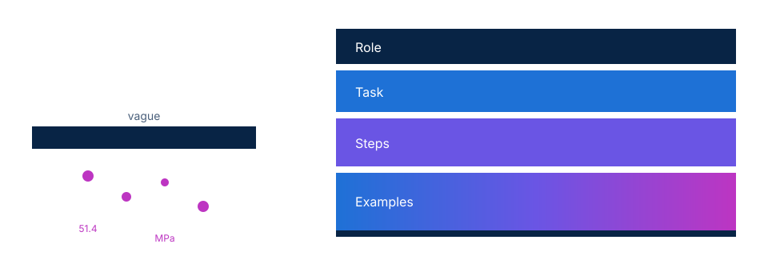
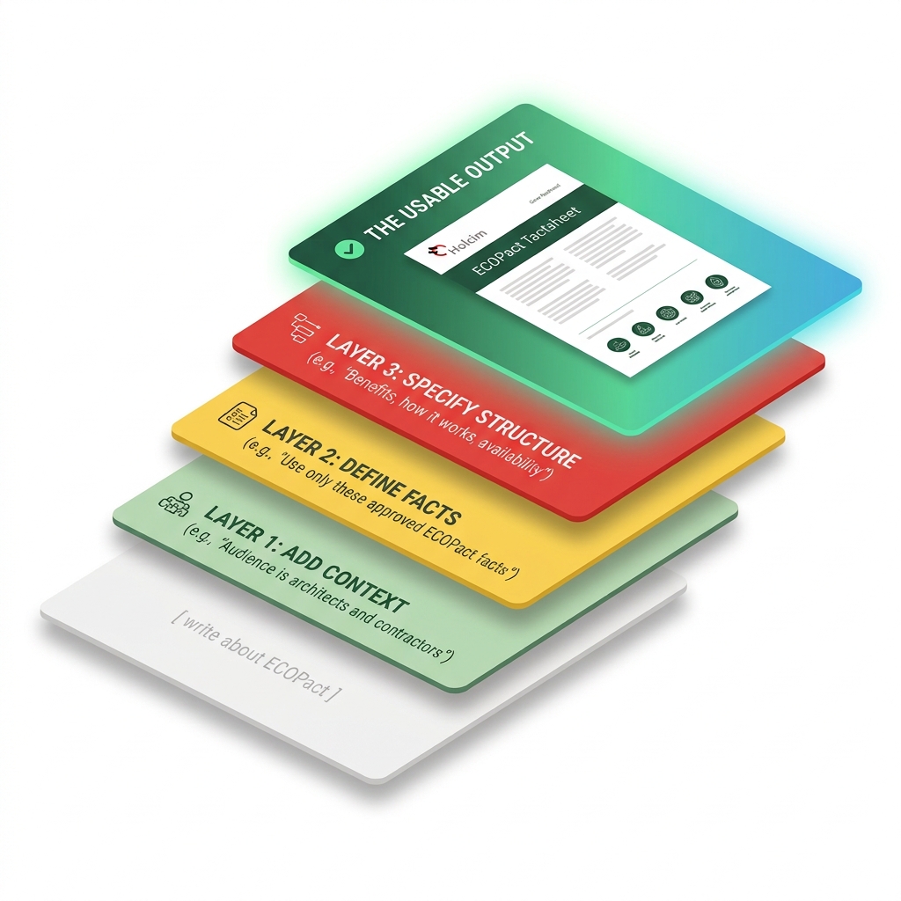
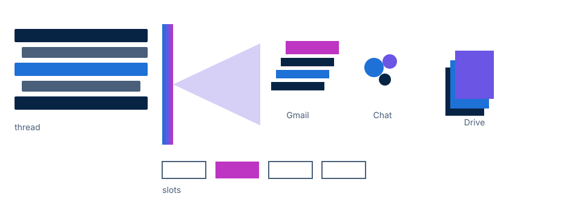
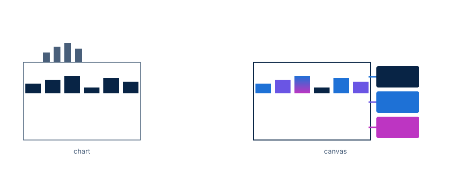
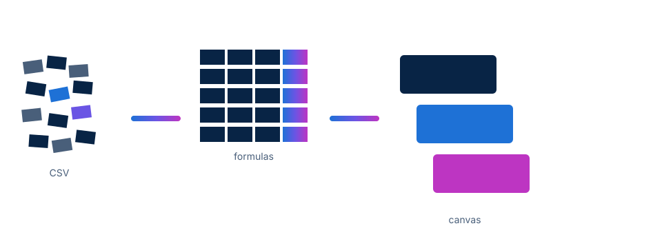
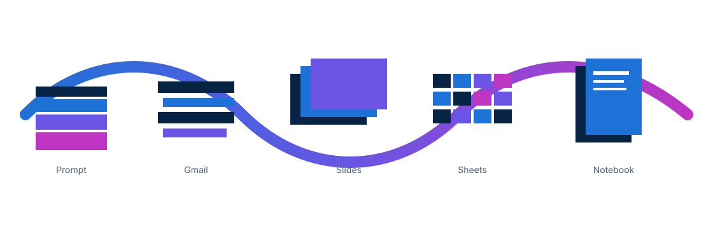

<!-- course-title: AI for the Holcim Innovation Centre -->
<!-- course-theme: roi-alt-theme -->

<!-- layout: full-bleed -->

---
<!-- layout: panel-right -->
# Welcome!

- ROI leads the industry in designing and delivering customized technology and management training solutions
- Meet your instructor
  - Name
  - Background
  - Contact info
- Let’s get started!

---
# Course Objectives

- Apply Gemini across everyday Holcim Innovation Centre workflows for binder trials and plant handover
- Engineer advanced prompts that stay grounded in trial files and refuse invented results
- Use Gemini in Gmail to search, schedule, and draft without leaving the inbox
- Generate and edit Holcim-style slides from a Doc or Sheet, then refine them with extra references
- Analyze trial data in Sheets with formulas, document search, and a Canvas dashboard
- Build an advanced Gemini Notebook briefing pack for an internal innovation review
---
<!-- layout: panel-left -->
# Agenda

- Advanced Prompt Engineering
- Gemini in Gmail
- Holcim-Style Presentations in Slides
- Trial Data in Sheets, Formulas, and Canvas
- Advanced Gemini Notebook

---
<!-- layout: panel-right -->
# Who Should Attend

- HIC scientists and technicians running binder, concrete, and process trials
- Lab leads who turn results into plant-facing notes and review decks
- Product and process specialists preparing a trial for plant handover
- Innovation managers who brief internal reviews from mixed sources

---
<!-- layout: panel-left -->
# Prerequisites

- A Google account with Gemini, Gmail, Chat, Calendar, Drive, Docs, Sheets, Slides, and Gemini Notebook
- Comfort working in Google Drive and the Gemini app
- No data-science background required
- You will write and check formulas; Gemini drafts them, you own them

---
<!-- layout: stacked -->
# Five Skills, One Afternoon

You already work in these tools. Today you make Gemini useful inside them.

---
<!-- nav: Advanced Prompt Engineering -->
---
<!-- layout: panel-right -->
# Why prompting still fails in the lab

- Vague asks produce vague trial notes
- Gemini will invent strengths, ages, and targets if you let it
- A good HIC prompt names the audience, the files, and what must stay out

> If a number is not in the source, it does not belong in the answer.

---
<!-- layout: stacked -->
# Role, Task, Steps, Examples

You already know this pattern. Today we use it as the floor, not the ceiling.

---
# From generic to specific

- Start with the job: a plant-facing trial note, not “write something about LC3”
- Name the audience: scientist, plant, or exec. They need different density
- Lock the output: headings, units, and a do-not-invent rule
- Show one short example of the tone you want
---
<!-- layout: panel-left -->
# Constraint stacks

- Stack limits instead of hoping Gemini “keeps it short”
- Typical HIC stack: audience, length, units, files in / files out, banned claims
- Example ban: no ECOPlanet commercial equivalence unless the source says it
- If Gemini drifts, paste the stack again. Do not start over from a vague prompt

---
# Multi-file grounding

- Attach the protocol, the results table, and the caveats file together
- Tell Gemini which file owns methods, which owns numbers, which owns limits
- Ask for structured Markdown so you can scan missing fields
- `Not found` is a valid answer. A made-up megapascal is not
---
<!-- layout: panel-right -->
# Critique loops and audience rewrites

- First pass: generate
- Second pass: “Critique this against the sources. List invented claims.”
- Third pass: rewrite for a different reader without adding numbers
- Same facts. Three voices: lab notebook, plant handover, exec headline

---
<!-- layout: stacked -->
# Lab 1: Advanced Prompt Engineering (30 minutes)

[https://labv.roitraining.com/?lab=https%3A%2F%2Fgithub.com%2Froitraining%2Fholcim-department-ai-training-labs%2Fblob%2Fmain%2Flabs%2Finnovation-centre%2Flab-01-advanced-prompt-engineering%2Flab.md](https://labv.roitraining.com/?lab=https%3A%2F%2Fgithub.com%2Froitraining%2Fholcim-department-ai-training-labs%2Fblob%2Fmain%2Flabs%2Finnovation-centre%2Flab-01-advanced-prompt-engineering%2Flab.md)

---
<!-- nav: Gemini in Gmail -->
---
<!-- layout: panel-right -->
# Gemini lives in the inbox

- Open **Ask Gemini** in Gmail. The thread stays on the left
- Summarize a long plant-handover thread before you reply
- Draft in the panel or in compose. You still click **Send**
- Do not paste unpublished mix designs into a prompt you would not put in email

---
<!-- layout: stacked -->
# Four moves in one panel

Search and schedule from Gmail so the trial does not stall in your inbox.

---
# Search Gmail, Chat, and Drive

- Ask Gemini to find the protocol, the last Chat decision, and the related Drive file
- Add a Drive source when you know the file. Search when you do not
- If Chat has no history in class, search Drive from the same panel
- Quote the file name you want. “Find my LC3 stuff” is how you get the wrong PDF
---
<!-- layout: 2-column -->
# Help me schedule

### In compose

- Add recipients, then click **Help me schedule**
- If you do not see it, open **More options**
- Review the four proposed slots against Calendar
- Send the times. The meeting is not booked until people accept

### If the button is missing

- Ask Gemini: “Draft a calendar-ready proposal for a 45-minute plant-handover working session next week.”
- Paste the draft into a Calendar invite yourself
- Same outcome. Extra click. Still your calendar
---
<!-- layout: panel-left -->
# Suggested replies versus a real draft

- Suggested replies are chips. Use them for “received, I will review”
- **Help me write** is for a fuller reply with next steps and owners
- Auto-detected replies can be wrong on technical content. Read them
- Never send a strength number Gemini added that was not in the thread

---
<!-- layout: stacked -->
# Lab 2: Gemini in Gmail (30 minutes)

[https://labv.roitraining.com/?lab=https%3A%2F%2Fgithub.com%2Froitraining%2Fholcim-department-ai-training-labs%2Fblob%2Fmain%2Flabs%2Finnovation-centre%2Flab-02-gemini-in-gmail%2Flab.md](https://labv.roitraining.com/?lab=https%3A%2F%2Fgithub.com%2Froitraining%2Fholcim-department-ai-training-labs%2Fblob%2Fmain%2Flabs%2Finnovation-centre%2Flab-02-gemini-in-gmail%2Flab.md)

---
<!-- nav: Holcim-Style Presentations in Slides -->
---
<!-- layout: panel-right -->
# Gemini in Google Slides

- Start from a **blank** deck. Gemini builds the outline with you
- Attach a Doc, a Sheet, or both. Those files are the source of figures
- Follow-up prompts edit existing slides. You do not have to regenerate the deck
- **Enhance this slide** is a visual pass, not a license to add new KPIs

---
# Generate from a Doc or a Sheet

- A **Doc template** is the narrative: status, risks, the ask of the review board
- A **Sheet** is the evidence: 28-day strengths, clinker factor, pass or fail
- Tell Gemini which file owns the story and which owns the numbers
- If a figure is not in those files, leave it off the slide
---
<!-- layout: panel-left -->
# Edit with extra reference files

- After the first draft, attach a brand-constraints file or a glossary
- Prompt: “Edit slides 3 and 4 using this reference. Do not add slides.”
- That is how you fix a deck without throwing the outline away
- Keep one idea per slide. Titles should name the finding, not “Overview”

---
<!-- layout: 2-column -->
# Holcim-style constraints

### Look

- White background, navy text
- Blue and green accents from the logo
- Logo in a corner, not colliding with the title
- No more than four bullets

### Content

- Quote a figure only if it appears in the attached files
- Label targets as targets, not as results
- No invented plant names, customer tons, or unpublished mix cards
---
<!-- layout: stacked -->
# Lab 3: Holcim-Style Slides from Docs and Sheets (30 minutes)

[https://labv.roitraining.com/?lab=https%3A%2F%2Fgithub.com%2Froitraining%2Fholcim-department-ai-training-labs%2Fblob%2Fmain%2Flabs%2Finnovation-centre%2Flab-03-presentations-from-docs-and-sheets%2Flab.md](https://labv.roitraining.com/?lab=https%3A%2F%2Fgithub.com%2Froitraining%2Fholcim-department-ai-training-labs%2Fblob%2Fmain%2Flabs%2Finnovation-centre%2Flab-03-presentations-from-docs-and-sheets%2Flab.md)

---
<!-- nav: Trial Data in Sheets -->
---
<!-- layout: panel-right -->
# AI meets the trial spreadsheet

- Gemini in Sheets formats, filters, and explains. It does not replace your spec
- Import a right-sized CSV. About 100 rows and 12 columns is enough for class
- Ask one analysis question at a time
- You will ask Gemini for formulas. You still read the equation before you trust the column

---
# Right-sized trial data

- Mix family, age, clinker factor, strength, spec, trial stage
- That is enough to find which LC3 mixes clear 28-day spec
- Wide lab exports with 40 columns bury the question
- Synthetic class files only. Do not upload a live LIMS extract in this room
---
<!-- layout: panel-left -->
# Formulas Gemini can write, you must check

- Ask for a pass/fail versus spec, a clinker-factor index, or a 28-day delta
- Require Gemini to put the formula in the sheet, not only describe it
- Spot-check three rows by hand
- If the formula references the wrong age, the dashboard will lie with confidence

---
# Search documents from the side panel

- The protocol and the glossary live in Drive, not in the CSV
- From Sheets, ask Gemini to find the spec definition in the related Doc
- Add that Doc as a source when the search is vague
- Use it to confirm what “handover ready” means before you color the column
---
<!-- layout: stacked -->
# Charts versus Canvas

A chart is a snapshot. A Canvas is a working view on the same data.

---
<!-- layout: panel-right -->
# Build a Canvas dashboard

- **Insert → Create a canvas**, or **Tools → Create canvas**, or the **Canvas** control on the bottom bar
- Prompt for scorecards, filters by mix family, and pass/fail cards
- Canvas is read-write and stays synced with the tab
- Refine with a second prompt. Do not rebuild from scratch for a color change

> If **Create a canvas** is missing, your tenant may still be rolling the feature out. Use a Gemini chart sheet as the fallback, and label it as a snapshot.

---
<!-- layout: stacked -->
# The HIC data path

Import, format, formula, Canvas. Stop when the plant can use it.

---
<!-- layout: stacked -->
# Lab 4: Analyzing Trial Data with Sheets and Gemini (45 minutes)

[https://labv.roitraining.com/?lab=https%3A%2F%2Fgithub.com%2Froitraining%2Fholcim-department-ai-training-labs%2Fblob%2Fmain%2Flabs%2Finnovation-centre%2Flab-04-analyzing-trial-data-with-sheets-and-gemini%2Flab.md](https://labv.roitraining.com/?lab=https%3A%2F%2Fgithub.com%2Froitraining%2Fholcim-department-ai-training-labs%2Fblob%2Fmain%2Flabs%2Finnovation-centre%2Flab-04-analyzing-trial-data-with-sheets-and-gemini%2Flab.md)

---
<!-- nav: Advanced Gemini Notebook -->
---
<!-- layout: panel-right -->
# Gemini Notebook is a briefing pack

- A notebook is for a sourced story, not a one-off chat
- HIC use: innovation review, plant handover, literature plus trial notes
- Sources in the left panel. Chat in the middle. Studio on the right
- If it is not in a source, it does not belong in the Report

---
<!-- layout: stacked -->
# From files to Studio

Narrow the source set before you generate anything a director will see.

---
<!-- layout: 2-column -->
# Sources in, insights out

### Put in

- Internal trial brief
- Literature excerpt
- Plant handover note
- Glossary
- Optional web papers you chose on purpose

### Get out

- Cited chat answers
- Notes converted to sources
- Report, Infographic, Slide Deck
- Audio Overview, Mind Map, or Quiz
---
# Ask sharper questions

- “Summarize these files” wastes the notebook
- Ask: which mixes meet 28-day spec, what the plant still needs, where the literature disagrees
- Save strong answers as notes. Convert those notes to sources
- Deselect web pages before Studio if you only want HIC-owned facts
---
<!-- layout: panel-left -->
# Studio, used as an advanced tool

- Report + Infographic + Deck is the review pack
- Then generate **Audio Overview**, a **Mind Map**, or a **Quiz** so a colleague can rehearse
- Studio extras are not decoration. They are how you scale the same sources
- Generation takes a few minutes. Start the next output while the last one runs

---
<!-- layout: stacked -->
# Lab 5: Advanced Binder Trial Briefing with Gemini Notebook (30 minutes)

[https://labv.roitraining.com/?lab=https%3A%2F%2Fgithub.com%2Froitraining%2Fholcim-department-ai-training-labs%2Fblob%2Fmain%2Flabs%2Finnovation-centre%2Flab-05-advanced-binder-trial-briefing-with-gemini-notebook%2Flab.md](https://labv.roitraining.com/?lab=https%3A%2F%2Fgithub.com%2Froitraining%2Fholcim-department-ai-training-labs%2Fblob%2Fmain%2Flabs%2Finnovation-centre%2Flab-05-advanced-binder-trial-briefing-with-gemini-notebook%2Flab.md)

---
<!-- layout: stacked -->
# Keep Data Safe

- Unpublished trial results, mix cards, and partner names stay out of public Gemini
- Use the class synthetic files in this room
- If a prompt would embarrass HIC on a slide, do not paste it
- You are accountable for every number that leaves the session

---
<!-- layout: stacked -->
# What you can reuse tomorrow

Prompting, Gmail, Slides, Sheets, Notebooks. Same Gemini. Different doors.

---
# What You Learned

- Advanced prompts with constraint stacks, multi-file grounding, and critique loops
- Gmail side panel search, Help me schedule, and draft-versus-send discipline
- Holcim-style decks generated from a Doc and a Sheet, then edited with extra references
- Sheets analysis with formulas, Drive document search, and a Canvas dashboard
- An advanced Gemini Notebook briefing pack with Studio extras
---
<!-- quiz -->
A 28-day compressive strength of 51.4 MPa appears in a Gemini trial note. The attached results PDF lists 44.8 MPa for that mix. What should you do?

- [ ] Keep 51.4 MPa. Gemini averaged similar mixes
- [ ] Keep 51.4 MPa if it “sounds typical” for LC3
- [x] Replace it with 44.8 MPa, or write Not found if the mix is not in the file
- [ ] Delete all numbers from the note so nobody can check
---
<!-- quiz -->
You need a 45-minute plant-handover working session with two colleagues. Where should you start in Gmail?

- [ ] Export the thread to a CSV, then open Calendar
- [x] Open compose or reply, add the recipients, and click Help me schedule
- [ ] Ask Gemini in the Gemini app to invent four times without looking at Calendar
- [ ] Send the email first, then hope someone else finds a slot
---
<!-- quiz -->
Why finish a trial spreadsheet with a Sheets canvas instead of only a chart?

- [ ] Canvas permanently deletes the grid so people cannot see raw rows
- [ ] Charts cannot be used in Holcim at all
- [x] Canvas is an interactive, read-write view that stays synced with the sheet
- [ ] Canvas uploads the trial to a public website automatically
---
<!-- layout: stacked -->
# Questions and Answers

