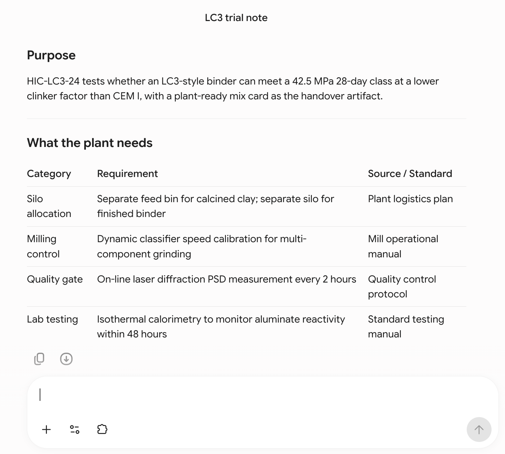
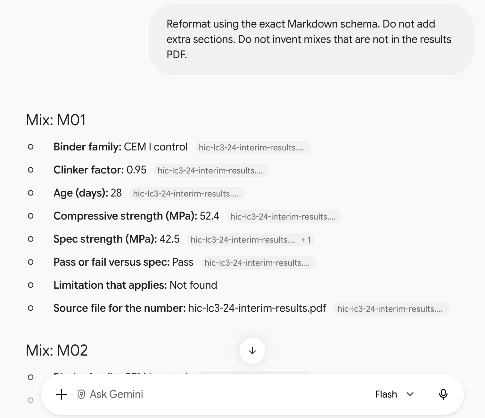
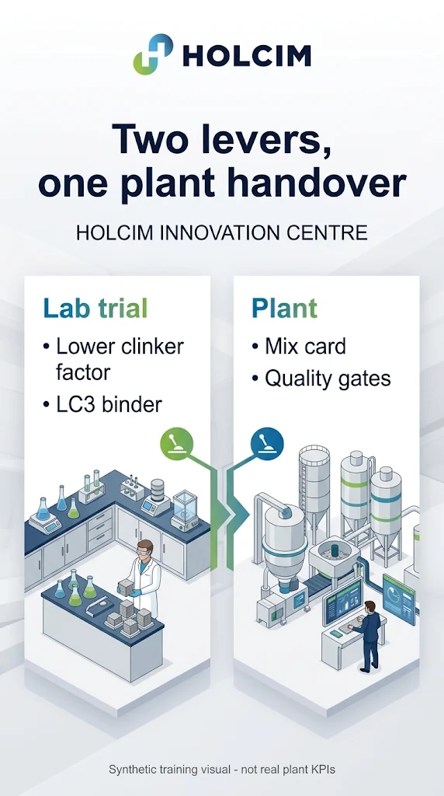
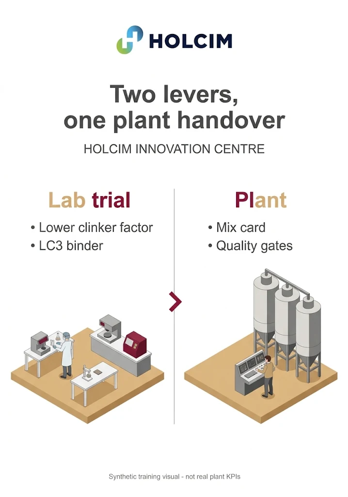

# Ingénierie de prompts avancée pour les notes d’essai du HIC

## Durée

30 minutes

## Vue d’ensemble

Dans cet atelier, vous allez construire un prompt Gemini avancé pour rédiger une note d’essai du Holcim Innovation Centre (HIC) destinée à l’usine. Vous extrairez ensuite des données structurées de PDF d’essai synthétiques, vous créerez une infographie de l’essai avec les outils d’image, puis vous ferez critiquer la note par Gemini avant de la réécrire pour trois publics, sans inventer de résultats.

### Vous allez apprendre à :
- Construire un prompt Rôle, Tâche, Étapes et Exemples pour une note d’essai du HIC destinée à l’usine.
- Extraire du Markdown structuré de plusieurs PDF d’essai sans inventer les champs manquants.
- Améliorer les prompts d’image Gemini avec le logo Holcim, des contraintes de style et le méta-prompting.
- Confronter un brouillon aux sources, puis le réécrire pour un scientifique, pour l’usine et pour la direction.

## Mise en situation


Vous travaillez au Holcim Innovation Centre. L’essai **HIC-LC3-24** porte sur un liant à faible teneur en clinker, à base d’argile calcinée (de type LC3), en voie de transfert vers l’usine synthétique **Loire Plant**. Demain, vous devez remettre une note à l’usine. Le protocole, les résultats intermédiaires et les limites de l’essai se trouvent dans des PDF. Gemini peut rédiger la note si vous lui précisez la tâche, les fichiers et la règle : aucun chiffre non publié ou manquant ne doit figurer dans la note.

> [!WARNING]
> Tous les PDF et tous les chiffres de cet atelier sont des **contenus de formation synthétiques**. Ne considérez pas les identifiants de formule, les résistances ou les noms d’usine comme de vrais résultats du HIC. Ne joignez aucune donnée d’essai réelle pendant la formation.

> [!NOTE]
> Les fichiers de cours sont en anglais. Rédigez vos prompts en français : Gemini lit les sources en anglais et répond en général dans la langue de votre prompt. Si une réponse arrive en anglais, ajoutez « Répondez en français. »

## Instructions de l’atelier

### Tâche 1 : Construire une note d’essai destinée à l’usine avec un rôle, une tâche, des étapes et des exemples

Dans cette tâche, vous rédigez la note d’essai en quatre versions successives du prompt, dans une seule conversation Gemini. Chaque échange ajoute de la structure : vous ne repartez jamais de zéro.

1. Ouvrez [https://gemini.google.com/](https://gemini.google.com/) et connectez-vous avec votre compte de formation.


2. Démarrez une nouvelle conversation (**New chat**). Envoyez cette demande volontairement vague :

```text
Rédigez une note sur notre essai LC3.
```

3. Lisez la réponse. Elle sera générique et risque d’inventer des résistances, des dates ou des arguments commerciaux. Restez dans la **même conversation** et ajoutez un **rôle** et une **tâche** :

```text
Vous êtes scientifique au Holcim Innovation Centre et vous écrivez pour l'équipe qualité et production de Loire Plant.

Tâche : rédigez une note d'essai destinée à l'usine sur HIC-LC3-24, un essai de liant à faible teneur en clinker à base d'argile calcinée, en voie de transfert vers l'usine.
N'inventez ni résistance à la compression, ni facteur de clinker, ni date, ni argument commercial lié à une marque.
Si un chiffre manque, écrivez Non trouvé.
```

4. Ajoutez des **étapes** et un **format de sortie**. Envoyez :

```text
Suivez ces étapes :
1. Présentez l'objet de HIC-LC3-24 en deux phrases.
2. Listez ce dont l'usine a besoin avant le transfert (silos, finesse, jalons qualité).
3. Séparez les méthodes des résultats. Ne les mélangez pas dans un même paragraphe.
4. Terminez par les questions ouvertes auxquelles l'usine doit répondre.

Renvoyez UNIQUEMENT du Markdown valide, avec ces titres :
## Objet
## Besoins de l'usine
## Méthodes et résultats
## Questions ouvertes
## Affirmations que j'ai refusé d'inventer
```

5. Ajoutez un court **exemple** du ton attendu. Envoyez :

```text
Reprenez ce ton et cette densité. Ne recopiez pas les chiffres fictifs de l'exemple.

Exemple :
## Objet
HIC-LC3-24 vérifie si un liant de type LC3 peut atteindre la classe 42,5 MPa à 28 jours avec un facteur de clinker inférieur à celui du CEM I. Le livrable du transfert est une fiche formule prête pour l'usine.

Faites des phrases courtes. Préférez les tableaux aux adjectifs. N'écrivez jamais "prometteur" sans chiffre sourcé.
```

<!-- TODO IMAGE: Screenshot of the four-stage trial-note chat after the example upgrade -->


> [!TIP]
> Si Gemini rédige encore une plaquette commerciale, répondez : `Réécrivez en utilisant uniquement les titres demandés. Supprimez les adjectifs marketing. N'ajoutez aucun chiffre.`

### Tâche 2 : Extraire des données structurées de trois PDF d’essai

Dans cette tâche, vous ancrez Gemini dans le protocole, les résultats intermédiaires et le fichier des limites, puis vous imposez un schéma pour que les champs manquants restent à `Non trouvé`.

1. Téléchargez les trois PDF d’essai synthétiques. Pour chaque fichier du tableau, cliquez sur le lien pour l’ouvrir dans Google Drive, puis cliquez sur **Download** (l’icône en forme de flèche vers le bas, en haut à droite de l’aperçu).

| Fichier | Fait foi pour |
| :--- | :--- |
| [hic-lc3-24-trial-protocol.pdf](https://drive.google.com/file/d/1cvvnx2dI6DQPwGoZpM-M0TLrJEEENZiy/view) | Méthodes, âges, spécification. Aucune ligne de résultat supplémentaire. |
| [hic-lc3-24-interim-results.pdf](https://drive.google.com/file/d/17i1fiajvB2RTU0UUhqNmo4w-3rfxvK7V/view) | Résultats de formules sélectionnées. C’est ici que se trouvent les chiffres. |
| [hic-lc3-24-limitations.pdf](https://drive.google.com/file/d/1OyLgZjaJZPRJ_yBDajhL7gLKw-48hXWc/view) | Réserves, demande en eau, contraintes de l’usine. |

2. Dans Gemini, démarrez une nouvelle conversation (**New chat**). Cliquez sur **+** (à gauche de la zone de prompt), choisissez **Upload files**, puis sélectionnez les trois PDF dans votre dossier **Downloads**.

3. Attendez que les trois fichiers apparaissent au-dessus de la zone de prompt. Envoyez ensuite une première demande volontairement faible :

```text
Regardez ces fichiers et dites-moi ce que vous en pensez.
```

4. Améliorez la demande dans la même conversation en imposant un **schéma**. Envoyez :

```text
Vous êtes responsable de laboratoire au Holcim Innovation Centre et vous préparez un dossier de transfert.

Tâche : lisez les trois PDF joints et renvoyez UNIQUEMENT du Markdown valide, en français. Pas de préambule.

Pour chaque formule qui figure dans le fichier des résultats intermédiaires, produisez :

## Formule : <Mix ID>
- **Famille de liant :**
- **Facteur de clinker :**
- **Âge (jours) :**
- **Résistance à la compression (MPa) :**
- **Résistance spécifiée (MPa) :**
- **Conforme ou non conforme à la spécification :**
- **Limite applicable :**
- **Fichier source du chiffre :**

Règles :
- Les résistances et les facteurs de clinker ne peuvent provenir que de hic-lc3-24-interim-results.pdf.
- Les méthodes et la spécification ne peuvent provenir que de hic-lc3-24-trial-protocol.pdf.
- Les limites ne peuvent provenir que de hic-lc3-24-limitations.pdf.
- Si un champ ne figure pas dans les fichiers, écrivez Non trouvé. Ne calculez pas de moyenne, ne devinez pas et n'utilisez pas de valeurs LC3 typiques issues de vos données d'entraînement.
```

5. Si Gemini résume au lieu de suivre votre schéma, répondez :

```text
Reprenez exactement le schéma Markdown demandé. N'ajoutez aucune section. N'inventez pas de formules absentes du PDF des résultats.
```

<!-- TODO IMAGE: Screenshot of structured Markdown extraction from the three trial PDFs -->


### Tâche 3 : Créer une infographie sur le transfert à l’usine avec les outils d’image de Gemini

Dans cette tâche, vous utilisez la génération d’images de Gemini pour créer une affiche du HIC. Vous partez d’une demande simple, puis vous ajoutez le logo Holcim, un contenu validé, une direction artistique et un méta-prompt.

1. Dans Gemini, démarrez une nouvelle conversation (**New chat**). Sélectionnez ensuite l’outil **Create image** dans le menu des outils.

2. Envoyez une demande d’image **simple** :

```text
Créez une infographie sur un essai LC3 du Holcim Innovation Centre.
```

> [!NOTE]
> Gemini produira une image, peut-être réussie visuellement. Il inventera très probablement des statistiques et ajoutera des logos superflus. C’est précisément l’objet de cette étape.

3. Démarrez une nouvelle conversation et sélectionnez de nouveau l’outil **Create image**.

4. Copiez le logo Holcim ci-dessous dans le presse-papiers, puis collez-le dans la zone de prompt.


5. Envoyez un prompt plus précis, qui fait référence au logo et verrouille le contenu :

```text
Créez une infographie promotionnelle au format vertical pour le Holcim Innovation Centre.

Marque :
- Placez le logo Holcim joint bien en évidence, en haut
- Respectez les proportions du logo ; ne le déformez pas et ne modifiez pas ses couleurs

Texte à faire figurer, lisible, sur l'infographie :
- Titre : Deux leviers, un transfert à l'usine
- En-tête de la colonne de gauche : Essai en laboratoire
- Lignes de la colonne de gauche : Facteur de clinker réduit ; Liant LC3
- En-tête de la colonne de droite : Usine
- Lignes de la colonne de droite : Fiche formule ; Jalons qualité
- Pied de page : Visuel de formation synthétique - pas de vrais KPI usine

Direction artistique :
- Design sobre et professionnel, adapté à un groupe international de matériaux de construction
- Beaucoup d'espace blanc ; évitez la surcharge
- Évoquez un laboratoire de matériaux, pas un chantier dangereux
- Pas de pourcentages inventés, de faux graphiques, de faux QR codes ni de logos supplémentaires
```



6. Ajoutez des **précisions de style** dans un message de suivi pour affiner (ou régénérer) l’infographie :

```text
Régénérez l'infographie avec ces contraintes de style :
- Palette : rouge Holcim, gris anthracite, blanc et touches de sable chaud (pas de néon)
- Typographie : sans-serif moderne en gras pour le titre ; sans-serif simple pour le texte
- Mise en page : logo en haut, titre sous le logo, deux colonnes égales Essai en laboratoire et Usine, pied de page en bas
- Format : infographie verticale (proportions proches du A4)
- Conservez tout le texte exactement tel qu'indiqué ; veillez à l'orthographe exacte de Holcim, LC3 et Loire
```

<!-- TODO IMAGE: Screenshot of the styled second infographic attempt -->


7. Entraînez-vous au **méta-prompting pour la génération d’images**. Demandez à Gemini d’améliorer le prompt avant de générer l’image suivante :

```text
Vous êtes expert en rédaction de prompts pour la génération d'images.

Méta-tâche :
1. Critiquez mon précédent prompt d'infographie : ambiguïtés, direction artistique manquante et risques de rendu du texte.
2. Rédigez un prompt d'image unique amélioré (moins de 180 mots), plus précis sur la composition, l'éclairage, la mise en page et les contraintes négatives (ce qu'il ne faut pas faire).
```

8. Copiez le prompt amélioré dans le presse-papiers, démarrez une nouvelle conversation, sélectionnez de nouveau l’outil **Create image**, collez de nouveau le logo Holcim, puis lancez le prompt amélioré.

<!-- TODO IMAGE: Screenshot of the final HIC infographic after meta-prompt -->


> [!TIP]
> Si le texte de l’image comporte des fautes, demandez à Gemini de régénérer l’image avec : `Conservez tout le texte exactement tel qu'indiqué ; veillez à l'orthographe exacte de Holcim, LC3 et transfert à l'usine.` Les accents sont une source d’erreurs fréquente : relisez chaque mot.

### Tâche 4 : Critiquer la note, puis la réécrire pour trois publics

Dans cette tâche, vous reprenez la note d’essai de la tâche 1, vous la confrontez aux PDF, puis vous en produisez trois réécritures qui partagent les mêmes faits et ne changent que le ton.

1. Revenez à la **conversation de la tâche 1**. Cliquez sur **+**, choisissez **Upload files**, puis sélectionnez les trois mêmes PDF dans votre dossier **Downloads**. Envoyez ensuite :

```text
Critiquez la note d'essai destinée à l'usine en la confrontant aux trois PDF joints.

Listez :
1. Chaque chiffre de la note qui ne figure pas dans les PDF.
2. Chaque affirmation qui ressemble à une promesse commerciale ECOPlanet ou ECOPact.
3. Chaque passage où méthodes et résultats sont mélangés.

Ne corrigez pas encore la note. Listez uniquement les problèmes.
```

2. Après avoir lu la critique, envoyez la demande de réécriture par public :

```text
Produisez maintenant trois réécritures de la même note. Utilisez uniquement les faits qui ont résisté à la critique. N'ajoutez aucun chiffre.

### Scientifique
Contenu : méthodes, âges, spécification, limites. Public : collègues de laboratoire du HIC.

### Usine
Contenu : silos, finesse, jalons qualité, ce qui doit être en place dès le premier jour. Public : équipes production et qualité de Loire Plant.

### Direction
Contenu : six lignes maximum. Ce que nous demandons à la revue d'innovation de décider. Pas d'annexe sur les méthodes.

Règles :
- Les trois versions doivent concorder sur chaque chiffre.
- Si un chiffre a été signalé comme inventé, remplacez-le par Non trouvé ou supprimez-le.
- Identifiez chaque version avec les titres ci-dessus.
```

3. Parcourez les trois versions. Vérifiez que la version Direction n’a pas glissé une nouvelle valeur en mégapascals.

> [!WARNING]
> Si une réécriture introduit une résistance, un facteur de clinker ou une date qui ne figure ni dans `hic-lc3-24-interim-results.pdf` ni dans la spécification du protocole, rejetez la phrase. Gemini n’est pas un second laboratoire.

### Tâche bonus 5 : Enregistrer un modèle de prompt réutilisable pour le HIC

1. Dans une nouvelle conversation (**New chat**), demandez à Gemini :

```text
Transformez le schéma Rôle-Tâche-Étapes-Exemples utilisé pour la note HIC-LC3-24 destinée à l'usine en un modèle vierge, réutilisable pour les prompts du Holcim Innovation Centre sur les essais de liant ou le transfert à l'usine. Indiquez les champs à remplir en MAJUSCULES.
```

2. Enregistrez le modèle à un endroit où vous pourrez le réutiliser après la formation.

## Félicitations !

Dans cet atelier, vous avez :

- Construit pas à pas un prompt de note d’essai du HIC destinée à l’usine, avec un rôle, une tâche, des étapes et des exemples.
- Extrait du Markdown structuré de trois PDF d’essai synthétiques sans inventer les champs manquants.
- Amélioré des prompts d’image Gemini avec le logo Holcim, des précisions de style et le méta-prompting.
- Confronté un brouillon aux sources, puis réécrit la note pour un scientifique, pour l’usine et pour la direction.


