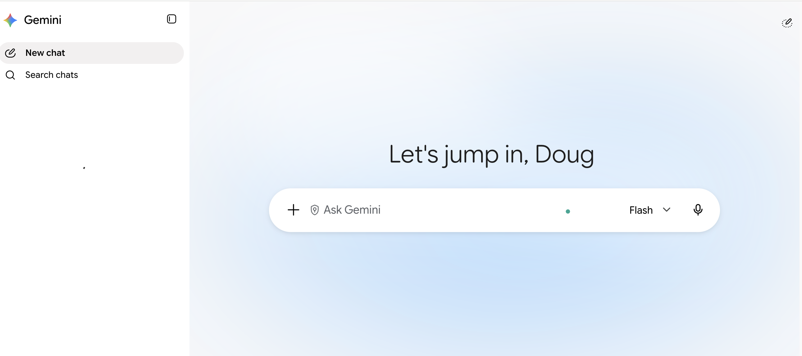
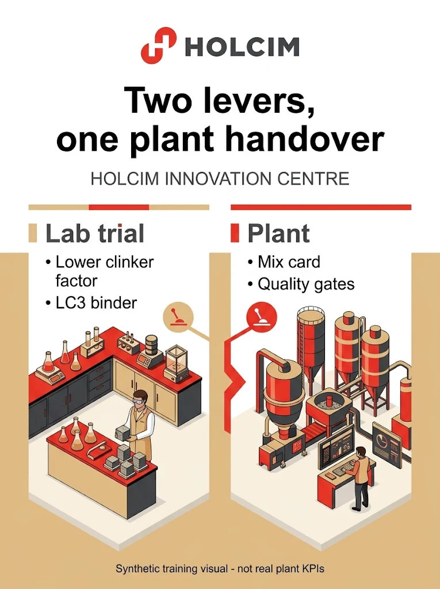

# Ingénierie de prompts avancée pour les notes d’essai du HIC

## Temps requis

30 minutes

## Présentation

Dans ce labo, vous construisez un prompt Gemini avancé pour une note d’essai du Holcim Innovation Centre (HIC) destinée à l’usine, vous extrayez des faits structurés de PDF d’essai synthétiques, vous créez une infographie d’essai avec les outils d’image, puis vous lancez une boucle de critique et réécrivez la même note pour trois publics sans inventer de résultats.

### Vous apprendrez à :
- Construire un prompt Rôle, tâche, étapes et exemples pour une note d’essai du HIC destinée à l’usine.
- Extraire du Markdown structuré de plusieurs PDF d’essai sans inventer les champs manquants.
- Améliorer les prompts d’image Gemini avec le logo Holcim, des contraintes de style et le méta-prompt.
- Critiquer un brouillon contre les sources, puis le réécrire pour un scientifique, une usine et un lecteur dirigeant.

## Scénario


Vous êtes au Holcim Innovation Centre. L’essai **HIC-LC3-24** est un liant à faible taux de clinker et à argile calcinée (style LC3) qui avance vers le transfert à l’usine synthétique **Loire Plant**. Demain, vous devez une note destinée à l’usine. Le protocole, les résultats intermédiaires et les limites sont des PDF. Gemini peut rédiger la note si vous précisez le travail, les fichiers et la règle : les chiffres non publiés ou manquants restent dehors.

> [!WARNING]
> Chaque PDF et chaque figure de ce labo est un **contenu de formation synthétique**. Ne traitez pas les identifiants de formule, les résistances ou les noms d’usine comme de vrais résultats du HIC. Ne joignez pas de données d’essai réelles pendant le cours.

## Instructions du labo

### Tâche 1 : Construire une note d’essai destinée à l’usine avec rôle, tâche, étapes et exemples

Dans cette tâche, vous rédigez la note d’essai en quatre améliorations de prompt, dans une seule conversation Gemini. Chaque tour ajoute de la structure. Vous ne recommencez pas.

1. Ouvrez [https://gemini.google.com/](https://gemini.google.com/) et connectez-vous avec votre compte de cours.



2. Cliquez sur **New chat**. Envoyez cette demande vague :

```text
Rédigez une note sur notre essai LC3.
```

3. Lisez la réponse. Elle sera générique, et elle peut inventer des résistances, des dates ou des allégations commerciales. Restez dans la **même conversation** et ajoutez un **rôle** et une **tâche** :

```text
Vous êtes un scientifique du Holcim Innovation Centre et vous écrivez pour l'équipe qualité et production de Loire Plant.

Tâche : rédigez une note d'essai destinée à l'usine pour HIC-LC3-24, un essai de liant à faible taux de clinker et à argile calcinée qui avance vers le transfert à l'usine.
N'inventez pas de résistances à la compression, de facteurs de clinker, de dates ni d'allégations de marque commerciale.
Si un chiffre manque, écrivez Non trouvé.
```

4. Ajoutez des **étapes** et une **forme de sortie**. Envoyez :

```text
Suivez ces étapes :
1. Énoncez l'objet de HIC-LC3-24 en deux phrases.
2. Listez ce dont l'usine a besoin avant le transfert (silos, finesse, portes qualité).
3. Séparez les méthodes des résultats. Ne les mélangez pas dans un seul paragraphe.
4. Terminez par les questions ouvertes auxquelles l'usine doit répondre.

Renvoyez UNIQUEMENT du Markdown valide avec ces titres :
## Objet
## Ce dont l'usine a besoin
## Méthodes et résultats
## Questions ouvertes
## Allégations que j'ai refusé d'inventer
```

5. Ajoutez un court **exemple** du ton que vous voulez. Envoyez :

```text
Reproduisez ce ton et cette densité. Ne copiez pas les faux chiffres de l'exemple.

Exemple :
## Objet
HIC-LC3-24 teste si un liant de style LC3 peut atteindre une classe de 42.5 MPa à 28 jours avec un facteur de clinker plus bas que le CEM I, avec une fiche formule prête pour l'usine comme livrable de transfert.

Gardez les phrases courtes. Préférez les tableaux aux adjectifs. N'écrivez jamais "prometteur" sans un chiffre source.
```

<!-- TODO IMAGE: Screenshot of the four-stage trial-note chat after the example upgrade -->


> [!TIP]
> Si Gemini écrit encore une brochure, répondez : `Réécrivez en utilisant seulement les titres que j'ai spécifiés. Supprimez les adjectifs marketing. N'ajoutez pas de chiffres.`

### Tâche 2 : Extraire des faits structurés de trois PDF d’essai

Dans cette tâche, vous ancrez Gemini dans le protocole, les résultats intermédiaires et le fichier de limites, puis vous imposez un schéma pour que les champs manquants restent `Non trouvé`.

1. Téléchargez les trois PDF d’essai synthétiques. Pour chaque fichier du tableau, cliquez sur le lien pour l’ouvrir dans Google Drive, puis cliquez sur **Download** (l’icône flèche vers le bas en haut à droite de l’aperçu).

| Fichier | Ce qu’il porte |
| :--- | :--- |
| [hic-lc3-24-trial-protocol.pdf](https://drive.google.com/file/d/1cvvnx2dI6DQPwGoZpM-M0TLrJEEENZiy/view) | Méthodes, âges, spec. Pas de lignes de résultats en plus. |
| [hic-lc3-24-interim-results.pdf](https://drive.google.com/file/d/17i1fiajvB2RTU0UUhqNmo4w-3rfxvK7V/view) | Résultats de formules sélectionnées. Les chiffres sont ici. |
| [hic-lc3-24-limitations.pdf](https://drive.google.com/file/d/1OyLgZjaJZPRJ_yBDajhL7gLKw-48hXWc/view) | Réserves, demande en eau, contraintes d’usine. |

2. Dans Gemini, cliquez sur **New chat**. Cliquez sur **+** (à gauche de la zone de prompt), choisissez **Upload files**, et sélectionnez les trois PDF dans votre dossier **Downloads**.

3. Attendez que les trois fichiers apparaissent au-dessus de la zone de prompt. Puis envoyez une première demande faible :

```text
Regardez ces fichiers et dites-moi ce que vous en pensez.
```

4. Améliorez la même conversation avec un **schéma**. Envoyez :

```text
Vous êtes un responsable de laboratoire du Holcim Innovation Centre qui prépare un dossier de transfert.

Tâche : lisez les trois PDF joints et renvoyez UNIQUEMENT du Markdown valide. Pas de préambule.

Pour chaque formule qui apparaît dans le fichier de résultats intermédiaires, produisez :

## Formule : <Mix ID>
- **Famille de liant :**
- **Facteur de clinker :**
- **Âge (jours) :**
- **Résistance à la compression (MPa) :**
- **Résistance de spec (MPa) :**
- **Réussi ou échec par rapport à la spec :**
- **Limite qui s'applique :**
- **Fichier source du chiffre :**

Règles :
- Les résistances et les facteurs de clinker ne peuvent venir que de hic-lc3-24-interim-results.pdf.
- Les méthodes et la spec ne peuvent venir que de hic-lc3-24-trial-protocol.pdf.
- Les limites ne peuvent venir que de hic-lc3-24-limitations.pdf.
- Si un champ n'est pas dans les fichiers, écrivez Non trouvé. Ne moyennez pas, ne devinez pas, n'utilisez pas de valeurs LC3 typiques issues des données d'entraînement.
```

5. Si Gemini résume au lieu d’utiliser votre schéma, répondez :

```text
Reformatez avec le schéma Markdown exact. N'ajoutez pas de sections. N'inventez pas de formules qui ne sont pas dans le PDF de résultats.
```

<!-- TODO IMAGE: Screenshot of structured Markdown extraction from the three trial PDFs -->


### Tâche 3 : Créer une infographie de transfert usine du HIC avec les outils d’image Gemini

Dans cette tâche, vous utilisez la génération d’images de Gemini pour créer une affiche du HIC. Vous commencez simple, puis vous ajoutez le logo Holcim, le contenu approuvé, la direction de style et un méta-prompt.

1. Dans Gemini, cliquez sur **New chat**. Puis sélectionnez l’outil **Create image** dans le menu des outils.

2. Envoyez une demande d’image **simple** :

```text
Créez une infographie sur un essai LC3 du Holcim Innovation Centre.
```

> [!NOTE]
> Il créera quelque chose, et cela peut être beau. Il inventera probablement des statistiques et des logos en plus. C’est le but de cette étape.

3. Créez une nouvelle conversation, et sélectionnez de nouveau l’outil **Create image**.

4. Copiez le logo Holcim ci-dessous dans le presse-papiers, et collez-le dans la zone de prompt.


5. Envoyez un prompt plus solide qui référence le logo et verrouille le contenu :

```text
Créez une infographie promotionnelle verticale pour le Holcim Innovation Centre.

Marque :
- Placez le logo Holcim joint clairement près du haut
- Gardez les proportions du logo ; ne déformez pas la marque et ne la recoloriez pas de travers

Contenu à inclure comme texte lisible sur l'infographie :
- Titre : Deux leviers, un transfert usine
- En-tête colonne gauche : Essai labo
- Lignes colonne gauche : Facteur de clinker plus bas ; liant LC3
- En-tête colonne droite : Usine
- Lignes colonne droite : Fiche formule ; portes qualité
- Pied de page : Visuel de formation synthétique - pas de vrais KPI d'usine

Direction visuelle :
- Design d'entreprise sobre, adapté à une entreprise mondiale de matériaux de construction
- Beaucoup d'espace blanc ; évitez l'encombrement
- Évoquez un laboratoire de matériaux, pas un chantier dangereux
- Pas de pourcentages inventés, de faux graphiques, de faux QR codes ni de logos en plus
```


6. Ajoutez des **détails de style** dans un suivi pour affiner (ou régénérer) l’infographie :

```text
Régénérez l'infographie avec ces contraintes de style :
- Palette : rouge Holcim, gris anthracite, blanc, et accents sable chaud (pas de néon)
- Typographie : sans-serif moderne en gras pour le titre ; sans-serif simple pour le corps
- Mise en page : logo en haut, titre sous le logo, deux colonnes égales pour Essai labo et Usine, pied de page en bas
- Format : infographie portrait (proportions proches de A4 / lettre)
- Gardez tout le texte de l'infographie exactement comme spécifié ; priorisez l'orthographe correcte de Holcim, LC3 et Loire
```

<!-- TODO IMAGE: Screenshot of the styled second infographic attempt -->


7. Pratiquez le **méta-prompt pour la génération d’images**. Demandez à Gemini d’améliorer le prompt avant de faire l’image suivante :

```text
Vous êtes un expert en prompts pour la génération d'images.

Méta-tâche :
1. Critiquez mon prompt d'infographie précédent pour l'ambiguïté, la direction artistique manquante et les risques de rendu du texte.
2. Écrivez un prompt d'image unique amélioré (moins de 180 mots), plus précis sur la composition, la lumière, le langage de mise en page et les contraintes négatives.
```

8. Copiez le prompt amélioré dans le presse-papiers, créez une nouvelle conversation, resélectionnez l’outil **Create image**, collez de nouveau le logo Holcim, et lancez le prompt amélioré.

<!-- TODO IMAGE: Screenshot of the final HIC infographic after meta-prompt -->


> [!TIP]
> Si le texte de l’image est mal orthographié, demandez à Gemini de régénérer avec : `Gardez tout le texte de l'infographie exactement comme spécifié ; priorisez l'orthographe correcte de Holcim, LC3 et du transfert usine.`

### Tâche 4 : Critiquer la note, puis la réécrire pour trois publics

Dans cette tâche, vous prenez la note d’essai de la tâche 1, vous la testez contre les PDF, puis vous produisez trois réécritures qui partagent les faits et ne changent que la voix.

1. Revenez à la **conversation de la tâche 1**. Cliquez sur **+**, choisissez **Upload files**, et sélectionnez les mêmes trois PDF dans votre dossier **Downloads**. Puis envoyez :

```text
Critiquez la note d'essai destinée à l'usine contre les trois PDF joints.

Listez :
1. Chaque chiffre de la note qui n'apparaît pas dans les PDF.
2. Chaque allégation qui ressemble à une promesse commerciale ECOPlanet ou ECOPact.
3. Chaque endroit où les méthodes et les résultats ont été mélangés.

Ne corrigez pas encore la note. Listez seulement les problèmes.
```

2. Après avoir lu la critique, envoyez la réécriture selon les publics :

```text
Produisez maintenant trois réécritures de la même note. Utilisez seulement les faits qui ont survécu à la critique. N'ajoutez pas de chiffres.

### Scientifique
Densité : méthodes, âges, spec, limites. Public : collègues de laboratoire du HIC.

### Usine
Densité : silos, finesse, portes qualité, ce qui doit être vrai le premier jour. Public : production et qualité de Loire Plant.

### Dirigeant
Densité : six lignes maximum. Ce que nous demandons à la revue d'innovation de décider. Pas d'annexe de méthodes.

Règles :
- Les trois versions doivent être d'accord sur chaque chiffre.
- Si un chiffre a été signalé comme inventé, remplacez-le par Non trouvé ou omettez-le.
- Étiquetez chaque version avec les titres ci-dessus.
```

3. Parcourez les trois versions. Vérifiez que la version dirigeant n’a pas glissé une nouvelle valeur en mégapascals.

> [!WARNING]
> Si une réécriture introduit une résistance, un facteur de clinker ou une date qui n’est pas dans `hic-lc3-24-interim-results.pdf` ou dans la spec du protocole, rejetez cette phrase. Gemini n’est pas un second laboratoire.

### Tâche bonus 5 : Enregistrer un modèle de prompt HIC réutilisable

1. Cliquez sur **New chat**, puis demandez à Gemini :

```text
Transformez le schéma Rôle-Tâche-Étapes-Exemples que nous avons utilisé pour la note HIC-LC3-24 destinée à l'usine en un modèle vierge réutilisable pour les prompts du Holcim Innovation Centre sur les essais de liant ou le transfert usine. Laissez les espaces réservés en MAJUSCULES.
```

2. Enregistrez le modèle là où vous pourrez le réutiliser après le cours.

## Félicitations !

Dans ce labo, vous avez :

- Construit pas à pas un prompt de note d’essai du HIC destinée à l’usine, avec rôle, tâche, étapes et exemples.
- Extrait du Markdown structuré de trois PDF d’essai synthétiques sans inventer les champs manquants.
- Amélioré des prompts d’image Gemini avec le logo Holcim, le détail de style et le méta-prompt.
- Critiqué un brouillon contre les sources et l’avez réécrit pour un scientifique, une usine et un lecteur dirigeant.


