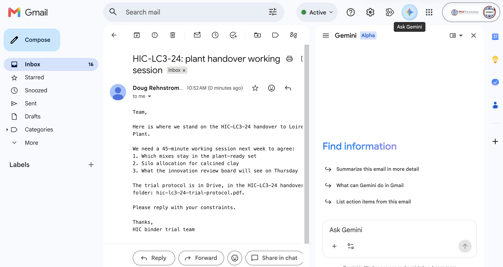
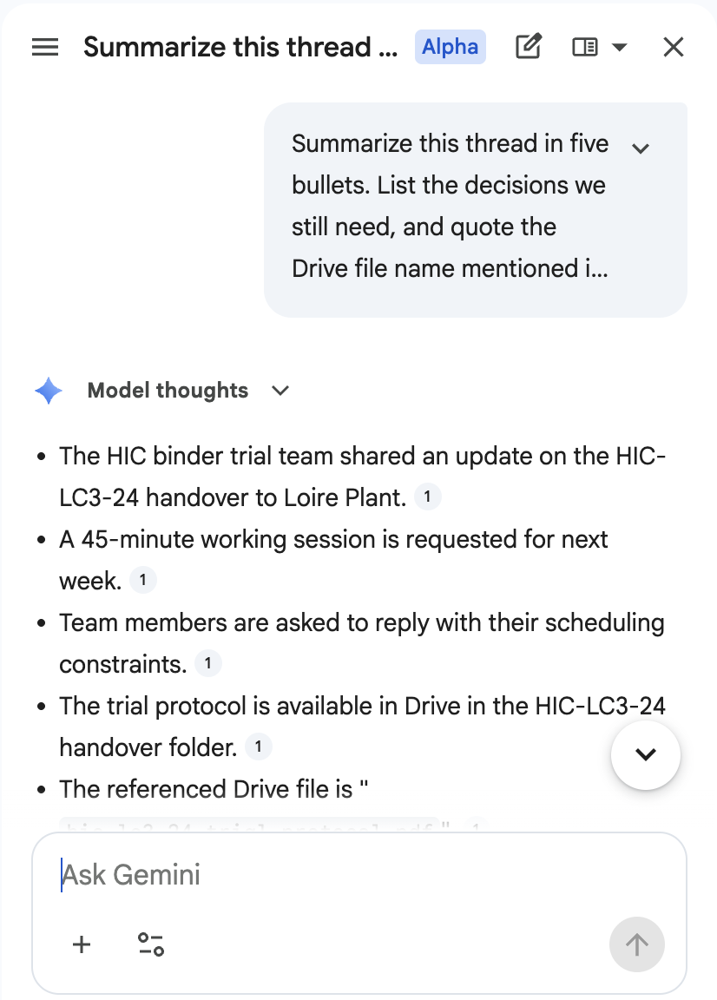
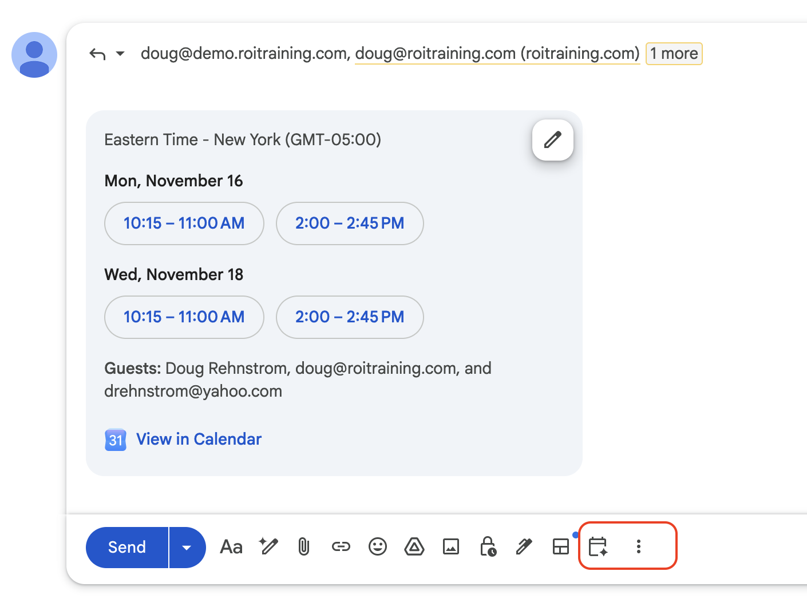

# Gemini dans Gmail pour la collaboration au HIC

## Durée

30 minutes

## Vue d’ensemble

Dans cet atelier, vous allez utiliser Gemini dans Gmail sur un fil de conversation consacré au transfert vers l’usine, que vous vous envoyez à vous-même. Vous résumerez le fil depuis le panneau latéral, vous rechercherez le protocole HIC-LC3-24 dans Gmail, Chat et Drive, vous proposerez une séance de travail avec Help me schedule, puis vous comparerez une réponse suggérée et un brouillon plus complet avant l’envoi.

### Vous allez apprendre à :
- Ouvrir Ask Gemini dans Gmail et résumer un fil de conversation sans quitter la boîte de réception.
- Effectuer une recherche dans Gmail, Chat et Drive depuis le panneau latéral de Gmail, avec Drive comme solution de repli.
- Proposer des créneaux avec Help me schedule, ou rédiger une proposition de réunion prête pour l’agenda si le bouton n’est pas disponible.
- Utiliser une réponse suggérée, puis rédiger un brouillon plus complet et le relire avant l’envoi.

## Mise en situation


Vous coordonnez le transfert de **HIC-LC3-24** vers l’usine synthétique Loire Plant. Le protocole et les fichiers du HIC associés seront dans votre Drive. Aucune réunion n’est encore à l’agenda. Vous créez vous-même le fil d’e-mails, pour que chaque participant parte de la même boîte de réception.

> [!WARNING]
> N’envoyez ni données d’essai réelles non publiées, ni noms de partenaires, ni fiches formule. Utilisez le message préparé de cet atelier. Les réponses suggérées peuvent se tromper sur le contenu technique. C’est vous qui cliquez sur **Send** : vous restez responsable du message.

> [!NOTE]
> Les libellés de Gemini dans Gmail évoluent. Si un nom de commande ci-dessous ne correspond pas à votre environnement, utilisez la solution de repli indiquée à l’étape. Ne bloquez pas l’atelier à chercher une capture d’écran identique.

> [!NOTE]
> Les fichiers de cours sont en anglais. Gemini les trouve et les lit sans difficulté ; vos prompts et vos e-mails restent en français.

## Instructions de l’atelier

### Tâche 1 : Importer les fichiers du HIC, puis envoyer et résumer le fil de transfert

Dans cette tâche, vous placez les fichiers du HIC dans votre propre Drive pour que Gemini puisse les retrouver plus tard. Vous créez ensuite le fil que Gemini va résumer. Vous envoyez le message préparé à votre propre adresse : l’atelier ne dépend ainsi d’aucune boîte de réception préremplie.

1. Téléchargez les quatre fichiers du HIC. Pour chaque fichier du tableau, cliquez sur le lien pour l’ouvrir dans Google Drive, puis cliquez sur **Download** (l’icône en forme de flèche vers le bas, en haut à droite de l’aperçu).

| Fichier | Contenu |
| :--- | :--- |
| [hic-lc3-24-trial-protocol.pdf](https://drive.google.com/file/d/1REHLF6NeIkN_kON23YtxkcSImcXSPU5o/view) | Âges d’essai et spécification à 28 jours |
| [hic-lc3-24-meeting-note.pdf](https://drive.google.com/file/d/1xGOwSrZjPmC4PlSmpopK9J0RzV_7DhI5/view) | Décisions de la réunion de lancement ; la séance de travail n’est pas encore planifiée |
| [hic-trial-glossary.pdf](https://drive.google.com/file/d/11iwfKBi8ONKtSBjhWbkGRWnjSf4eWgDm/view) | Définition de « prêt pour le transfert » |
| [hic-lc3-24-handover-checklist.pdf](https://drive.google.com/file/d/1V87d4tNd6qbqUmcljHZzrJsduPKmFDY0/view) | Liste de contrôle pour la séance de travail |

2. Ouvrez [https://drive.google.com/](https://drive.google.com/). Cliquez sur **New**, puis sur **New folder**. Nommez le dossier `HIC-LC3-24 handover` et cliquez sur **Create**.

3. Double-cliquez sur le nouveau dossier pour l’ouvrir. Cliquez sur **New**, puis sur **File upload**, et sélectionnez les quatre PDF dans votre dossier **Downloads**.

> [!NOTE]
> Drive peut mettre quelques minutes à indexer les nouveaux fichiers. Vous les importez dès maintenant pour que Gemini puisse les trouver à la tâche 2.

4. Ouvrez [https://mail.google.com/](https://mail.google.com/) et connectez-vous avec votre compte de formation.

5. Cliquez sur **Compose**.

6. Dans le champ **To**, saisissez votre propre adresse e-mail.

7. Dans le champ **Subject**, collez :

```text
HIC-LC3-24 : séance de travail sur le transfert à l'usine
```

8. Dans le corps du message, collez :

```text
Bonjour à tous,

Voici où nous en sommes du transfert de HIC-LC3-24 vers Loire Plant.

Nous avons besoin d'une séance de travail de 45 minutes la semaine prochaine pour décider :
1. Quelles formules restent dans la sélection prête pour l'usine
2. L'attribution du silo d'argile calcinée
3. Ce que le comité de revue d'innovation verra jeudi

Le protocole d'essai se trouve dans Drive, dans le dossier HIC-LC3-24 handover : hic-lc3-24-trial-protocol.pdf.

Merci de me faire part de vos contraintes en réponse.

Bien cordialement,
L'équipe essai liant du HIC
```

9. Ne joignez aucun fichier. L’e-mail se contente de nommer le protocole. À la tâche 2, Gemini le trouvera dans votre Drive.

10. Cliquez sur **Send**. Ouvrez le message dans votre boîte de réception pour en faire le fil actif.

11. En haut à droite de Gmail, cliquez sur **Ask Gemini**.

<!-- TODO IMAGE: Screenshot of Gmail with Ask Gemini side panel open on the self-sent thread -->


12. Dans le panneau Gemini, envoyez :

```text
Résumez ce fil en cinq points. Listez les décisions qui restent à prendre et citez le nom du fichier Drive mentionné dans l'e-mail. N'ajoutez aucun résultat d'essai absent du message.
```

> [!TIP]
> Si **Ask Gemini** n’apparaît pas, vérifiez que Gemini est activé pour Gmail dans votre compte Workspace. En dernier recours, transférez-vous le fil et utilisez l’application Gemini.

### Tâche 2 : Rechercher dans Gmail, Chat et Drive depuis le panneau latéral

Dans cette tâche, vous restez dans Gmail et vous demandez à Gemini de trouver le protocole et les fichiers du HIC associés. Chat est peut-être vide dans l’environnement de formation : Drive est la source fiable.

1. Gardez le panneau Gemini ouvert. Envoyez :

```text
Recherchez HIC-LC3-24 dans Gmail, Chat et Drive. J'ai besoin du protocole d'essai, des notes de réunion et du glossaire. Citez les noms des fichiers trouvés. Si Chat ne renvoie aucun résultat, signalez-le et poursuivez avec Drive.
```

2. Examinez les résultats renvoyés par Gemini.

3. Si les résultats Drive sont maigres, cliquez sur **Add source** (ou sur la commande Drive du panneau Gemini) et joignez `hic-lc3-24-trial-protocol.pdf` depuis votre dossier `HIC-LC3-24 handover` dans Drive.

4. Envoyez une question de suivi qui s’appuie sur ce fichier :

```text
D'après le protocole d'essai HIC-LC3-24, listez les âges d'essai et la résistance spécifiée à 28 jours. Si une valeur ne figure pas dans le protocole, écrivez Non trouvé. N'utilisez pas de valeurs LC3 typiques extérieures à ce fichier.
```

<!-- TODO IMAGE: Screenshot of Gemini in Gmail returning Drive protocol ages and spec -->


> [!NOTE]
> **Solution de repli si Chat est vide :** c’est normal dans un environnement de formation. Terminez la recherche avec Drive, depuis ce même panneau Gmail. Ne changez de produit que si Gemini dans Gmail n’est pas disponible.

> [!NOTE]
> Gemini doit trouver les quatre fichiers importés dans votre dossier `HIC-LC3-24 handover` à la tâche 1. S’il n’en trouve aucun, patientez une minute et renvoyez le prompt.

### Tâche 3 : Planifier une séance de travail avec Help me schedule

Dans cette tâche, vous proposez des créneaux depuis Gmail en vous appuyant sur Calendar. Il s’agit d’une séance de travail du HIC de 45 minutes, pas d’un créneau bloqué au hasard sans consulter les disponibilités.

1. Dans le même fil, cliquez sur **Reply**.

2. Dans le champ **To**, ajoutez au moins une autre personne que vous pouvez inviter pendant la formation (votre formateur ou un autre participant). Restez vous-même en destinataire.

3. En bas de la fenêtre de rédaction, cliquez sur **Help me schedule**.

   Si vous ne voyez pas **Help me schedule**, cliquez sur **More options**, puis sur **Help me schedule**.

4. Examinez les créneaux proposés. Réglez la durée sur **45 minutes** si Gemini a proposé une autre durée.

5. N’envoyez **pas** encore le message. Vous enverrez une réponse plus complète à la tâche 4.

<!-- TODO IMAGE: Screenshot of Help me schedule card in a Gmail draft -->


> [!NOTE]
> **Solution de repli si Help me schedule n’est pas disponible :** dans le panneau latéral Gemini, envoyez le prompt ci-dessous, puis collez vous-même la proposition dans une invitation Calendar.

```text
Rédigez une proposition de réunion prête à copier dans l'agenda : séance de travail de 45 minutes la semaine prochaine sur le transfert de HIC-LC3-24 à l'usine.
Incluez un objet, quatre créneaux possibles pendant mes heures de travail, un court ordre du jour (formules prêtes pour l'usine, attribution du silo d'argile, comité de revue d'innovation) et une phrase demandant aux invités de choisir un créneau.
N'inventez aucun résultat d'essai.
```

6. Facultatif : dans le panneau Gemini, vous pouvez aussi demander :

```text
Trouvez des créneaux libres de 45 minutes dans mon agenda principal la semaine prochaine pour une séance de travail sur le transfert à l'usine.
```

> [!WARNING]
> Gemini dans Gmail ne peut créer ou consulter des événements que dans votre agenda **principal**. Vérifiez les horaires du brouillon avant que quiconque ne les accepte.

### Tâche 4 : Utiliser une réponse suggérée, puis rédiger une réponse plus complète

Dans cette tâche, vous comparez une réponse suggérée en un clic à une véritable réponse sur le transfert, puis vous n’envoyez que la version que vous avez relue.

1. Fermez la fenêtre de rédaction si vous avez besoin de voir le fil, ou restez dans la réponse en cours.

2. Repérez les **réponses suggérées** (courtes pastilles, par exemple « Ça me va » ou « Sounds good », selon la langue de votre boîte de réception) au-dessus ou au-dessous du fil.

3. Cliquez sur une réponse suggérée pour voir ce que Gemini a détecté automatiquement. Lisez-la : elle ne suffira pas pour un transfert à l’usine.

> [!NOTE]
> **Solution de repli si aucune pastille n’apparaît :** passez directement à **Help me write**. Les réponses suggérées dépendent du message et de l’environnement. Leur absence ne signifie pas que l’atelier a échoué.

4. Dans la zone de réponse, cliquez sur **Help me write** (ou demandez dans le panneau latéral : « Rédigez une réponse »). Collez :

```text
Rédigez une réponse à ce fil HIC-LC3-24.
Ton : concis, destiné à l'usine, sans marketing.
Incluez :
- Un accusé de réception des trois points de l'ordre du jour
- La proposition de séance de travail de 45 minutes (reprenez les créneaux Help me schedule s'ils figurent dans le brouillon)
- Une demande de consulter hic-lc3-24-trial-protocol.pdf avant la réunion
- Une phrase précisant que nous ne discuterons pas de chiffres non publiés absents des fichiers partagés
N'ajoutez ni résistance à la compression ni facteur de clinker.
120 mots maximum.
```

5. Insérez le brouillon dans la réponse. Modifiez tout ce que vous ne diriez pas à Loire Plant.

6. Cliquez sur **Send**.

> [!WARNING]
> Gemini a rédigé le texte, mais c’est vous qui l’avez envoyé. Si une réponse suggérée a inventé une date, une spécification ou un participant, l’erreur est désormais la vôtre.

### Tâche bonus 5 : Transformer le fil en événement Calendar (facultatif)

1. Si Gmail affiche **Add to calendar** sur le fil, utilisez cette commande et vérifiez le titre et les invités extraits.

2. Si ce bouton n’apparaît pas, créez l’événement dans Calendar à partir de la proposition que vous avez déjà rédigée.

## Félicitations !

Dans cet atelier, vous avez :

- Créé un fil Gmail, puis résumé ce fil depuis le panneau latéral Ask Gemini.
- Effectué une recherche dans Gmail, Chat et Drive depuis Gmail, avec Drive comme solution de repli quand Chat était vide.
- Proposé une séance de travail de 45 minutes avec Help me schedule, ou rédigé une proposition prête pour l’agenda si la commande n’était pas disponible.
- Comparé une réponse suggérée à un brouillon plus complet rédigé avec Help me write, puis relu ce brouillon avant l’envoi.
