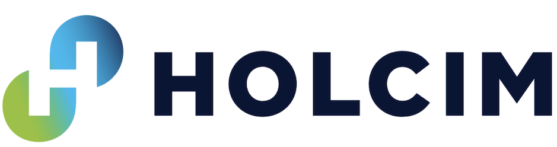
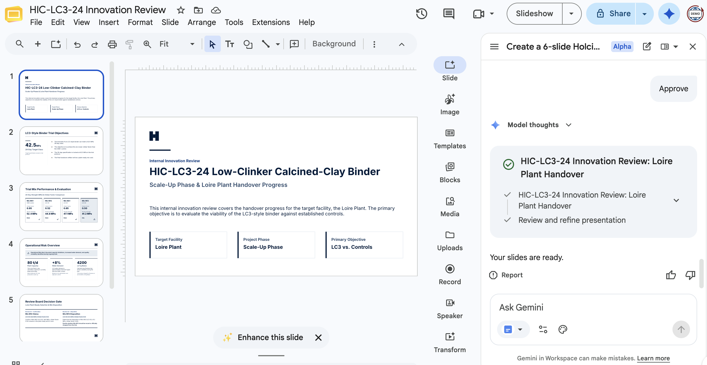
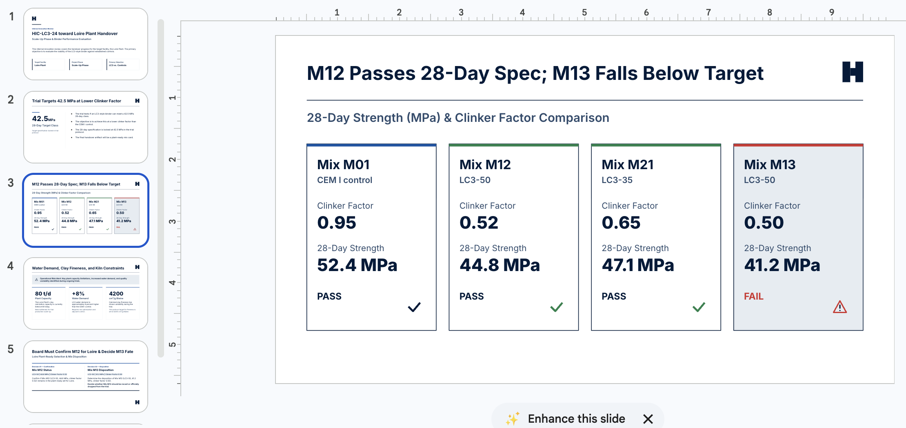

# Présentations au style Holcim avec Gemini dans Google Slides

## Temps requis

30 minutes

## Présentation

Dans ce labo, vous générez une présentation de revue d’innovation au style Holcim avec Gemini dans Google Slides. Vous partez d’une présentation vide, vous ancrez le premier brouillon dans un modèle Doc de point d’avancement, puis vous modifiez les diapositives existantes avec un Sheet de résultats d’essai et un fichier de contraintes de marque. Vous terminez avec Enhance this slide et une liste de contrôle qualité.

### Vous apprendrez à :
- Générer une présentation de plusieurs diapositives à partir d’un modèle Doc de point d’avancement.
- Modifier des diapositives existantes avec un Google Sheet de résultats d’essai et un fichier de référence supplémentaire.
- Appliquer le look Holcim avec des prompts de suivi et Enhance this slide.
- Refuser les KPI inventés qui n’apparaissent pas dans les fichiers joints.

## Scénario



La revue d’innovation interne de jeudi a besoin de six diapositives sur **HIC-LC3-24**. Le récit est déjà dans un Doc de point d’avancement. Les preuves à 28 jours sont dans un Sheet. Un court fichier de contraintes de marque liste ce qui ne doit jamais apparaître sur une diapositive. Vous ne taperez pas la présentation à partir d’un plan vide dans votre tête.

> [!WARNING]
> Les chiffres du Doc, du Sheet et du fichier de contraintes sont un **contenu de formation synthétique**. Si un chiffre n’est pas dans ces fichiers, laissez-le hors de la diapositive.

## Instructions du labo

### Tâche 1 : Créer une présentation vide et ouvrir Gemini dans Slides

Dans cette tâche, vous préparez une présentation vide pour que Gemini construise le plan avec vous, au lieu de lutter contre un modèle restant.

1. Ouvrez [https://slides.google.com/](https://slides.google.com/) et créez une présentation **Blank**.

2. Renommez-la :

```text
HIC-LC3-24 Innovation Review
```

3. Ouvrez **Ask Gemini** dans Slides (bouton étincelle, en général en haut à droite).


4. Si Gemini propose un thème, choisissez un fond blanc propre. Vous verrouillerez les couleurs Holcim dans la tâche 3.

### Tâche 2 : Générer la première présentation depuis le Doc de point d’avancement

Dans cette tâche, le **Doc** porte le récit. Vous le joignez et vous demandez six diapositives. Vous ne joignez pas encore le Sheet.

1. Cliquez sur [hic-project-update-template.md](https://drive.google.com/file/d/12cgN2UVmm7JTJp3eknlpShE9x6C5t2k6/view) pour l’ouvrir dans Google Drive, puis cliquez sur **Download** (l’icône flèche vers le bas en haut à droite de l’aperçu).

2. Dans un nouvel onglet, ouvrez [https://docs.google.com/](https://docs.google.com/) et cliquez sur **Blank document**.

3. Cliquez sur **File**, puis **Open**. Choisissez l’onglet **Upload**, cliquez sur **Browse**, et sélectionnez `hic-project-update-template.md` dans votre dossier **Downloads**. Docs l’ouvre comme un nouveau document.

4. Si le titre se termine encore par `.md`, cliquez sur **File**, puis **Save as Google Docs**. Renommez le document :

```text
HIC-LC3-24 Project Update
```

5. Revenez à l’onglet **HIC-LC3-24 Innovation Review**. Dans le panneau Gemini, cliquez sur **Add sources**, puis **Add from Drive**, et sélectionnez **HIC-LC3-24 Project Update**.

6. Envoyez :

```text
Créez une présentation de 6 diapositives du Holcim Innovation Centre pour une revue d'innovation interne de HIC-LC3-24.

Utilisez UNIQUEMENT le Google Doc joint comme source du récit. N'inventez pas de résistances, de facteurs de clinker, de dates ni de noms d'usine.

Plan des diapositives :
1. Titre : HIC-LC3-24 vers le transfert à Loire Plant
2. Pourquoi cet essai existe
3. Statut de cette période
4. Risques et points usine ouverts
5. La demande au comité de revue
6. Les 30 prochains jours

Contraintes :
- Une idée par diapositive
- Les titres nomment le constat, pas Aperçu
- Pas plus de quatre puces par diapositive
- Fond blanc, texte bleu marine
- Ajoutez des notes d'orateur sur chaque diapositive
- Si un chiffre n'est pas dans le Doc, omettez-le
```

7. Si Gemini pose des questions de clarification ou montre un plan, répondez à partir du Doc. Cliquez sur **Approve** quand le plan correspond aux six diapositives.

8. Attendez la fin des diapositives, puis parcourez-les. Vérifiez qu’aucune valeur en mégapascals absente du Doc n’est apparue.

<!-- TODO IMAGE: Screenshot of the six-slide deck generated from the project-update Doc -->


### Tâche 3 : Modifier les diapositives existantes avec le Sheet d’essai et le fichier de contraintes

Dans cette tâche, vous gardez le plan et vous **modifiez** les diapositives avec des références supplémentaires. Vous ne régénérez pas toute la présentation.

1. Téléchargez les deux fichiers de référence. Pour chaque fichier, cliquez sur le lien pour l’ouvrir dans Google Drive, puis cliquez sur **Download**.

| Fichier | Ce qu’il porte |
| :--- | :--- |
| [hic-lc3-28day-results.csv](https://drive.google.com/file/d/1I5lJxak57QsvQU4Cf2zc1dvdvDFHmBRv/view) | Chaque chiffre à 28 jours que vous pouvez citer |
| [hic-lc3-brand-constraints.md](https://drive.google.com/file/d/1eAIfoNN3sTh0eXHR-Er5o3fD7SMLrUDW/view) | Look Holcim, règles de chiffres et allégations interdites |

2. Ouvrez [https://sheets.google.com/](https://sheets.google.com/) et cliquez sur **Blank spreadsheet**. Cliquez sur **File**, puis **Import**. Choisissez l’onglet **Upload**, cliquez sur **Browse**, et sélectionnez `hic-lc3-28day-results.csv`. Réglez **Import location** sur **Replace spreadsheet**, puis cliquez sur **Import data**.

3. Renommez la feuille de calcul :

```text
HIC-LC3-24 28-day Results
```

4. Ouvrez [https://docs.google.com/](https://docs.google.com/), cliquez sur **Blank document**, puis cliquez sur **File**, puis **Open**. Choisissez l’onglet **Upload** et sélectionnez `hic-lc3-brand-constraints.md`. Si le titre se termine encore par `.md`, cliquez sur **File**, puis **Save as Google Docs**. Renommez le document :

```text
HIC-LC3-24 brand constraints
```

5. Revenez à l’onglet **HIC-LC3-24 Innovation Review**. Dans la **même** conversation Gemini, cliquez sur **Add sources**, puis **Add from Drive**, et sélectionnez **HIC-LC3-24 28-day Results** et **HIC-LC3-24 brand constraints**.

6. Envoyez ce suivi. Il doit dire **modifiez**, pas **créez** :

```text
Modifiez les diapositives existantes. N'ajoutez pas de diapositives. Ne régénérez pas la présentation.

Utilisez le Google Sheet joint seulement pour les diapositives qui parlent des résultats (en général les diapositives 3 et 5) :
- Vous pouvez citer la résistance à la compression à 28 jours, le facteur de clinker, et la réussite ou l'échec seulement si la valeur apparaît dans le Sheet.
- Ne moyennez pas les formules en un nouveau KPI.

Utilisez le fichier de contraintes de marque joint pour chaque diapositive :
- Suivez ses règles de couleur et de logo.
- Suivez sa liste d'allégations interdites.

Si le Sheet et le Doc se contredisent, gardez le Sheet pour les chiffres et le Doc pour le récit, et ajoutez une note d'orateur indiquant qu'il faut les réconcilier.
```

<!-- TODO IMAGE: Screenshot of Gemini editing existing slides after the Sheet and constraints file were attached -->


7. Vérifiez chaque diapositive à la main :

   - Une idée par diapositive
   - Les titres sont précis (« LC3-50 passe la spec à 28 jours », pas « Résultats »)
   - Pas plus de quatre puces
   - De l’espace blanc autour du titre, le logo Holcim ne collisionne pas avec le texte
   - Fond blanc, texte bleu marine, et accents bleu et vert du logo
   - Chaque chiffre existe dans le Doc ou le Sheet

8. Demandez à Gemini de corriger toute diapositive qui échoue à la liste. Nommez le numéro de diapositive dans le prompt.

### Tâche 4 : Enhance this slide et verrouiller le look Holcim

Dans cette tâche, vous utilisez l’outil visuel, puis le contenu reste le vôtre.

1. Sélectionnez une diapositive de résultats. Cliquez sur **Enhance this slide**. Si le changement vous convient, cliquez sur **Replace**. Sinon, annulez.

<!-- TODO IMAGE: Screenshot of Enhance this slide on an HIC results slide -->


> [!NOTE]
> Si le bouton a un libellé légèrement différent (par exemple **Enhance**), utilisez ce contrôle. S’il manque, sautez cette étape et utilisez un prompt de suivi : `Restylez cette diapositive : fond blanc, texte bleu marine, plus d'espace blanc, logo dans le coin.`

2. Envoyez un dernier suivi :

```text
Ajoutez une diapositive de synthèse à la fin avec les 3 points que le comité de revue doit retenir. Puis ajoutez une diapositive Questions et réponses. Toujours aucun chiffre inventé.
```

### Tâche bonus 5 : Réécriture de public dans la même présentation

1. Dans la même conversation Gemini, envoyez :

```text
Réécrivez les notes d'orateur de la diapositive 5 pour un responsable d'usine : silos, finesse, portes qualité. Ne changez pas les puces de la diapositive. N'ajoutez pas de chiffres.
```

2. Vérifiez que les puces à l’écran n’ont pas pris de nouveaux chiffres venus de la réécriture des notes.

## Félicitations !

Dans ce labo, vous avez :

- Généré une présentation de revue d’innovation Holcim de plusieurs diapositives à partir d’un modèle Google Doc.
- Modifié des diapositives existantes avec un Sheet de résultats d’essai et un fichier de contraintes de marque.
- Utilisé Enhance this slide et une liste de contrôle qualité sans ajouter de KPI inventés.
