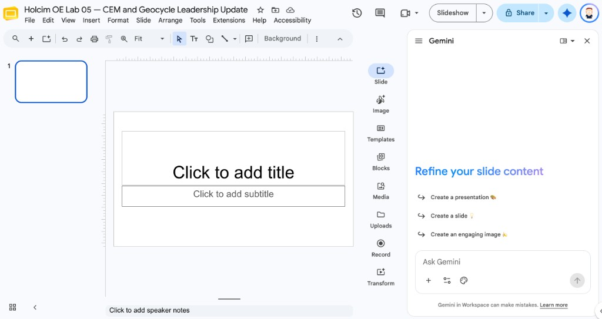
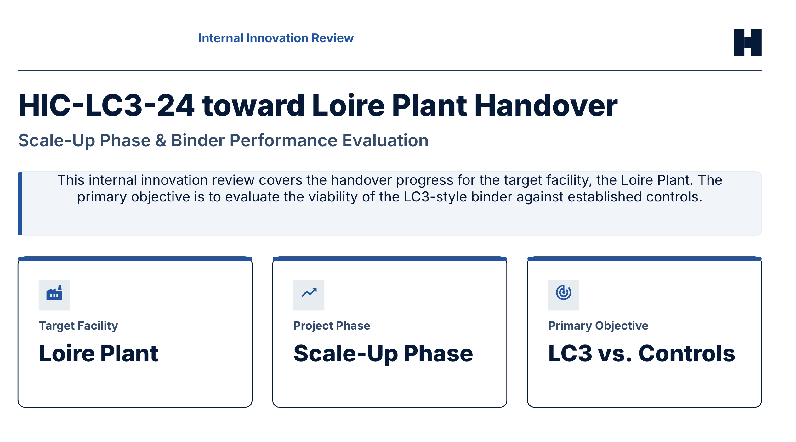

# Présentations conformes à la charte Holcim avec Gemini dans Google Slides

## Durée

30 minutes

## Vue d’ensemble

Dans cet atelier, vous allez générer avec Gemini dans Google Slides une présentation de revue d’innovation conforme à la charte Holcim. Vous partirez d’une présentation vierge, vous ancrerez le premier jet dans un modèle de point d’avancement (Google Docs), puis vous modifierez les diapositives existantes à l’aide d’un tableau Google Sheets de résultats d’essai et d’un fichier de charte graphique. Vous terminerez avec Enhance this slide et une liste de contrôle qualité.

### Vous allez apprendre à :
- Générer une présentation de plusieurs diapositives à partir d’un modèle de point d’avancement dans Google Docs.
- Modifier des diapositives existantes à l’aide d’un tableau Google Sheets de résultats d’essai et d’un fichier de référence supplémentaire.
- Appliquer la charte graphique Holcim avec des prompts de suivi et Enhance this slide.
- Refuser les KPI inventés qui ne figurent pas dans les fichiers joints.

## Mise en situation


La revue d’innovation interne de jeudi attend six diapositives sur **HIC-LC3-24**. Le récit se trouve déjà dans un document de point d’avancement. Les résultats à 28 jours sont dans un tableau Google Sheets. Un court fichier de charte graphique liste ce qui ne doit jamais figurer sur une diapositive. Inutile de rédiger la présentation en partant de zéro.

> [!WARNING]
> Les chiffres du document, du tableau et du fichier de charte sont des **contenus de formation synthétiques**. Si un chiffre ne figure pas dans ces fichiers, ne le mettez pas sur la diapositive.

> [!NOTE]
> Le document de point d’avancement et le fichier de charte sont en français. Le tableau de résultats (CSV) reste en anglais : ses noms de colonnes servent d’identifiants.

## Instructions de l’atelier

### Tâche 1 : Créer une présentation vierge et ouvrir Gemini dans Slides

Dans cette tâche, vous préparez une présentation vierge pour que Gemini construise le plan avec vous, plutôt que de partir d’un modèle existant qu’il faudrait défaire.

1. Ouvrez [https://slides.google.com/](https://slides.google.com/) et créez une présentation vierge (**Blank**).

2. Renommez-la :

```text
HIC-LC3-24 Innovation Review
```

3. Ouvrez **Ask Gemini** dans Slides (bouton en forme d’étincelle, en général en haut à droite).



4. Si Gemini propose un thème, choisissez un fond blanc épuré. Vous appliquerez les couleurs Holcim à la tâche 3.

### Tâche 2 : Générer la première version à partir du document de point d’avancement

Dans cette tâche, c’est le **document** qui fait foi pour le récit. Vous le joignez et vous demandez six diapositives. Vous ne joignez pas encore le tableau.

1. Cliquez sur [hic-project-update-template-fr.md](https://drive.google.com/file/d/15alXfcxl95cashM0pyIu3xtelzxS_UMs/view) pour l’ouvrir dans Google Drive, puis cliquez sur **Download** (l’icône en forme de flèche vers le bas, en haut à droite de l’aperçu).

2. Dans un nouvel onglet, ouvrez [https://docs.google.com/](https://docs.google.com/) et cliquez sur **Blank document**.

3. Cliquez sur **File**, puis sur **Open**. Choisissez l’onglet **Upload**, cliquez sur **Browse**, puis sélectionnez `hic-project-update-template-fr.md` dans votre dossier **Downloads**. Docs l’ouvre comme un nouveau document.

4. Si le titre se termine encore par `.md`, cliquez sur **File**, puis sur **Save as Google Docs**. Renommez le document :

```text
HIC-LC3-24 Project Update
```

5. Revenez à l’onglet **HIC-LC3-24 Innovation Review**. Dans le panneau Gemini, cliquez sur **Add sources**, puis sur **Add from Drive**, et sélectionnez **HIC-LC3-24 Project Update**.

6. Envoyez :

```text
Créez une présentation de 6 diapositives du Holcim Innovation Centre pour une revue d'innovation interne de HIC-LC3-24. Rédigez les diapositives et les notes de l'orateur en français.

Utilisez UNIQUEMENT le document Google Docs joint comme source du récit. N'inventez ni résistance, ni facteur de clinker, ni date, ni nom d'usine.

Plan des diapositives :
1. Titre : HIC-LC3-24, vers le transfert à Loire Plant
2. Pourquoi cet essai
3. Avancement de la période
4. Risques et points ouverts avec l'usine
5. La demande au comité de revue
6. Les 30 prochains jours

Contraintes :
- Une idée par diapositive
- Les titres énoncent le constat, pas "Vue d'ensemble"
- Quatre éléments de liste maximum par diapositive
- Fond blanc, texte bleu marine
- Ajoutez des notes de l'orateur sur chaque diapositive
- Si un chiffre ne figure pas dans le document, omettez-le
```

7. Si Gemini pose des questions de clarification ou affiche un plan, répondez à partir du document. Cliquez sur **Approve** lorsque le plan correspond aux six diapositives prévues.

8. Attendez la fin de la génération, puis parcourez les diapositives. Vérifiez qu’aucune valeur en mégapascals absente du document n’est apparue.

<!-- TODO IMAGE: Screenshot of the six-slide deck generated from the project-update Doc -->


### Tâche 3 : Modifier les diapositives existantes à l’aide du tableau d’essai et du fichier de charte

Dans cette tâche, vous conservez le plan et vous **modifiez** les diapositives à l’aide de références supplémentaires. Vous ne régénérez pas toute la présentation.

1. Téléchargez les deux fichiers de référence. Pour chaque fichier, cliquez sur le lien pour l’ouvrir dans Google Drive, puis cliquez sur **Download**.

| Fichier | Fait foi pour |
| :--- | :--- |
| [hic-lc3-28day-results.csv](https://drive.google.com/file/d/1I5lJxak57QsvQU4Cf2zc1dvdvDFHmBRv/view) | Tous les chiffres à 28 jours que vous pouvez citer |
| [hic-lc3-brand-constraints-fr.md](https://drive.google.com/file/d/1Gpa214YR6U9Q2OHou4pF3avSoO1obYL_/view) | Charte graphique Holcim, règles sur les chiffres et affirmations interdites |

2. Ouvrez [https://sheets.google.com/](https://sheets.google.com/) et cliquez sur **Blank spreadsheet**. Cliquez sur **File**, puis sur **Import**. Choisissez l’onglet **Upload**, cliquez sur **Browse**, puis sélectionnez `hic-lc3-28day-results.csv`. Réglez **Import location** sur **Replace spreadsheet**, puis cliquez sur **Import data**.

> [!NOTE]
> **Si les nombres s’importent mal :** le fichier CSV utilise le point décimal (`52.4`). Si votre feuille de calcul utilise les paramètres régionaux français, les valeurs peuvent s’importer comme du texte (alignées à gauche) au lieu de nombres (alignés à droite). Dans ce cas, cliquez sur **File**, puis sur **Settings**, réglez **Locale** sur **United States**, cliquez sur **Save settings**, puis importez de nouveau le fichier.

3. Renommez la feuille de calcul :

```text
HIC-LC3-24 28-day Results
```

4. Ouvrez [https://docs.google.com/](https://docs.google.com/), cliquez sur **Blank document**, puis sur **File** et **Open**. Choisissez l’onglet **Upload** et sélectionnez `hic-lc3-brand-constraints-fr.md`. Si le titre se termine encore par `.md`, cliquez sur **File**, puis sur **Save as Google Docs**. Renommez le document :

```text
HIC-LC3-24 brand constraints
```

5. Revenez à l’onglet **HIC-LC3-24 Innovation Review**. Dans la **même** conversation Gemini, cliquez sur **Add sources**, puis sur **Add from Drive**, et sélectionnez **HIC-LC3-24 28-day Results** et **HIC-LC3-24 brand constraints**.

6. Envoyez ce message de suivi. Il doit dire **modifiez**, et non **créez** :

```text
Modifiez les diapositives existantes. N'ajoutez pas de diapositives. Ne régénérez pas la présentation. Gardez le texte en français.

Utilisez le tableau Google Sheets joint uniquement pour les diapositives qui présentent des résultats (probablement les diapositives 3 et 5) :
- Vous pouvez citer la résistance à la compression à 28 jours, le facteur de clinker et la conformité à la spécification uniquement si la valeur figure dans le tableau.
- Ne calculez pas de moyenne entre formules pour créer un nouveau KPI.

Utilisez le fichier de charte graphique joint pour chaque diapositive :
- Respectez ses règles de couleur et de logo.
- Respectez sa liste d'affirmations interdites.

Si le tableau et le document se contredisent, gardez le tableau pour les chiffres et le document pour le récit, et ajoutez une note de l'orateur signalant qu'il faut les réconcilier.
```

<!-- TODO IMAGE: Screenshot of Gemini editing existing slides after the Sheet and constraints file were attached -->


7. Vérifiez chaque diapositive à la main :

   - Une idée par diapositive
   - Des titres précis (« LC3-50 conforme à la spécification à 28 jours », et non « Résultats »)
   - Quatre éléments de liste maximum
   - De l’espace autour du titre, et un logo Holcim qui ne chevauche pas le texte
   - Fond blanc, texte bleu marine, accents bleu et vert du logo
   - Chaque chiffre figure dans le document ou dans le tableau

8. Demandez à Gemini de corriger toute diapositive qui ne respecte pas cette liste. Indiquez le numéro de la diapositive dans le prompt.

### Tâche 4 : Utiliser Enhance this slide et verrouiller le style Holcim

Dans cette tâche, vous utilisez l’outil visuel, mais le contenu reste sous votre responsabilité.

1. Sélectionnez une diapositive de résultats. Cliquez sur **Enhance this slide**. Si la modification vous convient, cliquez sur **Replace**. Sinon, annulez.

<!-- TODO IMAGE: Screenshot of Enhance this slide on an HIC results slide -->


> [!NOTE]
> Si le bouton porte un libellé légèrement différent (par exemple **Enhance**), utilisez cette commande. S’il n’apparaît pas, passez cette étape et envoyez ce prompt de suivi : `Remettez en forme cette diapositive : fond blanc, texte bleu marine, plus d'espace, logo dans un coin.`

2. Envoyez un dernier message de suivi :

```text
Ajoutez à la fin une diapositive de synthèse avec les 3 points que le comité de revue doit retenir. Ajoutez ensuite une diapositive Questions et réponses. Toujours aucun chiffre inventé.
```

### Tâche bonus 5 : Réécrire pour un autre public dans la même présentation

1. Dans la même conversation Gemini, envoyez :

```text
Réécrivez les notes de l'orateur de la diapositive 5 pour un directeur d'usine : silos, finesse, jalons qualité. Ne modifiez pas les éléments de liste de la diapositive. N'ajoutez aucun chiffre.
```

2. Vérifiez que les éléments de liste affichés sur la diapositive n’ont pas récupéré de nouveaux chiffres lors de la réécriture des notes.

## Félicitations !

Dans cet atelier, vous avez :

- Généré une présentation de revue d’innovation Holcim de plusieurs diapositives à partir d’un modèle Google Docs.
- Modifié des diapositives existantes à l’aide d’un tableau Google Sheets de résultats d’essai et d’un fichier de charte graphique.
- Utilisé Enhance this slide et une liste de contrôle qualité, sans ajouter de KPI inventés.
