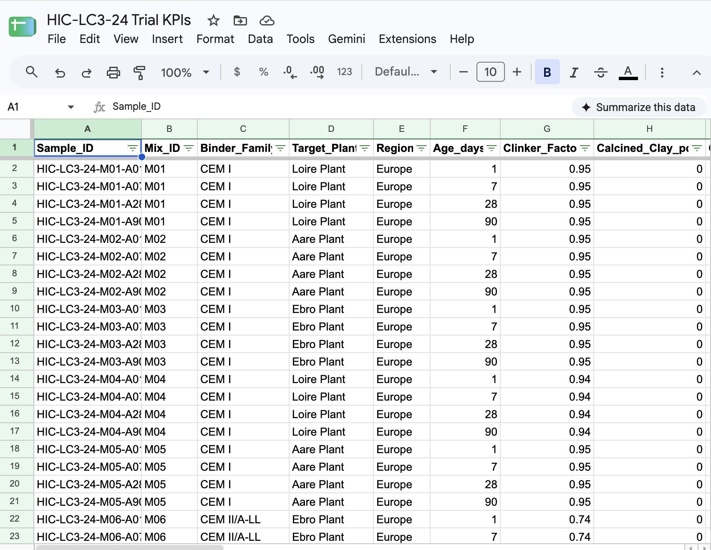
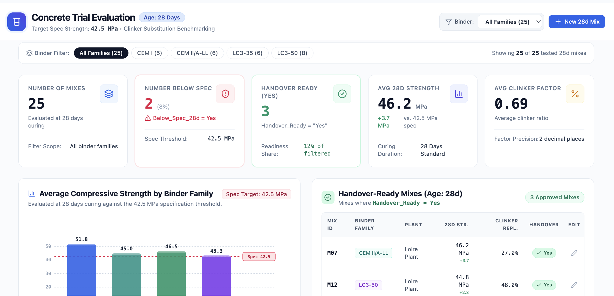

# Analyser les données d’essai du HIC avec Sheets et Gemini

## Temps requis

30 minutes

## Présentation

Dans ce labo, vous utilisez Gemini dans Google Sheets pour mettre en forme, analyser et ajouter des formules à un fichier d’essai synthétique, puis vous en faites un tableau de bord Canvas.

### Vous apprendrez à :
- Importer un CSV et le mettre en forme avec un seul prompt Gemini.
- Poser des questions d’analyse ciblées et vérifier les réponses contre la feuille.
- Faire écrire et expliquer des formules par Gemini, puis les contrôler par échantillon.
- Créer et affiner un tableau de bord Canvas à partir de l’onglet de données.

## Scénario


Le fichier d’essai HIC-LC3-24 a 100 lignes : 25 formules, chacune testée à 1, 7, 28 et 90 jours. L’équipe usine veut voir quelles formules passent la spec de 42.5 MPa à 28 jours et lesquelles sont prêtes pour le transfert.

> [!WARNING]
> Le CSV contient des **données de formation synthétiques**. N’importez pas de vraies données d’essai dans ce labo.

## Instructions du labo

### Tâche 1 : Importer le CSV et mettre la feuille en forme

Dans cette tâche, vous importez le fichier d’essai et vous le mettez en forme pour l’analyse.

1. Ouvrez [https://sheets.new](https://sheets.new) pour créer une feuille de calcul vide. Cliquez sur **Untitled spreadsheet** en haut à gauche et nommez-la :

```text
HIC-LC3-24 Trial KPIs
```


2. Cliquez sur [hic-lc3-24-trial-kpis.csv](https://drive.google.com/file/d/1KDWqWRkoEGnQ50DPJD5Fa-1trIBQB5-M/view) pour l’ouvrir dans Google Drive, puis cliquez sur **Download** (l’icône flèche vers le bas en haut à droite de l’aperçu).

3. Revenez à votre feuille de calcul. Cliquez sur **File**, puis **Import**. Choisissez l’onglet **Upload**, cliquez sur **Browse**, et sélectionnez `hic-lc3-24-trial-kpis.csv` dans votre dossier **Downloads**. Réglez **Import location** sur **Insert new sheet(s)**, puis cliquez sur **Import data**.


4. Double-cliquez sur le nouvel onglet en bas de l’écran et renommez-le :

```text
TrialData
```

5. Vérifiez que l’onglet a **100 lignes de données** sous l’en-tête et **12 colonnes**, de `Sample_ID` en colonne A à `Handover_Ready` en colonne L.

6. Cliquez sur **Ask Gemini** en haut à droite pour ouvrir le panneau latéral Gemini.


7. Envoyez :

```text
Mettez cette feuille en forme pour l'analyse :
- Figez et mettez en gras la ligne d'en-tête
- Ajustez la largeur des colonnes
- Affichez Clinker_Factor avec 2 décimales
- Affichez Compressive_Strength_MPa et Spec_Strength_MPa avec 1 décimale
- Activez les filtres
- Remplissez en vert les cellules Handover_Ready quand la valeur est Yes
N'ajoutez, ne supprimez ni ne réordonnez de lignes.
```

8. Vérifiez le résultat. Si Gemini montre un aperçu ou demande une confirmation, cliquez sur **Approve**.



### Tâche 2 : Analyser une question à la fois

Dans cette tâche, vous posez une question ciblée par prompt et vous vérifiez chaque réponse contre la feuille.

1. Envoyez :

```text
En utilisant uniquement cette feuille, listez les valeurs Mix_ID où Age_days vaut 28 et Compressive_Strength_MPa est inférieur à Spec_Strength_MPa.
```

2. Vérifiez la réponse : **M13** (41.2 MPa) et **M16** (40.4 MPa). Pour vérifier vous-même, filtrez **Age_days** sur 28 et triez par **Compressive_Strength_MPa**.

3. Envoyez une deuxième question :

```text
Pour les lignes où Age_days vaut 28, comparez la moyenne de Compressive_Strength_MPa pour LC3-50 et CEM I. Utilisez uniquement cette feuille.
```

4. Vérifiez la réponse : LC3-50 moyenne environ **43.3 MPa** sur 8 formules, et CEM I moyenne environ **51.8 MPa** sur 5 formules.

5. Envoyez une troisième question :

```text
Quelles valeurs Mix_ID ont Handover_Ready égal à Yes ? Listez chaque Mix_ID une seule fois, avec son Binder_Family et son Target_Plant.
```

6. Vérifiez la réponse : **M07** (CEM II/A-LL), **M12** (LC3-50) et **M21** (LC3-35), tous à Loire Plant.

### Tâche 3 : Ajouter des formules écrites par Gemini

Dans cette tâche, vous faites ajouter deux colonnes de formules par Gemini et en faire expliquer une, puis vous les vérifiez à la main.

1. Envoyez :

```text
Sur l'onglet TrialData, ajoutez deux colonnes de formules, à partir de la colonne M :

En-tête colonne M : Below_Spec_28d
Yes si Age_days vaut 28 et Compressive_Strength_MPa est inférieur à Spec_Strength_MPa, sinon No.

En-tête colonne N : Clinker_Replaced_pct
(1 - Clinker_Factor) * 100, arrondi à 1 décimale.

Mettez de vraies formules Sheets dans les cellules, remplies vers le bas pour chaque ligne de données. Ne changez pas les colonnes A à L.
```

2. Cliquez sur la cellule **M2** et lisez la formule dans la barre de formule. Elle doit ressembler à :

```text
=IF(AND(F2=28,I2<J2),"Yes","No")
```

3. Cliquez sur la cellule **N2**. La formule doit ressembler à :

```text
=ROUND((1-G2)*100,1)
```

4. Demandez à Gemini d’expliquer une formule :

```text
Expliquez la formule de la cellule M2 en langage clair, une étape à la fois.
```

### Tâche 4 : Construire un tableau de bord Canvas

Dans cette tâche, vous transformez l’onglet TrialData en tableau de bord interactif et vous l’affinez avec un prompt de suivi.

1. Cliquez sur l’onglet **TrialData**. Un canvas utilise les données d’un seul onglet.

2. Dans le panneau **Ask Gemini**, cliquez sur le bouton **Tools** dans la zone de prompt et choisissez **Create canvas**. Une coche montre qu’il est sélectionné.


3. Envoyez :

```text
Construisez un tableau de bord d'essai à partir de cet onglet. Utilisez uniquement les lignes où Age_days vaut 28.
Incluez :
- Indicateurs : nombre de formules, nombre sous la spec, et nombre avec Handover_Ready égal à Yes
- Un graphique en barres de la moyenne de Compressive_Strength_MPa par Binder_Family
- Un filtre par Binder_Family
- Un tableau des formules avec Handover_Ready égal à Yes
```

4. Vérifiez les indicateurs contre la tâche 2 : **25** formules, **2** sous la spec, et **3** prêtes pour le transfert.

5. Utilisez le filtre **Binder_Family** pour sélectionner **LC3-50**. Vérifiez que les indicateurs passent à 8 formules, 2 sous la spec, et 1 prête pour le transfert.

6. Affinez le canvas avec un prompt de suivi :

```text
Ajoutez un indicateur pour la moyenne de Clinker_Factor. Ne changez rien d'autre.
```

7. Vérifiez que le nouvel indicateur affiche environ **0.69** pour toutes les formules, et que le reste du canvas n’a pas changé.



> [!NOTE]
> Si **Create canvas** n’est pas dans le menu **Tools**, votre compte n’a pas encore Canvas. Demandez plutôt à Gemini un graphique de la résistance moyenne à 28 jours par Binder_Family.

## Félicitations !

Dans ce labo, vous avez :

- Importé un CSV et l’avez mis en forme avec un seul prompt Gemini.
- Posé des questions d’analyse ciblées et vérifié les réponses contre la feuille.
- Fait écrire et expliquer des formules par Gemini, puis les avez contrôlées par échantillon.
- Créé et affiné un tableau de bord Canvas à partir de l’onglet de données.
