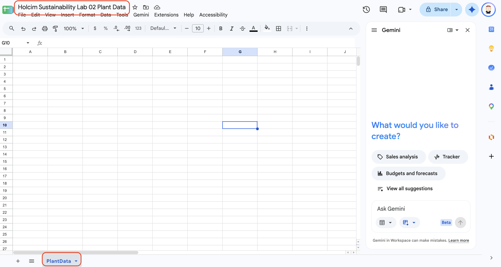
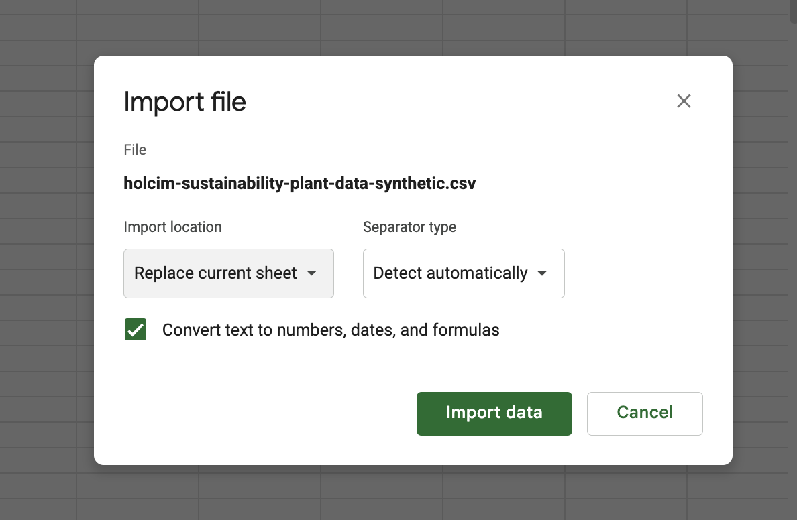
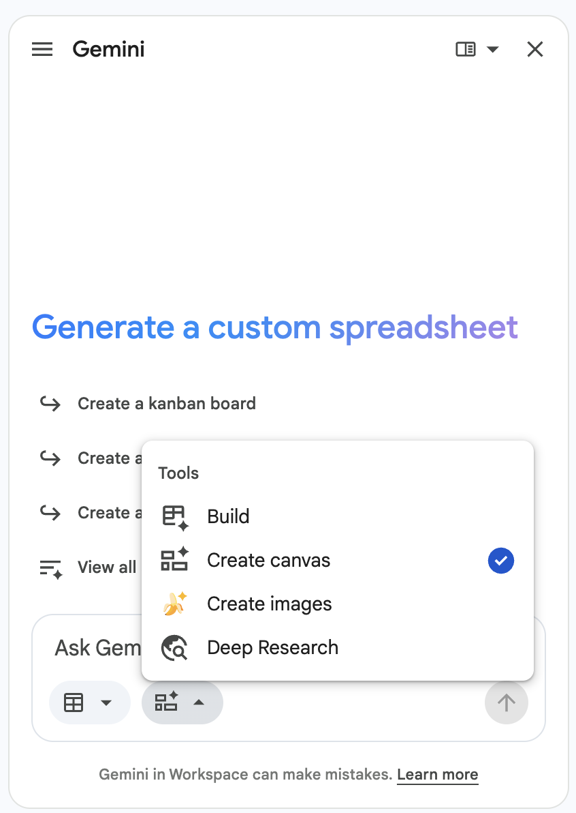

# Analyser les données d’essai du HIC avec Sheets et Gemini

## Durée

30 minutes

## Vue d’ensemble

Dans cet atelier, vous allez utiliser Gemini dans Google Sheets pour mettre en forme et analyser un fichier d’essai synthétique et y ajouter des formules, puis vous en ferez un tableau de bord dans un canvas.

### Vous allez apprendre à :
- Importer un fichier CSV et le mettre en forme avec un seul prompt Gemini.
- Poser des questions d’analyse ciblées et vérifier les réponses dans la feuille.
- Faire écrire et expliquer des formules par Gemini, puis les vérifier sur quelques lignes.
- Créer et affiner un tableau de bord dans un canvas à partir de l’onglet de données.

## Mise en situation


Le fichier d’essai HIC-LC3-24 compte 100 lignes : 25 formules, chacune testée à 1, 7, 28 et 90 jours. L’équipe de l’usine veut savoir quelles formules sont conformes à la spécification de 42,5 MPa à 28 jours et lesquelles sont prêtes pour le transfert.

> [!WARNING]
> Le fichier CSV contient des **données de formation synthétiques**. N’importez aucune donnée d’essai réelle dans cet atelier.

> [!NOTE]
> Les données sont en anglais. Les noms de colonnes (`Mix_ID`, `Age_days`…) et les valeurs (`Yes`, `No`, `Lab screening`, `Scale-up`, `Plant-ready`) restent tels quels dans vos prompts. Les valeurs attendues sont écrites ici au format français (43,3 MPa) ; la feuille les affiche selon ses paramètres régionaux (43.3 avec les paramètres anglais).

## Instructions de l’atelier

### Tâche 1 : Importer le fichier CSV et mettre la feuille en forme

Dans cette tâche, vous importez le fichier d’essai et vous le mettez en forme pour l’analyse.

1. Ouvrez [https://sheets.new](https://sheets.new) pour créer une feuille de calcul vierge. Cliquez sur **Untitled spreadsheet** en haut à gauche et nommez-la :

```text
HIC-LC3-24 Trial KPIs
```



2. Cliquez sur [hic-lc3-24-trial-kpis.csv](https://drive.google.com/file/d/1KDWqWRkoEGnQ50DPJD5Fa-1trIBQB5-M/view) pour l’ouvrir dans Google Drive, puis cliquez sur **Download** (l’icône en forme de flèche vers le bas, en haut à droite de l’aperçu).

3. Revenez à votre feuille de calcul. Cliquez sur **File**, puis sur **Import**. Choisissez l’onglet **Upload**, cliquez sur **Browse**, puis sélectionnez `hic-lc3-24-trial-kpis.csv` dans votre dossier **Downloads**. Réglez **Import location** sur **Insert new sheet(s)**, puis cliquez sur **Import data**.



> [!NOTE]
> **Si les nombres s’importent mal :** le fichier CSV utilise le point décimal (`52.4`). Si votre feuille de calcul utilise les paramètres régionaux français, les valeurs peuvent s’importer comme du texte (alignées à gauche) au lieu de nombres (alignés à droite). Dans ce cas, supprimez l’onglet importé, cliquez sur **File**, puis sur **Settings**, réglez **Locale** sur **United States**, cliquez sur **Save settings**, puis importez de nouveau le fichier. Avec les paramètres régionaux français, les formules utilisent aussi le point-virgule comme séparateur : `=IF(AND(F2=28;I2<J2);"Yes";"No")` au lieu de `=IF(AND(F2=28,I2<J2),"Yes","No")`.

4. Double-cliquez sur le nouvel onglet en bas de l’écran et renommez-le :

```text
TrialData
```

5. Vérifiez que l’onglet compte **100 lignes de données** sous l’en-tête et **12 colonnes**, de `Sample_ID` en colonne A à `Handover_Ready` en colonne L.

6. Cliquez sur **Ask Gemini** en haut à droite pour ouvrir le panneau latéral Gemini.


7. Envoyez :

```text
Mettez cette feuille en forme pour l'analyse :
- Figez la ligne d'en-tête et mettez-la en gras
- Ajustez la largeur des colonnes
- Affichez Clinker_Factor avec 2 décimales
- Affichez Compressive_Strength_MPa et Spec_Strength_MPa avec 1 décimale
- Activez les filtres
- Colorez en vert les cellules Handover_Ready qui valent Yes
N'ajoutez, ne supprimez et ne réordonnez aucune ligne.
```

8. Vérifiez le résultat. Si Gemini affiche un aperçu ou demande une confirmation, cliquez sur **Approve**.


### Tâche 2 : Analyser une question à la fois

Dans cette tâche, vous posez une seule question ciblée par prompt et vous vérifiez chaque réponse dans la feuille.

1. Envoyez :

```text
En utilisant uniquement cette feuille, listez les valeurs de Mix_ID pour lesquelles Age_days vaut 28 et Compressive_Strength_MPa est inférieur à Spec_Strength_MPa.
```

2. Vérifiez la réponse : **M13** (41,2 MPa) et **M16** (40,4 MPa). Pour le vérifier vous-même, filtrez **Age_days** sur 28 et triez par **Compressive_Strength_MPa**.

3. Envoyez une deuxième question :

```text
Pour les lignes où Age_days vaut 28, comparez la moyenne de Compressive_Strength_MPa entre LC3-50 et CEM I. Utilisez uniquement cette feuille.
```

4. Vérifiez la réponse : la moyenne de LC3-50 est d’environ **43,3 MPa** sur 8 formules, et celle de CEM I d’environ **51,8 MPa** sur 5 formules.

5. Envoyez une troisième question :

```text
Quelles valeurs de Mix_ID ont Handover_Ready égal à Yes ? Listez chaque Mix_ID une seule fois, avec son Binder_Family et son Target_Plant.
```

6. Vérifiez la réponse : **M07** (CEM II/A-LL), **M12** (LC3-50) et **M21** (LC3-35), toutes à Loire Plant.

### Tâche 3 : Ajouter des formules écrites par Gemini

Dans cette tâche, vous demandez à Gemini d’ajouter deux colonnes de formules et d’expliquer l’une d’elles, puis vous les vérifiez à la main.

1. Envoyez :

```text
Dans l'onglet TrialData, ajoutez deux colonnes de formules, à partir de la colonne M :

En-tête de la colonne M : Below_Spec_28d
Yes si Age_days vaut 28 et Compressive_Strength_MPa est inférieur à Spec_Strength_MPa, sinon No.

En-tête de la colonne N : Clinker_Replaced_pct
(1 - Clinker_Factor) * 100, arrondi à 1 décimale.

Placez de vraies formules Sheets dans les cellules, recopiées sur toutes les lignes de données. Ne modifiez pas les colonnes A à L.
```

2. Cliquez sur la cellule **M2** et lisez la formule dans la barre de formule. Elle doit ressembler à :

```text
=IF(AND(F2=28,I2<J2),"Yes","No")
```

3. Cliquez sur la cellule **N2**. La formule doit ressembler à :

```text
=ROUND((1-G2)*100,1)
```

> [!TIP]
> Avec les paramètres régionaux français, les mêmes formules s’affichent avec des points-virgules, par exemple `=ROUND((1-G2)*100;1)`. Elles sont équivalentes.

4. Demandez à Gemini d’expliquer une formule :

```text
Expliquez en langage simple la formule de la cellule M2, étape par étape.
```

### Tâche 4 : Créer un tableau de bord dans un canvas

Dans cette tâche, vous transformez l’onglet TrialData en tableau de bord interactif, puis vous l’affinez avec un prompt de suivi.

1. Cliquez sur l’onglet **TrialData**. Un canvas utilise les données d’un seul onglet.

2. Dans le panneau **Ask Gemini**, cliquez sur le bouton **Tools** dans la zone de prompt, puis choisissez **Create canvas**. Une coche indique que l’option est sélectionnée.



3. Envoyez :

```text
Créez un tableau de bord d'essai à partir de cet onglet. Utilisez uniquement les lignes où Age_days vaut 28.
Incluez :
- Des indicateurs : nombre de formules, nombre de formules sous la spécification et nombre de formules avec Handover_Ready égal à Yes
- Un graphique en barres de la moyenne de Compressive_Strength_MPa par Binder_Family
- Un filtre par Binder_Family
- Un tableau des formules avec Handover_Ready égal à Yes
```

> [!NOTE]
> La création de canvas est prévue pour une utilisation en anglais. Si Gemini ne crée pas le canvas à partir du prompt en français, envoyez cette version anglaise :
>
> `Build a trial dashboard from this tab. Use only rows where Age_days is 28. Include: scorecards for number of mixes, number below spec, and number with Handover_Ready set to Yes; a bar chart of average Compressive_Strength_MPa by Binder_Family; a filter by Binder_Family; a table of the mixes with Handover_Ready set to Yes.`

4. Vérifiez les indicateurs par rapport à la tâche 2 : **25** formules, **2** sous la spécification et **3** prêtes pour le transfert.

5. Utilisez le filtre **Binder_Family** pour sélectionner **LC3-50**. Vérifiez que les indicateurs passent à 8 formules, 2 sous la spécification et 1 prête pour le transfert.

6. Affinez le canvas avec un prompt de suivi :

```text
Ajoutez un indicateur pour la moyenne de Clinker_Factor. Ne modifiez rien d'autre.
```

7. Vérifiez que le nouvel indicateur affiche environ **0,69** pour l’ensemble des formules, et que le reste du canvas n’a pas changé.


> [!NOTE]
> Si **Create canvas** n’apparaît pas dans le menu **Tools**, votre compte n’a pas encore accès au canvas. Demandez plutôt à Gemini un graphique de la résistance moyenne à 28 jours par Binder_Family.

## Félicitations !

Dans cet atelier, vous avez :

- Importé un fichier CSV et mis la feuille en forme avec un seul prompt Gemini.
- Posé des questions d’analyse ciblées et vérifié les réponses dans la feuille.
- Fait écrire et expliquer des formules par Gemini, puis vérifié ces formules sur quelques lignes.
- Créé et affiné un tableau de bord dans un canvas à partir de l’onglet de données.
