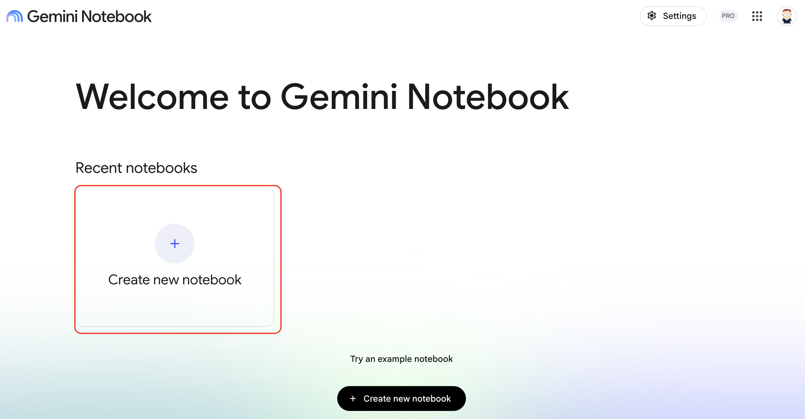
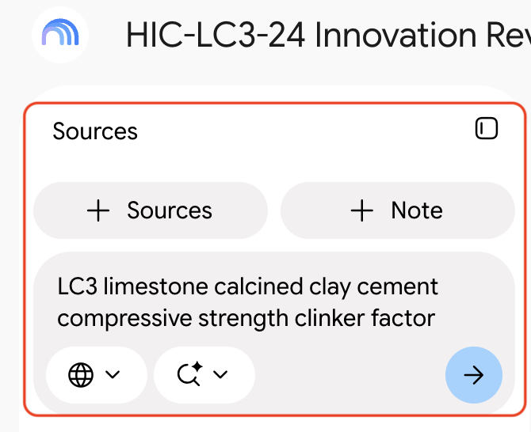
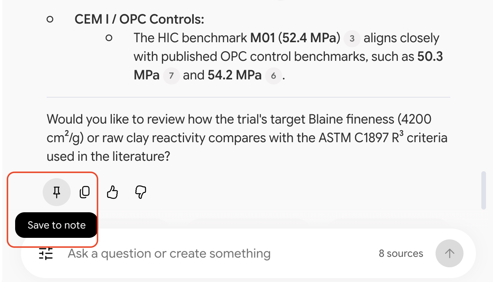

# Note de synthèse sur l’essai de liant avec Gemini Notebook

## Durée

30 minutes

## Vue d’ensemble

Dans cet atelier, vous allez créer un Gemini Notebook (NotebookLM) pour la revue d’innovation de HIC-LC3-24, poser des questions avec réponses citées et générer un dossier de revue dans Studio.

### Vous allez apprendre à :
- Créer un notebook et y ajouter des sources du HIC.
- Ajouter de la littérature publiée grâce à une recherche web.
- Poser des questions avec réponses citées et enregistrer la meilleure réponse comme source.
- Générer un rapport (Report), une infographie (Infographic) et une présentation (Slide Deck) dans Studio.

## Mise en situation


Le comité de revue se réunit jeudi. Vous disposez d’une note d’essai et d’une note de transfert à l’usine, et le comité veut savoir comment vos résultats se situent par rapport à la littérature publiée.

> [!WARNING]
> Les fichiers du HIC de cet atelier sont des **contenus de formation synthétiques**. N’ajoutez aucun véritable rapport d’essai.

> [!NOTE]
> La note d’essai est `hic-lc3-24-trial-brief-fr.pdf` et la note de transfert est `hic-loire-plant-handover-note-fr.pdf`. Les sources web seront en anglais : c’est pourquoi les prompts ci-dessous demandent des réponses en français.

## Instructions de l’atelier

### Tâche 1 : Créer un notebook et ajouter les sources du HIC

Dans cette tâche, vous créez le notebook et vous y ajoutez les deux fichiers du HIC.

1. Ouvrez [https://notebooklm.google.com/](https://notebooklm.google.com/) et cliquez sur **Create new notebook**.



2. Renommez le notebook :

```text
HIC-LC3-24 Innovation Review
```

3. Téléchargez les deux sources du HIC. Cliquez sur chaque lien pour l’ouvrir dans Google Drive, puis cliquez sur **Download** (l’icône en forme de flèche vers le bas, en haut à droite de l’aperçu).

   - [hic-lc3-24-trial-brief-fr.pdf](https://drive.google.com/file/d/1TBxS9Y6O6PFYRstEOFTMUefZCJZsVQkH/view)
   - [hic-loire-plant-handover-note-fr.pdf](https://drive.google.com/file/d/1GmrbBXQybIpvAEQCHaaZqMFQPkimK_aP/view)

4. Dans votre notebook, cliquez sur **Add sources**, puis sur **Upload files**, et sélectionnez les deux PDF dans votre dossier **Downloads**.

5. Attendez que les deux fichiers apparaissent comme prêts dans le panneau **Sources**.

### Tâche 2 : Ajouter de la littérature publiée grâce à une recherche web

Dans cette tâche, vous ajoutez des travaux publiés pour les comparer aux résultats du HIC.

1. Dans **Search the web for new sources**, saisissez :

```text
LC3 limestone calcined clay cement compressive strength clinker factor
```

> [!NOTE]
> La requête est volontairement en anglais : l’essentiel de la littérature sur le LC3 est publié en anglais.

<!-- TODO IMAGE: Screenshot of Search the web for LC3 literature -->


2. Examinez les résultats et importez les sources avec **Import**. Vous pouvez sélectionner ou désélectionner des sources si vous le souhaitez.

3. Certaines sources web ne peuvent pas être téléchargées en raison de restrictions de l’éditeur. Si une importation échoue, cliquez sur le menu d’actions à côté du nom de la source et supprimez-la.

### Tâche 3 : Poser des questions avec réponses citées

Dans cette tâche, vous posez les questions que posera le comité, et vous conservez la meilleure réponse.

1. Dans le chat, envoyez :

```text
Quelles formules de HIC-LC3-24 sont conformes à la spécification à 28 jours, et lesquelles ne le sont pas ? Donnez la résistance et le facteur de clinker de chacune, et citez le fichier source. Répondez en français.
```

2. Vérifiez la réponse : M12 (44,8 MPa) et M21 (47,1 MPa) sont conformes, M13 (41,2 MPa) ne l’est pas, et M01 est le témoin CEM I (52,4 MPa). Cliquez sur un numéro de citation pour afficher le passage d’origine.

3. Envoyez :

```text
Comment nos résultats LC3 à 28 jours se situent-ils par rapport à la littérature publiée ? Séparez les résultats du HIC des chiffres de la littérature, et citez les deux. Répondez en français.
```

4. Cliquez sur **Save to note** sous la réponse de comparaison.

<!-- TODO IMAGE: Screenshot of a cited chat answer with the Save to note button -->


5. La comparaison est désormais une source que Studio peut utiliser.

### Tâche 4 : Générer le dossier de revue dans Studio

Dans cette tâche, vous générez trois livrables à partir de toutes vos sources. Chacun prend quelques minutes : lancez le suivant pendant que le précédent est en cours.

> [!TIP]
> Studio génère ses livrables dans la langue de sortie du notebook. Si les résultats arrivent en anglais, ouvrez **Settings**, choisissez **Output language**, puis sélectionnez le français.

1. Dans **Studio**, cliquez sur **Report** et choisissez **Document**, puis **Briefing doc**.

2. La génération prend un court moment. Une fois le document prêt, cliquez sur son icône et relisez-le.

3. Cliquez sur l’icône **Infographic**. Saisissez cette description, puis cliquez sur **Generate** :

```text
Synthèse d'une page de HIC-LC3-24 pour le comité de revue, en français : la spécification à 28 jours, les formules conformes, les points ouverts avec l'usine et la décision attendue. Indiquez que tout chiffre issu de la littérature provient de travaux publiés et n'est pas un résultat du HIC.
```

   Voici un exemple d’infographie déjà générée. La vôtre sera un peu différente. Affinez le prompt et relancez la génération si vous le souhaitez.

   

4. Cliquez sur l’icône **Slide Deck**, puis sélectionnez **Presenter slides**. Saisissez cette description, puis cliquez sur **Generate** :

```text
Une présentation de cinq diapositives sur HIC-LC3-24 pour le comité de revue, en français : pourquoi cet essai, les résultats à 28 jours, leur comparaison avec la littérature, les points ouverts avec l'usine et la décision attendue.
```

5. Ouvrez le Slide Deck lorsqu’il est prêt. Vérifiez que chaque résistance du HIC correspond à la note d’essai et que les chiffres de la littérature ne sont pas présentés comme des résultats du HIC.

   [Exemple de Slide Deck](https://drive.google.com/file/d/1gqC9CqYBLddXXTV5kIlljo5z8960J4ca/view?usp=drive_link)

## Félicitations !

Dans cet atelier, vous avez :

- Créé un notebook et ajouté des sources du HIC.
- Ajouté de la littérature publiée grâce à une recherche web.
- Posé des questions avec réponses citées et enregistré la meilleure réponse comme source.
- Généré un rapport, une infographie et une présentation dans Studio.


