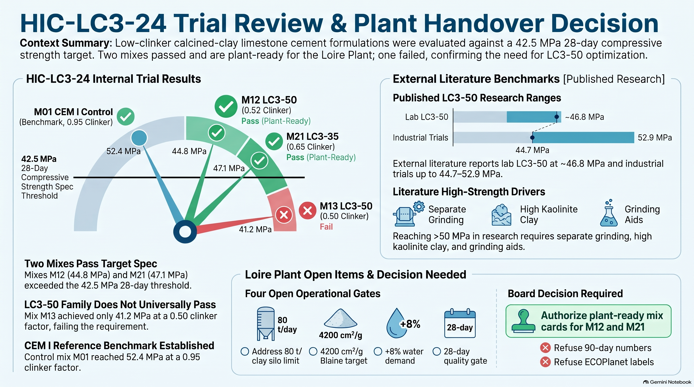

# Note de synthèse sur l’essai de liant avec Gemini Notebook

## Temps requis

30 minutes

## Présentation

Dans ce labo, vous construisez un Gemini Notebook (NotebookLM) pour la revue d’innovation HIC-LC3-24, vous posez des questions citées, et vous générez un dossier de revue dans Studio.

### Vous apprendrez à :
- Créer un notebook et ajouter des sources HIC.
- Ajouter de la littérature publique avec une recherche web.
- Poser des questions citées et enregistrer la meilleure réponse comme source.
- Générer un Report, une Infographic et un Slide Deck dans Studio.

## Scénario


Le comité de revue se réunit jeudi. Vous avez une note d’essai et une note de transfert usine, et le comité veut savoir comment vos résultats se comparent à la littérature publiée.

> [!WARNING]
> Les fichiers HIC de ce labo sont un **contenu de formation synthétique**. N’ajoutez pas un vrai rapport d’essai.

## Instructions du labo

### Tâche 1 : Créer un notebook et ajouter des sources HIC

Dans cette tâche, vous créez le notebook et vous ajoutez les deux fichiers HIC.

1. Ouvrez [https://notebooklm.google.com/](https://notebooklm.google.com/) et cliquez sur **Create new notebook**.


2. Renommez le notebook :

```text
HIC-LC3-24 Innovation Review
```

3. Téléchargez les deux sources HIC. Cliquez sur chaque lien pour l’ouvrir dans Google Drive, puis cliquez sur **Download** (l’icône flèche vers le bas en haut à droite de l’aperçu).

   - [hic-lc3-24-trial-brief.pdf](https://drive.google.com/file/d/1nDdt_QtYdP64pK689VAjSOwZwZLsyv2-/view)
   - [hic-loire-plant-handover-note.pdf](https://drive.google.com/file/d/1vA6CGOMrW6RB_KIcddDI0DX7eQSBdAjL/view)

4. Dans votre notebook, cliquez sur **Add sources**, puis **Upload files**, et sélectionnez les deux PDF dans votre dossier **Downloads**.

5. Attendez que les deux fichiers s’affichent comme prêts dans le panneau **Sources**.

### Tâche 2 : Ajouter de la littérature publique avec une recherche web

Dans cette tâche, vous ajoutez de la recherche publiée pour la comparer aux résultats du HIC.

1. Dans **Search the web for new sources**, saisissez :

```text
LC3 limestone calcined clay cement compressive strength clinker factor
```

<!-- TODO IMAGE: Screenshot of Search the web for LC3 literature -->


2. Relisez les résultats et **Import** les sources. Note : vous pouvez sélectionner ou désélectionner des sources si vous le souhaitez.

3. Certaines sources web ne peuvent pas être téléchargées et ajoutées à cause de restrictions du fournisseur. Si une importation échoue, cliquez sur le menu d’actions à côté de son nom et retirez-la.

### Tâche 3 : Poser des questions citées

Dans cette tâche, vous posez les questions que le comité posera, et vous gardez la meilleure réponse.

1. Dans le chat, envoyez :

```text
Quelles formules HIC-LC3-24 passent la spec à 28 jours, et lesquelles ne la passent pas ? Donnez la résistance et le facteur de clinker de chacune, et citez le fichier source.
```

2. Vérifiez la réponse : M12 (44.8 MPa) et M21 (47.1 MPa) réussissent, M13 (41.2 MPa) échoue, et M01 est le témoin CEM I (52.4 MPa). Cliquez sur un numéro de citation pour voir le passage d’origine.

3. Envoyez :

```text
Comment nos résultats LC3 à 28 jours se comparent-ils à la littérature publiée ? Gardez les résultats HIC et les chiffres de la littérature séparés, et citez les deux.
```

4. Cliquez sur **Save to note** sous la réponse de comparaison.

<!-- TODO IMAGE: Screenshot of a cited chat answer with the Save to note button -->


5. La comparaison est maintenant une source que Studio peut utiliser.

### Tâche 4 : Générer le dossier de revue dans Studio

Dans cette tâche, vous générez trois sorties à partir de toutes vos sources. Chacune prend quelques minutes, donc lancez la suivante pendant que la précédente tourne.

1. Dans **Studio**, cliquez sur **Report** et choisissez **Document**, puis **Briefing doc**.

2. La génération prend un court moment. Cliquez sur son icône quand c’est fini et relisez-la.

3. Cliquez sur l’icône **Infographic**. Saisissez cette description, et cliquez sur **Generate** :

```text
Synthèse d'une page de HIC-LC3-24 pour le comité de revue : la spec à 28 jours, quelles formules réussissent, les points usine ouverts, et la décision demandée. Marquez tout chiffre de la littérature comme recherche publiée, pas comme un résultat HIC.
```

   Voici une infographie exemple déjà créée. La vôtre sera un peu différente. Affinez le prompt et réessayez si vous voulez.

   

4. Cliquez sur l’icône **Slide Deck**, et sélectionnez **Presenter slides**. Saisissez cette description, et cliquez sur **Generate** :

```text
Une note de cinq diapositives sur HIC-LC3-24 pour le comité de revue : pourquoi l'essai existe, les résultats à 28 jours, comment ils se comparent à la littérature, les points usine ouverts, et la décision demandée.
```

5. Ouvrez le Slide Deck quand il est prêt. Vérifiez que chaque résistance HIC correspond à la note d’essai, et que les chiffres de la littérature ne sont pas présentés comme des résultats HIC.

   [Lien vers un exemple de Slide Deck](https://drive.google.com/file/d/1gqC9CqYBLddXXTV5kIlljo5z8960J4ca/view?usp=drive_link)

## Félicitations !

Dans ce labo, vous avez :

- Créé un notebook et ajouté des sources HIC.
- Ajouté de la littérature publique avec une recherche web.
- Posé des questions citées et enregistré la meilleure réponse comme source.
- Généré un Report, une Infographic et un Slide Deck dans Studio.


