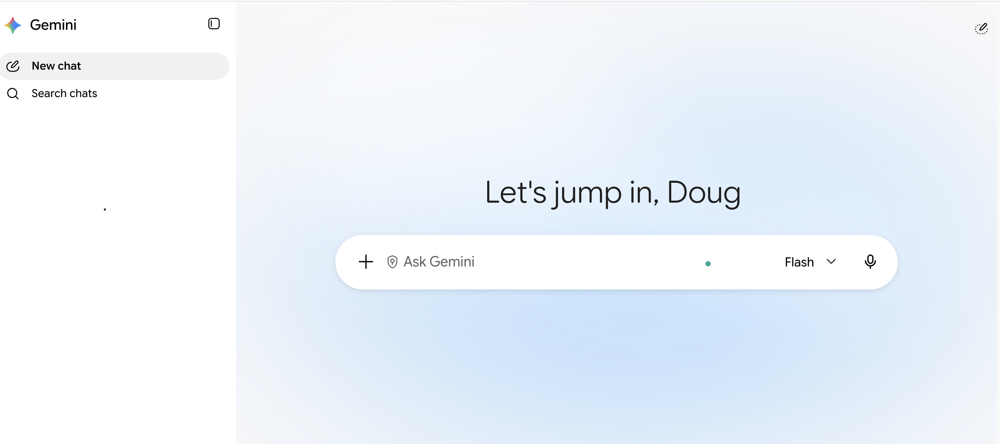
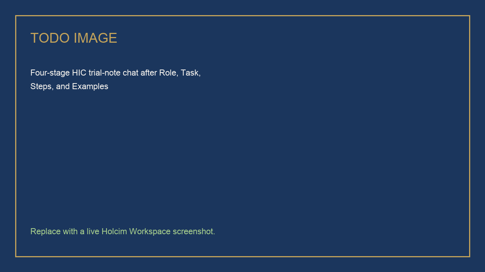
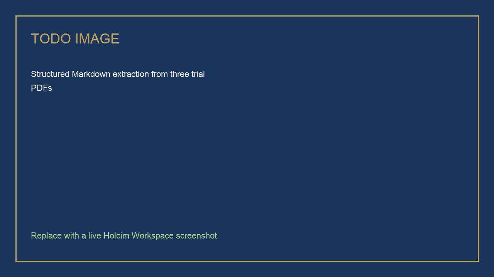
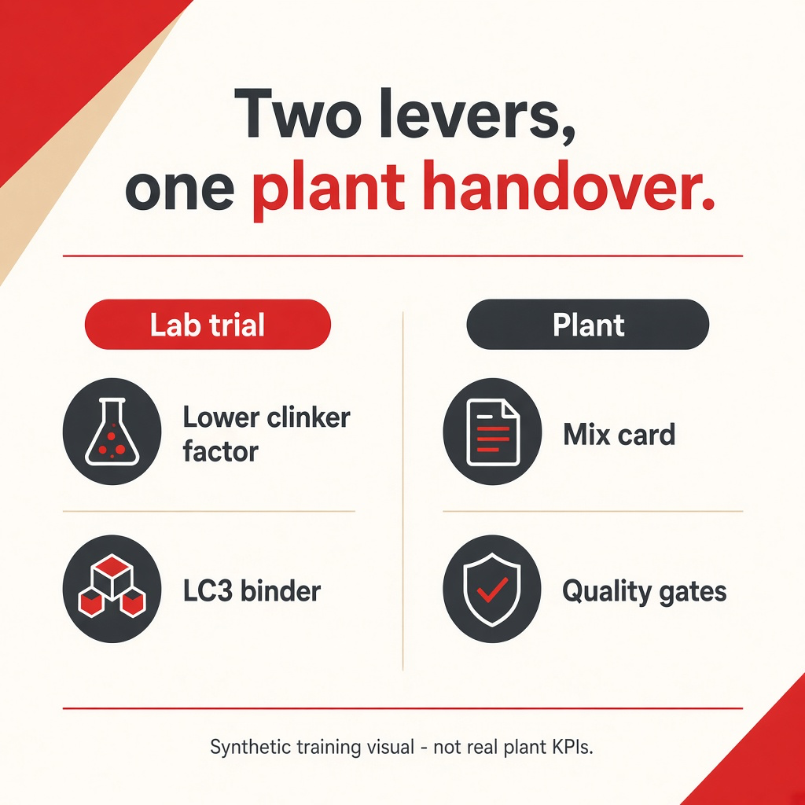
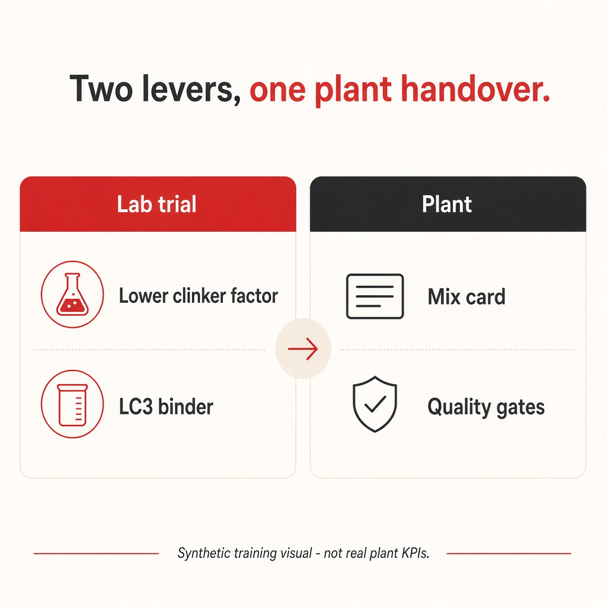
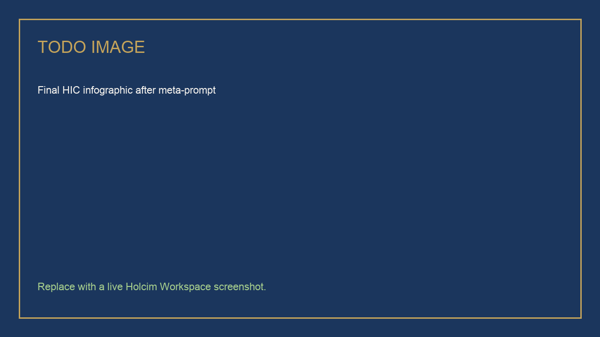

# Advanced Prompt Engineering for HIC Trial Notes

## Time Required

30 minutes

## Overview

In this lab, you will build an advanced Gemini prompt for a plant-facing Holcim Innovation Centre (HIC) trial note, extract structured facts from synthetic trial PDFs, create a trial infographic with image tools, then run a critique loop and rewrite the same note for three audiences without inventing results.

### You learn how to:
- Build a Role-Task-Steps-Examples prompt for an HIC plant-facing trial note.
- Extract structured Markdown from multiple trial PDFs without inventing missing fields.
- Improve Gemini image prompts with the Holcim logo, style constraints, and meta-prompting.
- Critique a draft against sources, then rewrite it for a scientist, a plant, and an executive reader.

## Scenario


You sit at the Holcim Innovation Centre. Trial **HIC-LC3-24** is a low-clinker calcined-clay (LC3-style) binder moving toward plant handover at the synthetic **Loire Plant**. Tomorrow you owe a plant-facing note. The protocol, interim results, and limitations live as PDFs. Gemini can draft the note if you specify the job, the files, and the rule that unpublished or missing numbers stay out.

> [!WARNING]
> Every PDF and figure in this lab is **synthetic training content**. Do not treat mix IDs, strengths, or plant names as real HIC results. Do not attach live trial data during class.

## Lab Instructions

### Task 1: Build a plant-facing trial note with Role, Task, Steps, and Examples

In this task, you write the trial note in four prompt upgrades in a single Gemini chat. Each turn adds structure. You do not start over.

1. Open [https://gemini.google.com/](https://gemini.google.com/) and sign in with your class account.



2. Start a **new chat**. Send this vague request:

```text
Write a note about our LC3 trial.
```

3. Read the answer. It will be generic, and it may invent strengths, dates, or commercial claims. Stay in the **same chat** and add a **Role** and a **Task**:

```text
You are a Holcim Innovation Centre scientist writing for the Loire Plant quality and production team.

Task: Draft a plant-facing trial note for HIC-LC3-24, a low-clinker calcined-clay binder trial moving toward plant handover.
Do not invent compressive strengths, clinker factors, dates, or commercial brand claims.
If a number is missing, write Not found.
```

4. Add **Steps** and an **output shape**. Send:

```text
Follow these steps:
1. State the purpose of HIC-LC3-24 in two sentences.
2. List what the plant needs before handover (silos, fineness, quality gates).
3. Separate methods from results. Do not mix them in one paragraph.
4. End with open questions the plant must answer.

Return ONLY valid Markdown with these headings:
## Purpose
## What the plant needs
## Methods versus results
## Open questions
## Claims I refused to invent
```

5. Add a short **example** of the tone you want. Send:

```text
Match this tone and density. Do not copy the fake numbers from the example.

Example:
## Purpose
HIC-LC3-24 tests whether an LC3-style binder can meet a 42.5 MPa 28-day class at a lower clinker factor than CEM I, with a plant-ready mix card as the handover artifact.

Keep sentences short. Prefer tables over adjectives. Never write "promising" without a source number.
```

<!-- TODO IMAGE: Screenshot of the four-stage trial-note chat after the example upgrade -->


> [!TIP]
> If Gemini still writes a brochure, reply: `Rewrite using only the headings I specified. Delete marketing adjectives. Do not add numbers.`

### Task 2: Extract structured facts from three trial PDFs

In this task, you ground Gemini in the protocol, the interim results, and the limitations file, then force a schema so missing fields stay `Not found`.

1. Open the class Drive folder your instructor shared. Confirm these three synthetic PDFs:

| File | What it owns |
| :--- | :--- |
| `hic-lc3-24-trial-protocol.pdf` | Methods, ages, spec. No extra result rows. |
| `hic-lc3-24-interim-results.pdf` | Selected mix results. Numbers live here. |
| `hic-lc3-24-limitations.pdf` | Caveats, water demand, plant constraints. |

> [!NOTE]
> Local copies are in this lab’s `assets/` folder if you need to upload from your computer. Prefer **Add from Drive** when the class folder is available.

2. Start a **new chat**. Click **+**, choose **Add from Drive**, and attach all three PDFs.

3. Send a weak first ask:

```text
Look at these files and tell me what you think.
```

4. Upgrade the same chat with a **schema**. Send:

```text
You are a Holcim Innovation Centre lab lead preparing a handover pack.

Task: Read the three attached PDFs and return ONLY valid Markdown. No preamble.

For each mix that appears in the interim results file, output:

## Mix: <Mix ID>
- **Binder family:**
- **Clinker factor:**
- **Age (days):**
- **Compressive strength (MPa):**
- **Spec strength (MPa):**
- **Pass or fail versus spec:**
- **Limitation that applies:**
- **Source file for the number:**

Rules:
- Strengths and clinker factors may come only from hic-lc3-24-interim-results.pdf.
- Methods and the spec may come only from hic-lc3-24-trial-protocol.pdf.
- Limitations may come only from hic-lc3-24-limitations.pdf.
- If a field is not in the files, write Not found. Do not average, do not guess, do not use typical LC3 values from training data.
```

5. If Gemini summarizes instead of using your schema, reply:

```text
Reformat using the exact Markdown schema. Do not add extra sections. Do not invent mixes that are not in the results PDF.
```

<!-- TODO IMAGE: Screenshot of structured Markdown extraction from the three trial PDFs -->


### Task 3: Create an HIC plant-handover infographic with Gemini image tools

In this task, you use Gemini’s image generation to create an HIC poster. You start simple, then add the Holcim logo, approved content, style direction, and a meta-prompt.

1. In Gemini, start a **new chat**. Then select the **create image** tool from the tools menu.

2. Send a **simple** image request:

```text
Create an infographic about a Holcim Innovation Centre LC3 trial.
```

> [!NOTE]
> It will create something, and it might look good. It will likely invent statistics and extra logos. That is the point of this step.

3. Create a new chat, and select the create image tool again.

4. Copy the Holcim logo below to the clipboard, and paste it in the prompt box.


5. Send a stronger prompt that references the logo and locks the content:

```text
Create a vertical promotional infographic image for the Holcim Innovation Centre.

Brand:
- Place the attached Holcim logo clearly near the top
- Keep logo proportions intact; do not distort or recolor the logo mark incorrectly

Content to include as readable text on the infographic:
- Title: Two levers, one plant handover
- Left column header: Lab trial
- Left column lines: Lower clinker factor; LC3 binder
- Right column header: Plant
- Right column lines: Mix card; Quality gates
- Footer: Synthetic training visual - not real plant KPIs

Visual direction:
- Clean corporate design suitable for a global building materials company
- Plenty of whitespace; avoid clutter
- Suggest a materials laboratory, not an unsafe worksite
- No invented percentages, fake charts, fake QR codes, or extra logos
```



6. Add **style details** in a follow-up to refine (or regenerate) the infographic:

```text
Regenerate the infographic with these style constraints:
- Color palette: Holcim red, charcoal gray, white, and warm sand accents (not neon)
- Typography: bold modern sans-serif for the title; simple sans-serif for body text
- Layout: logo top, title under logo, two equal columns for Lab trial and Plant, footer at bottom
- Aspect: portrait infographic (roughly A4 / letter proportions)
- Keep all infographic text exactly as specified; prioritize correct spelling of Holcim, LC3, and Loire
```

<!-- TODO IMAGE: Screenshot of the styled second infographic attempt -->


7. Practice **meta-prompting for image generation**. Ask Gemini to improve the prompt before making the next image:

```text
You are an expert prompt engineer for image generation.

Meta-task:
1. Critique my previous infographic prompt for ambiguity, missing art direction, and text-rendering risks.
2. Write an improved single image prompt (under 180 words) that is more specific about composition, lighting, layout language, and negative constraints.
```

8. Copy the improved prompt to the clipboard, create a new chat, reselect the create image tool, paste the Holcim logo again, and run the improved prompt.

<!-- TODO IMAGE: Screenshot of the final HIC infographic after meta-prompt -->


> [!TIP]
> If text on the image is misspelled, ask Gemini to regenerate with: `Keep all infographic text exactly as specified; prioritize correct spelling of Holcim, LC3, and plant handover.`

### Task 4: Critique the note, then rewrite it for three audiences

In this task, you take the trial note from Task 1, stress-test it against the PDFs, then produce three rewrites that share facts and change only voice.

1. Return to the **Task 1 chat** (or start a new chat and attach the three PDFs plus your trial note). Send:

```text
Critique the plant-facing trial note against the three attached PDFs.

List:
1. Every number in the note that does not appear in the PDFs.
2. Every claim that sounds like a commercial ECOPlanet or ECOPact promise.
3. Every place methods and results were mixed.

Do not fix the note yet. Only list problems.
```

2. After you read the critique, send the audience rewrite:

```text
Now produce three rewrites of the same note. Use only facts that survived the critique. Do not add numbers.

### Scientist
Density: methods, ages, spec, limitations. Audience: HIC lab colleagues.

### Plant
Density: silos, fineness, quality gates, what must be true on day one. Audience: Loire Plant production and quality.

### Executive
Density: six lines maximum. What we are asking the innovation review to decide. No methods appendix.

Rules:
- All three versions must agree on every number.
- If a number was flagged as invented, replace it with Not found or omit it.
- Label each version with the headings above.
```

3. Skim the three versions. Confirm the executive version did not smuggle in a new megapascal value.

> [!WARNING]
> If any rewrite introduces a strength, clinker factor, or date that is not in `hic-lc3-24-interim-results.pdf` or the protocol spec, reject that sentence. Gemini is not a second laboratory.

### Bonus Task 5: Save a reusable HIC prompt template

1. In a **new chat**, ask Gemini:

```text
Turn the Role-Task-Steps-Examples pattern we used for the HIC-LC3-24 plant-facing note into a reusable blank template for Holcim Innovation Centre prompts about binder trials or plant handover. Leave placeholders in ALL CAPS.
```

2. Save the template somewhere you can reuse after class.

## Congratulations!

In this lab, you have:

- Built an HIC plant-facing trial note prompt step by step with role, task, steps, and examples.
- Extracted structured Markdown from three synthetic trial PDFs without inventing missing fields.
- Improved Gemini image prompts with the Holcim logo, style detail, and meta-prompting.
- Critiqued a draft against sources and rewritten it for a scientist, a plant, and an executive reader.


