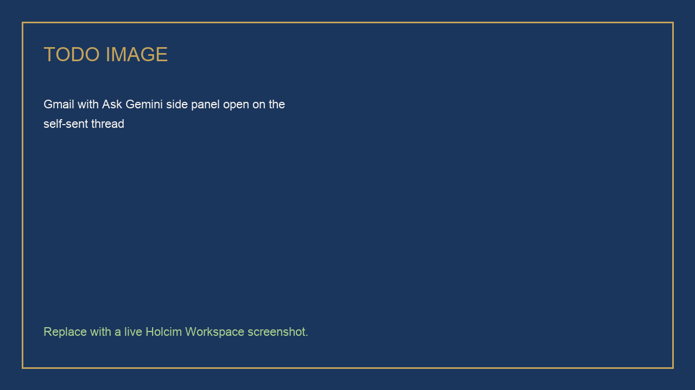
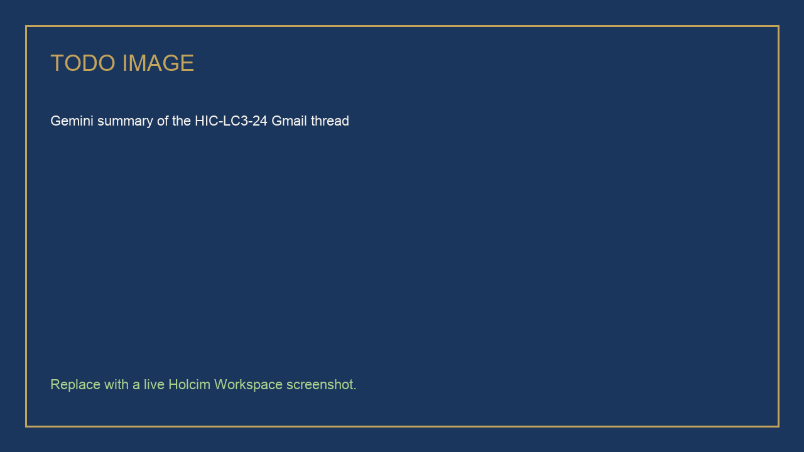
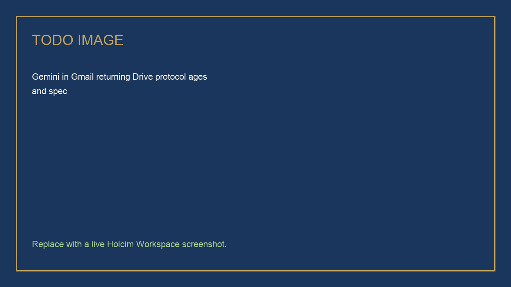
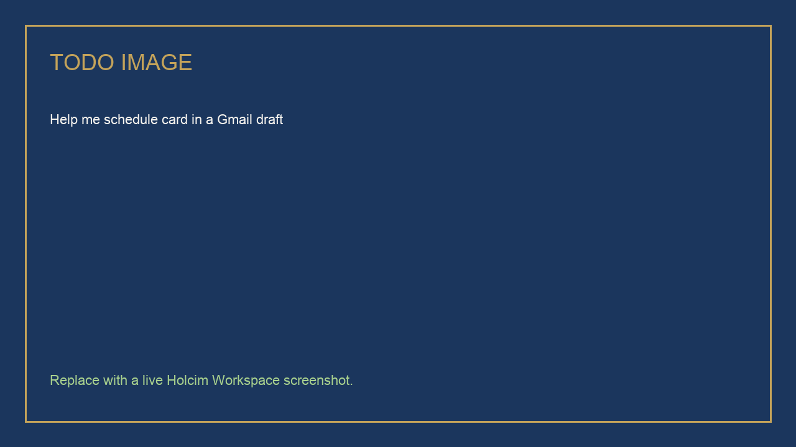
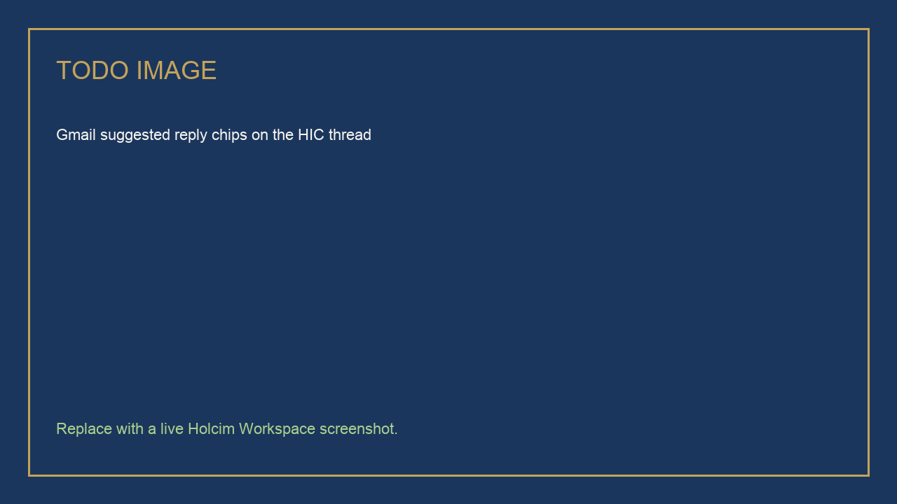

# Gemini in Gmail for HIC Collaboration

## Time Required

30 minutes

## Overview

In this lab, you will use Gemini inside Gmail on a plant-handover thread you send to yourself. You summarize the thread from the side panel, search Gmail, Chat, and Drive for the HIC-LC3-24 protocol, propose a working session with Help me schedule, then use a suggested reply and a fuller draft before you send.

### You learn how to:
- Open Ask Gemini in Gmail and summarize a thread without leaving the inbox.
- Search across Gmail, Chat, and Drive from the Gmail side panel, with a Drive fallback.
- Propose meeting times with Help me schedule, or draft a calendar-ready proposal if the button is missing.
- Use a suggested reply, then write a fuller draft and review it before sending.

## Scenario


You are coordinating the **HIC-LC3-24** handover to the synthetic Loire Plant. The protocol sits in the class Drive folder. Nobody has a meeting on the calendar yet. You will create the email thread yourself so every learner has the same inbox starting point.

> [!WARNING]
> Do not send unpublished real trial data, partner names, or mix cards. Use the canned body in this lab. Suggested replies can be wrong on technical content. You still click **Send**.

> [!NOTE]
> Gmail Gemini labels move. If a control name below does not match your tenant, use the fallback in that step. Do not stall the lab hunting for an identical screenshot.

## Lab Instructions

### Task 1: Send yourself the handover thread and summarize it

In this task, you create the thread Gemini will summarize. You send the canned message to your own address so the lab does not depend on a pre-seeded mailbox.

1. Open [https://mail.google.com/](https://mail.google.com/) and sign in with your class account.

2. Click **Compose**.

3. In **To**, enter your own email address.

4. In **Subject**, paste:

```text
HIC-LC3-24: plant handover working session
```

5. In the message body, paste:

```text
Team,

Please find the latest HIC-LC3-24 status for the Loire Plant handover.

We need a 45-minute working session next week to agree:
1. Which mixes stay in the plant-ready set
2. Silo allocation for calcined clay
3. What the innovation review board will see on Thursday

The trial protocol is in the shared Drive folder: hic-lc3-24-trial-protocol.pdf.

Please reply with your constraints.

Thanks,
HIC binder trial team
```

6. Click **Send**. Open the message in your inbox so it is the active thread.

7. At the top right of Gmail, click **Ask Gemini**.

<!-- TODO IMAGE: Screenshot of Gmail with Ask Gemini side panel open on the self-sent thread -->


8. In the Gemini panel, send:

```text
Summarize this thread in five bullets. List the decisions we still need, and quote the Drive file name mentioned in the email. Do not add trial results that are not in the message.
```

<!-- TODO IMAGE: Screenshot of the Gemini summary of the self-sent HIC-LC3-24 thread -->


> [!TIP]
> If Ask Gemini is missing, confirm Gemini is enabled for Gmail in your Workspace account, or use the Gemini app with the thread forwarded to yourself as a last resort.

### Task 2: Search Gmail, Chat, and Drive from the side panel

In this task, you stay in Gmail and ask Gemini to find the protocol and related HIC files. Chat may be empty in class. Drive is the reliable source.

1. Keep the Gemini panel open. Send:

```text
Search Gmail, Chat, and Drive for HIC-LC3-24. I need the trial protocol, any meeting notes, and the glossary. Quote the file names you find. If Chat has no results, say so and continue with Drive.
```

2. Review what Gemini returns.

3. If Drive results are thin, click **Add source** (or the Drive control in the Gemini panel) and attach `hic-lc3-24-trial-protocol.pdf` from the class Drive folder.

4. Send a follow-up that uses the file:

```text
Using the HIC-LC3-24 trial protocol, list the test ages and the 28-day spec strength. If a value is not in the protocol, write Not found. Do not use typical LC3 values from outside this file.
```

<!-- TODO IMAGE: Screenshot of Gemini in Gmail returning Drive protocol ages and spec -->


> [!NOTE]
> **Fallback if Chat is empty:** that is expected in a training tenant. Complete the search using Drive from this same Gmail panel. Do not switch to a different product unless Gemini in Gmail is unavailable.

> [!NOTE]
> Files you should be able to find in the class Drive folder: `hic-lc3-24-trial-protocol.pdf`, `hic-lc3-24-meeting-note.pdf`, `hic-trial-glossary.pdf`, `hic-lc3-24-handover-checklist.pdf`. Local copies are in this lab’s `assets/` folder.

### Task 3: Help me schedule a plant-handover working session

In this task, you propose times from Gmail using Calendar. The meeting is a 45-minute HIC working session, not a hold you invent without looking at availability.

1. In the same thread, click **Reply**.

2. In **To**, add at least one other person you may invite in class (your instructor or a classmate). Leave yourself on the thread.

3. At the bottom of the compose window, click **Help me schedule**.

   If you do not see **Help me schedule**, click **More options**, then **Help me schedule**.

4. Review the proposed time slots. Adjust duration to **45 minutes** if Gemini offered a different length.

5. Do **not** send yet. You will send a fuller reply in Task 4.

<!-- TODO IMAGE: Screenshot of Help me schedule card in a Gmail draft -->


> [!NOTE]
> **Fallback if Help me schedule is missing:** in the Gemini side panel, send the prompt below, then paste the proposal into a Calendar invite yourself.

```text
Draft a calendar-ready proposal for a 45-minute HIC-LC3-24 plant-handover working session next week.
Include a subject line, four candidate slots in my working hours, a short agenda (plant-ready mixes, clay silo allocation, innovation review board), and a note that invitees should pick one slot.
Do not invent trial results.
```

6. Optional: in the Gemini panel you can also ask:

```text
Find 45-minute open slots on my primary calendar next week for a plant-handover working session.
```

> [!WARNING]
> Gemini in Gmail can only create or read events on your **primary** calendar. Check the draft times before anyone accepts.

### Task 4: Use a suggested reply, then draft a fuller response

In this task, you compare a one-click suggested reply with a real handover response, then send only the version you have read.

1. Close the compose window if you need to see the thread, or stay in Reply.

2. Look for **suggested replies** (short chips such as “Sounds good” or “I can meet”) above or below the thread.

3. Click a suggested reply so you see what Gemini auto-detected. Read it. It will not be enough for a plant handover.

<!-- TODO IMAGE: Screenshot of Gmail suggested reply chips on the HIC thread -->


> [!NOTE]
> **Fallback if no chips appear:** skip to Help me write. Suggested replies depend on the message and the tenant. Their absence is not a failed lab.

4. In the reply box, click **Help me write** (or ask Gemini in the side panel: “Draft a reply”). Paste:

```text
Draft a reply to this HIC-LC3-24 thread.
Tone: concise, plant-facing, no marketing.
Include:
- Acknowledgement of the three agenda items
- The 45-minute working session proposal (use the Help me schedule times if they are in the draft)
- A request that people open hic-lc3-24-trial-protocol.pdf before the meeting
- A sentence that we will not discuss unpublished numbers that are not in the shared files
Do not add compressive strengths or clinker factors.
Keep it under 120 words.
```

5. Insert the draft into the reply. Edit anything you would not say to Loire Plant.

6. Click **Send**.

> [!WARNING]
> Gemini drafted the text. You sent it. If a suggested reply invented a date, a spec, or an attendee, that error is now yours.

### Bonus Task 5: Turn the thread into a Calendar event (optional)

1. If Gmail shows **Add to calendar** on the thread, use it and review the extracted title and guests.

2. If that button is missing, create the event in Calendar from the proposal you already drafted.

## Congratulations!

In this lab, you have:

- Created a Gmail thread and summarized it from the Ask Gemini side panel.
- Searched Gmail, Chat, and Drive from Gmail, with a Drive fallback when Chat is empty.
- Proposed a 45-minute working session with Help me schedule, or a calendar-ready draft if the control was missing.
- Compared a suggested reply with a fuller Help me write draft, then reviewed it before sending.
