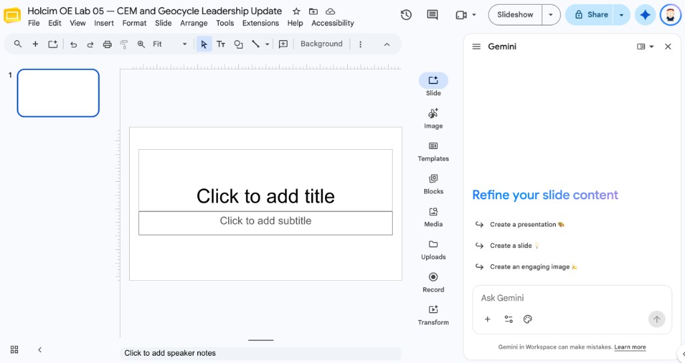
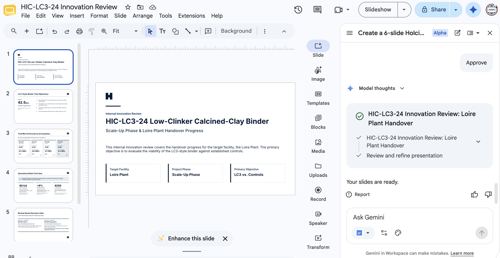
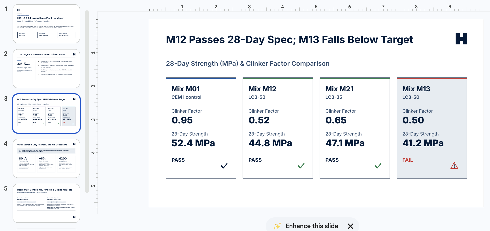
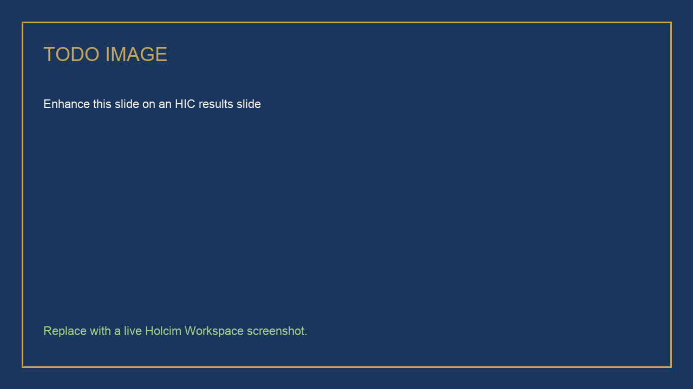

# Holcim-Style Presentations from Docs and Sheets

## Time Required

30 minutes

## Overview

In this lab, you will generate a Holcim-style innovation-review deck with Gemini in Google Slides. You start from a blank presentation, ground the first draft in a Google Doc project-update template, then edit existing slides with a trial-results Sheet and a brand-constraints file. You finish with Enhance this slide and a quality checklist.

### You learn how to:
- Generate a multi-slide deck from a Google Doc project-update template.
- Edit existing slides using a Google Sheet of trial results plus an extra reference file.
- Apply Holcim look-and-feel with follow-up prompts and Enhance this slide.
- Refuse invented KPIs that do not appear in the attached files.

## Scenario


Thursday’s internal innovation review needs six slides on **HIC-LC3-24**. The narrative already lives in a project-update Doc. The 28-day evidence lives in a Sheet. A short brand-constraints file lists what must never appear on a slide. You will not type the deck from a blank outline in your head.

> [!WARNING]
> Figures in the Doc, Sheet, and constraints file are **synthetic training content**. If a number is not in those files, leave it off the slide.

## Lab Instructions

### Task 1: Create a blank deck and open Gemini in Slides

In this task, you set up a blank presentation so Gemini builds the outline with you, instead of fighting a leftover template.

1. Open [https://slides.google.com/](https://slides.google.com/) and create a **Blank** presentation.

2. Rename it:

```text
HIC-LC3-24 Innovation Review
```

3. Open **Ask Gemini** in Slides (sparkle button, usually top right).



4. If Gemini offers a theme, choose a clean white background. You will lock Holcim colors in Task 3.

### Task 2: Generate the first deck from the project-update Doc

In this task, the **Doc** owns the story. You attach it and ask for six slides. You do not attach the Sheet yet.

1. Click [hic-project-update-template.md](https://drive.google.com/file/d/12cgN2UVmm7JTJp3eknlpShE9x6C5t2k6/view) to open it in Google Drive, then click **Download** (the down-arrow icon at the top right of the preview).

2. In a new browser tab, open [https://docs.google.com/](https://docs.google.com/) and click **Blank document**.

3. Click **File**, then **Open**. Choose the **Upload** tab, click **Browse**, and select `hic-project-update-template.md` from your **Downloads** folder. Docs opens it as a new document.

4. If the title still ends in `.md`, click **File**, then **Save as Google Docs**. Rename the document:

```text
HIC-LC3-24 Project Update
```

5. Return to the **HIC-LC3-24 Innovation Review** tab. In the Gemini panel, click **Add sources**, then **Add from Drive**, and select **HIC-LC3-24 Project Update**.

6. Send:

```text
Create a 6-slide Holcim Innovation Centre deck for an internal innovation review of HIC-LC3-24.

Use ONLY the attached Google Doc as the source of the story. Do not invent strengths, clinker factors, dates, or plant names.

Slide outline:
1. Title: HIC-LC3-24 toward Loire Plant handover
2. Why this trial exists
3. Status this period
4. Risks and open plant items
5. The ask of the review board
6. Next 30 days

Constraints:
- One idea per slide
- Titles name the finding, not Overview
- No more than four bullets per slide
- White background, navy text
- Add speaker notes on every slide
- If a figure is not in the Doc, omit it
```

7. If Gemini asks clarifying questions or shows a plan, answer from the Doc. Approve the plan when it matches the six-slide outline.

8. Wait for the slides to finish, then skim them. Confirm no megapascal value appeared that is not in the Doc.

<!-- TODO IMAGE: Screenshot of the six-slide deck generated from the project-update Doc -->


### Task 3: Edit existing slides with the trial Sheet and the constraints file

In this task, you keep the outline and **edit** slides with extra references. You do not regenerate the whole deck.

1. Download both reference files. For each file, click the link to open it in Google Drive, then click **Download**.

| File | What it owns |
| :--- | :--- |
| [hic-lc3-28day-results.csv](https://drive.google.com/file/d/1I5lJxak57QsvQU4Cf2zc1dvdvDFHmBRv/view) | Every 28-day number you may quote |
| [hic-lc3-brand-constraints.md](https://drive.google.com/file/d/1eAIfoNN3sTh0eXHR-Er5o3fD7SMLrUDW/view) | Holcim look, number rules, and banned claims |

2. Open [https://sheets.google.com/](https://sheets.google.com/) and click **Blank spreadsheet**. Click **File**, then **Import**. Choose the **Upload** tab, click **Browse**, and select `hic-lc3-28day-results.csv`. Set **Import location** to **Replace spreadsheet**, then click **Import data**.

3. Rename the spreadsheet:

```text
HIC-LC3-24 28-day Results
```

4. Open [https://docs.google.com/](https://docs.google.com/), click **Blank document**, then click **File**, then **Open**. Choose the **Upload** tab and select `hic-lc3-brand-constraints.md`. If the title still ends in `.md`, click **File**, then **Save as Google Docs**. Rename the document:

```text
HIC-LC3-24 brand constraints
```

5. Return to the **HIC-LC3-24 Innovation Review** tab. In the **same** Gemini chat, click **Add sources**, then **Add from Drive**, and select **HIC-LC3-24 28-day Results** and **HIC-LC3-24 brand constraints**.

6. Send this follow-up. It must say **edit**, not **create**:

```text
Edit the existing slides. Do not add slides. Do not regenerate the deck.

Use the attached Google Sheet only for slides that discuss results (likely slides 3 and 5):
- You may quote 28-day compressive strength, clinker factor, and pass or fail only if the value appears in the Sheet.
- Do not average mixes into a new KPI.

Use the attached brand-constraints file for every slide:
- Follow its color and logo rules.
- Follow its banned-claims list.

If the Sheet and the Doc disagree, keep the Sheet for numbers and the Doc for narrative, and add a speaker note that they should be reconciled.
```

<!-- TODO IMAGE: Screenshot of Gemini editing existing slides after the Sheet and constraints file were attached -->


7. Manually check each slide:

   - One idea per slide
   - Titles are specific (“LC3-50 clears 28-day spec”, not “Results”)
   - No more than four bullets
   - White space around the title, with the Holcim logo not colliding with text
   - White background, navy text, and blue and green accents from the logo
   - Every number exists in the Doc or the Sheet

8. Ask Gemini to fix any slide that fails the checklist. Name the slide number in the prompt.

### Task 4: Enhance this slide and lock the Holcim look

In this task, you use the visual tool, then you still own the content.

1. Select a results slide. Click **Enhance this slide**. If you like the change, click **Replace**. If not, cancel.

<!-- TODO IMAGE: Screenshot of Enhance this slide on an HIC results slide -->


> [!NOTE]
> If the button is labeled slightly differently (for example **Enhance**), use that control. If it is missing, skip this step and use a follow-up prompt: `Restyle this slide: white background, navy text, more whitespace, logo in the corner.`

2. Send a final follow-up:

```text
Add a summary slide at the end with the 3 takeaways the review board must remember. Then add a Questions and Answers slide. Still no invented numbers.
```

### Bonus Task 5: Audience rewrite inside the same deck

1. In the same Gemini chat, send:

```text
Rewrite speaker notes on slide 5 for a plant manager: silos, fineness, quality gates. Do not change the slide bullets. Do not add numbers.
```

2. Confirm the on-slide bullets did not pick up new figures from the notes rewrite.

## Congratulations!

In this lab, you have:

- Generated a multi-slide Holcim innovation-review deck from a Google Doc template.
- Edited existing slides with a trial-results Sheet and a brand-constraints file.
- Used Enhance this slide and a quality checklist without adding invented KPIs.
