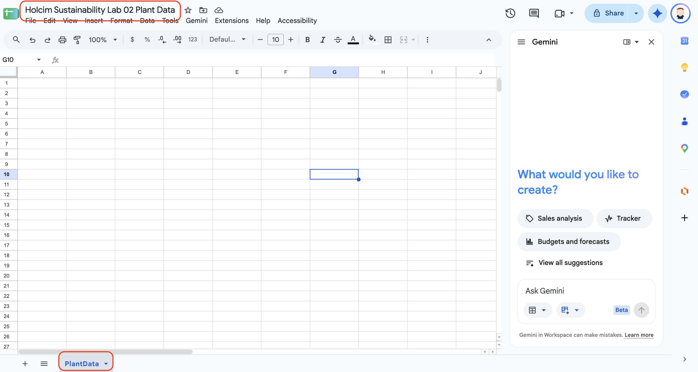
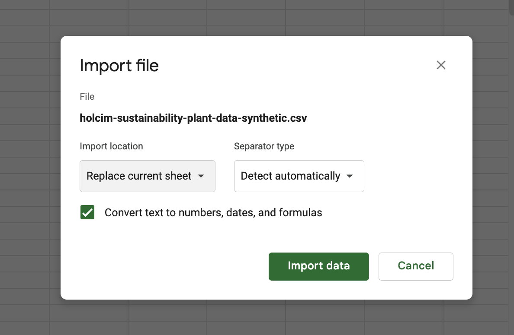
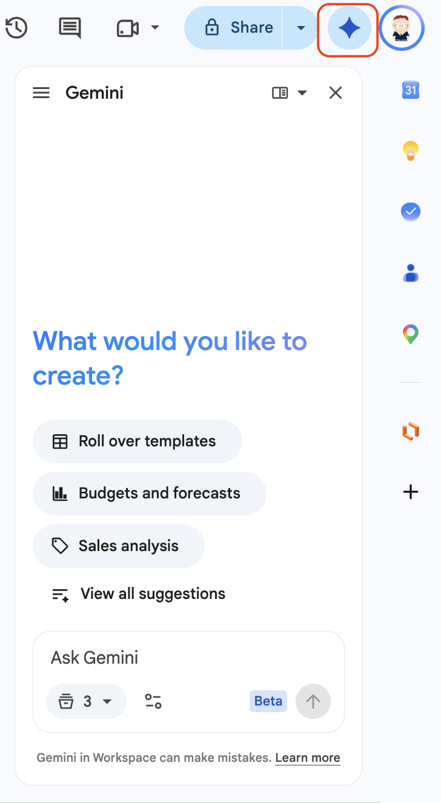
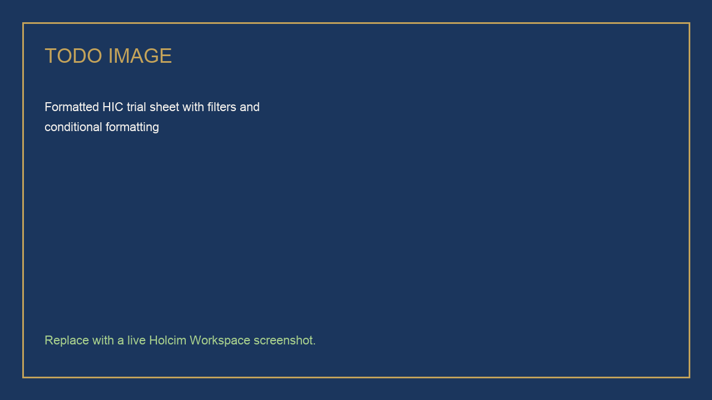
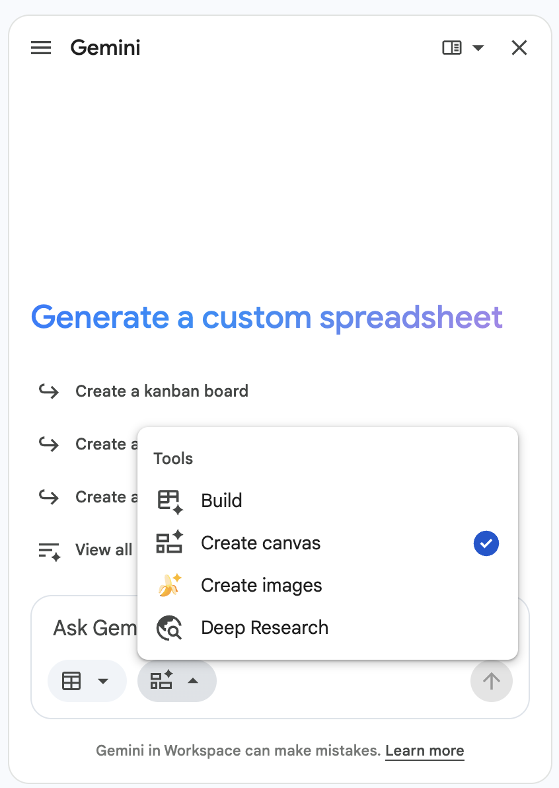
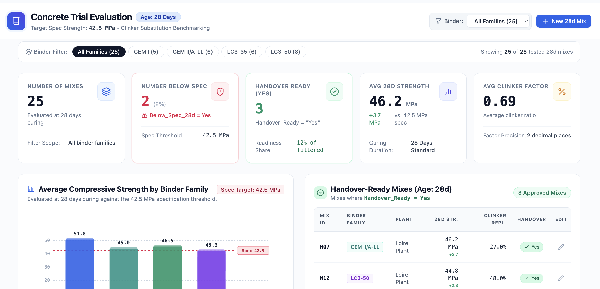

# Analyzing HIC Trial Data With Sheets and Gemini

## Time Required

30 minutes

## Overview

In this lab, you will use Gemini in Google Sheets to format, analyze, and add formulas to a synthetic trial file, then turn it into a Canvas dashboard.

### You learn how to:
- Import a CSV and format it with one Gemini prompt.
- Ask scoped analysis questions and check the answers against the sheet.
- Have Gemini write and explain formulas, then spot-check them.
- Create and refine a Canvas dashboard from the data tab.

## Scenario


The HIC-LC3-24 trial file has 100 rows: 25 mixes, each tested at 1, 7, 28, and 90 days. The plant team wants to see which mixes pass the 42.5 MPa spec at 28 days and which are ready for handover.

> [!WARNING]
> The CSV is **synthetic training data**. Do not upload real trial data in this lab.

## Lab Instructions

### Task 1: Import the CSV and format the sheet

In this task, you import the trial file and format it for analysis.

1. Open [https://sheets.new](https://sheets.new) to create a blank spreadsheet. Click **Untitled spreadsheet** at the top left and name it:

```text
HIC-LC3-24 Trial KPIs
```



2. Click [hic-lc3-24-trial-kpis.csv](https://drive.google.com/file/d/1KDWqWRkoEGnQ50DPJD5Fa-1trIBQB5-M/view) to open it in Google Drive, then click **Download** (the down-arrow icon at the top right of the preview).

3. Return to your spreadsheet. Click **File**, then **Import**. Choose the **Upload** tab, click **Browse**, and select `hic-lc3-24-trial-kpis.csv` from your **Downloads** folder. Set **Import location** to **Insert new sheet(s)**, then click **Import data**.



4. Double-click the new tab at the bottom of the screen and rename it:

```text
TrialData
```

5. Confirm the tab has **100 data rows** below the header and **12 columns**, from `Sample_ID` in column A to `Handover_Ready` in column L.

6. Click **Ask Gemini** at the top right to open the Gemini side panel.



7. Send:

```text
Format this sheet for analysis:
- Freeze and bold the header row
- Auto-size the columns
- Show Clinker_Factor with 2 decimal places
- Show Compressive_Strength_MPa and Spec_Strength_MPa with 1 decimal place
- Turn on filters
- Fill Handover_Ready cells green when Yes
Do not add, delete, or reorder rows.
```

8. Check the result. If Gemini shows a preview or asks you to confirm, click **Approve**.



### Task 2: Analyze one question at a time

In this task, you ask one scoped question per prompt and check each answer against the sheet.

1. Send:

```text
Using only this sheet, list the Mix_ID values where Age_days is 28 and Compressive_Strength_MPa is below Spec_Strength_MPa.
```

2. Check the answer: **M13** (41.2 MPa) and **M16** (40.4 MPa). To check it yourself, filter **Age_days** to 28 and sort by **Compressive_Strength_MPa**.

3. Send a second question:

```text
For rows where Age_days is 28, compare the average Compressive_Strength_MPa for LC3-50 and CEM I. Use only this sheet.
```

4. Check the answer: LC3-50 averages about **43.3 MPa** across 8 mixes, and CEM I averages about **51.8 MPa** across 5 mixes.

5. Send a third question:

```text
Which Mix_ID values have Handover_Ready set to Yes? List each Mix_ID once, with its Binder_Family and Target_Plant.
```

6. Check the answer: **M07** (CEM II/A-LL), **M12** (LC3-50), and **M21** (LC3-35), all at Loire Plant.

### Task 3: Add formulas Gemini writes

In this task, you have Gemini add two formula columns and explain one of them, then you check them by hand.

1. Send:

```text
On the TrialData tab, add two formula columns, starting in column M:

Column M header: Below_Spec_28d
Yes if Age_days is 28 and Compressive_Strength_MPa is below Spec_Strength_MPa, otherwise No.

Column N header: Clinker_Replaced_pct
(1 - Clinker_Factor) * 100, rounded to 1 decimal place.

Put real Sheets formulas in the cells, filled down for every data row. Do not change columns A to L.
```

2. Click cell **M2** and read the formula in the formula bar. It should look similar to:

```text
=IF(AND(F2=28,I2<J2),"Yes","No")
```

3. Click cell **N2**. The formula should look similar to:

```text
=ROUND((1-G2)*100,1)
```

4. Ask Gemini to explain a formula:

```text
Explain the formula in cell M2 in plain language, one step at a time.
```

### Task 4: Build a Canvas dashboard

In this task, you turn the TrialData tab into an interactive dashboard and refine it with a follow-up prompt.

1. Click the **TrialData** tab. A canvas uses the data in one tab.

2. In the **Ask Gemini** panel, click the **Tools** button in the prompt box and choose **Create canvas**. A check mark shows that it is selected.



3. Send:

```text
Build a trial dashboard from this tab. Use only rows where Age_days is 28.
Include:
- Scorecards: number of mixes, number below spec, and number with Handover_Ready set to Yes
- A bar chart of average Compressive_Strength_MPa by Binder_Family
- A filter by Binder_Family
- A table of the mixes with Handover_Ready set to Yes
```

4. Check the scorecards against Task 2: **25** mixes, **2** below spec, and **3** ready for handover.

5. Use the **Binder_Family** filter to select **LC3-50**. Confirm that the scorecards change to 8 mixes, 2 below spec, and 1 ready for handover.

6. Refine the canvas with a follow-up prompt:

```text
Add a scorecard for the average Clinker_Factor. Change nothing else.
```

7. Check that the new scorecard shows about **0.69** for all mixes, and that the rest of the canvas did not change.



> [!NOTE]
> If **Create canvas** is not in the **Tools** menu, your account does not have Canvas yet. Ask Gemini for a chart of average 28-day strength by Binder_Family instead.

## Congratulations!

In this lab, you have:

- Imported a CSV and formatted it with one Gemini prompt.
- Asked scoped analysis questions and checked the answers against the sheet.
- Had Gemini write and explain formulas, then spot-checked them.
- Created and refined a Canvas dashboard from the data tab.
