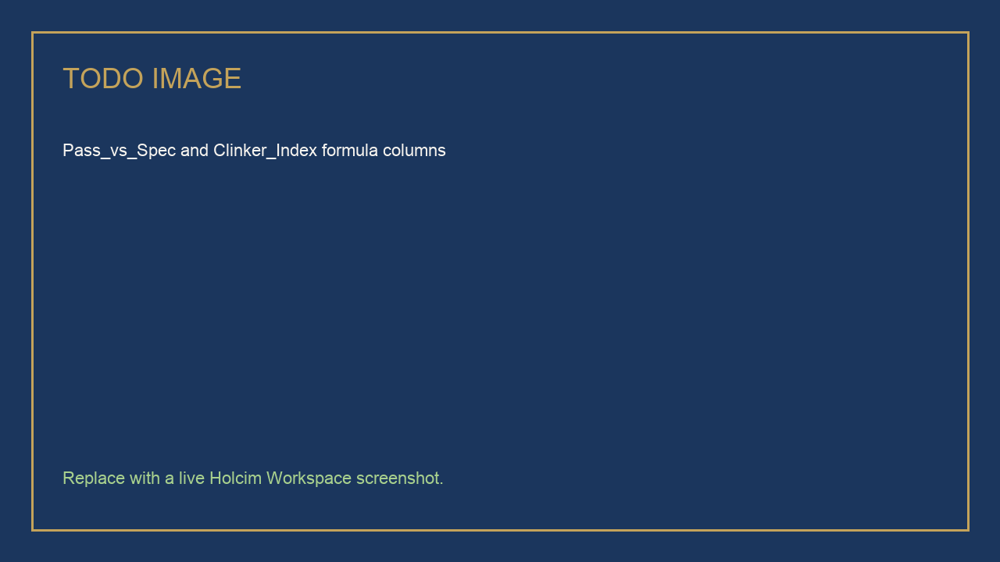

# Analyzing HIC Trial Data with Sheets and Gemini

## Time Required

45 minutes

## Overview

In this lab, you will import a synthetic HIC-LC3-24 trial CSV into Google Sheets, format and filter it with Gemini, ask one analysis question at a time, add formulas Gemini writes and you check, search a related Drive document from the Sheets side panel, and finish with a Sheets canvas dashboard instead of a static chart.

### You learn how to:
- Import a right-sized trial CSV and let Gemini format headers, types, filters, and conditional formatting.
- Ask focused analysis questions without dumping the whole sheet into one prompt.
- Have Gemini write formulas for pass/fail and a clinker-factor index, then spot-check them.
- Search a related Drive document from the Sheets side panel.
- Create and refine a Canvas dashboard that stays synced with the data tab.

## Scenario


HIC-LC3-24 has about 100 rows of mix results: binder family, age, clinker factor, strength, spec, and trial stage. The Loire Plant wants to know which mixes are handover-ready. The glossary that defines those terms lives in Drive, not in the CSV. You will finish on a Canvas the review board can filter.

> [!WARNING]
> The CSV is **synthetic training data**. Do not upload a live LIMS extract in this lab.

## Lab Instructions

### Task 1: Import the CSV and format the working sheet

In this task, you get a clean working tab. Formatting first. Analysis second.

1. Open [https://sheets.google.com/](https://sheets.google.com/) and create a new spreadsheet named:

```text
HIC-LC3-24 Trial KPIs
```


2. Click [hic-lc3-24-trial-kpis.csv](https://drive.google.com/file/d/1KDWqWRkoEGnQ50DPJD5Fa-1trIBQB5-M/view) to open it in Google Drive, then click **Download** (the down-arrow icon at the top right of the preview).

3. Return to your spreadsheet. Click **File**, then **Import**. Choose the **Upload** tab, click **Browse**, and select `hic-lc3-24-trial-kpis.csv` from your **Downloads** folder. Set **Import location** to **Insert new sheet(s)**, then click **Import data**.


4. Double-click the new tab at the bottom of the screen and rename it:

```text
TrialData
```

5. Confirm you have about **100 rows** and **12 columns**, including `Sample_ID`, `Mix_ID`, `Binder_Family`, `Target_Plant`, `Region`, `Age_days`, `Clinker_Factor`, `Calcined_Clay_pct`, `Compressive_Strength_MPa`, `Spec_Strength_MPa`, `Trial_Stage`, and `Handover_Ready`.

6. Download the glossary you search for in Task 3. Click [hic-trial-glossary.pdf](https://drive.google.com/file/d/12NCiX79_M1Qb7Wk9XbtZkQuMlg4oiAfy/view), then click **Download**.

7. Open [https://drive.google.com/](https://drive.google.com/) in a new tab. Click **New**, then **File upload**, and select `hic-trial-glossary.pdf` from your **Downloads** folder.

> [!NOTE]
> You upload the glossary now because Drive can take a few minutes to make a new file searchable.

8. Return to your spreadsheet and open **Ask Gemini** in Sheets.


9. Send:

```text
Format this sheet for analysis:
- Freeze the header row
- Make headers bold
- Auto-size columns
- Set Clinker_Factor as a number with 2 decimal places
- Set Compressive_Strength_MPa and Spec_Strength_MPa as numbers with 1 decimal place
- Turn on filters
- Apply a light Holcim-friendly header color (navy text, pale sand fill)
Do not add or delete rows. Do not invent columns.
```

10. Add conditional formatting with a follow-up:

```text
Apply conditional formatting on Handover_Ready: green fill when Yes, pale red fill when No.
Apply conditional formatting on Compressive_Strength_MPa when it is below Spec_Strength_MPa.
```

<!-- TODO IMAGE: Screenshot of the formatted HIC trial sheet with filters and conditional formatting -->


> [!TIP]
> If Gemini offers a chart in this task, decline it. You want a working grid first. Canvas comes last.

### Task 2: Analyze one question at a time

In this task, you practice the Sheets habit that prevents hallucinated summaries: one question, then the next.

1. Send:

```text
Using only this sheet, which binder families have 28-day compressive strength at or above spec? List Mix_ID, Binder_Family, Clinker_Factor, Compressive_Strength_MPa, and Spec_Strength_MPa. Ignore other ages in this answer.
```

2. Read the answer. Then send a **different** question:

```text
Among rows where Age_days is 28, how does average compressive strength compare for LC3-50 versus CEM I? Use only this sheet. If a family has no 28-day rows, say so.
```

3. Send a third question that a plant would actually ask:

```text
Which mixes are Trial_Stage Plant-ready AND Handover_Ready is Yes? Return Mix_ID, Target_Plant, and Binder_Family. Do not add commentary about typical LC3 performance.
```

> [!WARNING]
> If Gemini cites a mix that is not in the sheet, stop and reply: `Use only rows in this spreadsheet. Quote Mix_ID values you used.`

### Task 3: Add formulas Gemini writes, then search the glossary

In this task, you add two calculated columns and confirm a definition from Drive so “handover ready” means what the protocol says.

1. Send:

```text
Add two formula columns on the TrialData tab, starting in the first empty column:

Column M header: Pass_vs_Spec
Formula: Yes if Compressive_Strength_MPa >= Spec_Strength_MPa, otherwise No.

Column N header: Clinker_Index
Formula: (1 - Clinker_Factor) * 100, 1 decimal place, meaning percent clinker replaced.

Put real Sheets formulas in the cells, filled down for all data rows. Then explain each formula in one sentence.
Do not overwrite A to L.
```

2. Spot-check **three rows** by hand: one CEM I, one LC3-50, one fail versus spec. If a formula is wrong, tell Gemini which cell and what you expected.

<!-- TODO IMAGE: Screenshot of Pass_vs_Spec and Clinker_Index formula columns -->


3. From the **same** Sheets Gemini panel, search Drive for the glossary:

```text
Search Drive for hic-trial-glossary. Using that document, quote the definition of Handover ready and the 28-day spec used in HIC-LC3-24. If you cannot find the file, say so.
```

4. If search returns nothing, click **Add sources**, then **Add from Drive**, and select `hic-trial-glossary.pdf` (you uploaded it in Task 1).

5. Send:

```text
Does the Handover_Ready column in this sheet match the glossary definition? List Mix_ID values that look inconsistent. Do not change the CSV values unless I ask.
```

<!-- TODO IMAGE: Screenshot of Gemini in Sheets citing the glossary document -->


> [!NOTE]
> **Fallback if Drive search is missing in Sheets:** open the glossary from Drive yourself, then attach it with Add source. The skill is the same: the sheet does not own the definitions.

### Task 4: Build a Canvas dashboard

In this task, you replace the old “make me a chart sheet” finish with an interactive Canvas on the trial tab.

1. Click the **TrialData** tab so Canvas uses that data. Canvas uses **one tab**.

2. Create a canvas using one of these controls (tenants differ):

   - Menu bar: **Insert → Create a canvas**
   - **Tools → Create canvas**
   - Bottom bar: **Canvas → Create a canvas**
   - Gemini side panel: look for **Create canvas**

<!-- TODO IMAGE: Screenshot of Create a canvas in Google Sheets -->


3. In the Canvas prompt box, send:

```text
Build an interactive dashboard for HIC-LC3-24 plant handover.

Include:
- Scorecards: count of mixes, count passing 28-day spec, average clinker factor for 28-day rows
- A filter for Binder_Family and Target_Plant
- A table or cards of Mix_ID where Age_days is 28 and Pass_vs_Spec is Yes
- A simple comparison of LC3-50 versus CEM I 28-day strength
Style: clean, corporate, navy and sand, no neon.

Use only this tab. Do not invent mixes.
```

4. When the canvas appears, use a filter. Confirm a card or scorecard changes.

5. Refine with a follow-up instead of rebuilding:

```text
Add a handover-ready section that lists Mix_ID where Trial_Stage is Plant-ready and Handover_Ready is Yes. Keep the existing scorecards.
```

> [!NOTE]
> **Fallback if Create a canvas is missing:** in the Gemini panel ask: `Create a chart sheet titled Trial Snapshot with 28-day strength by Binder_Family and a pass/fail summary. Label it as a static snapshot, not a canvas.` Then tell your instructor the Canvas control was not in this tenant.

> [!WARNING]
> Canvas is read-write. If you drag or edit a value in the canvas, you can change the sheet. Spot-check the grid after you click around.

### Bonus Task 5: Share the canvas, not a screenshot

1. Use **Copy link** on the canvas (top right of the canvas, when shown). Access follows the spreadsheet sharing.

2. Paste the link into a note to yourself. That is what you would send the Loire Plant, not a PNG of a chart.

## Congratulations!

In this lab, you have:

- Imported and formatted a synthetic HIC trial CSV with Gemini in Sheets.
- Analyzed 28-day spec performance one question at a time.
- Added checked formulas and confirmed a definition from a Drive document.
- Built (or attempted) a Sheets canvas dashboard as the handover view.
