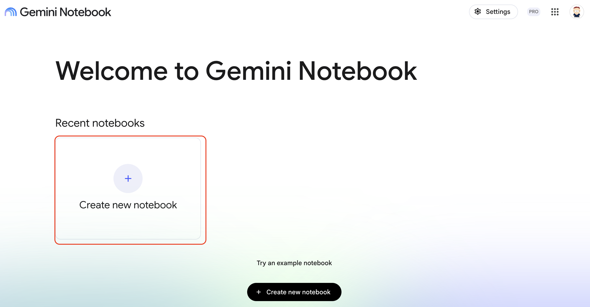
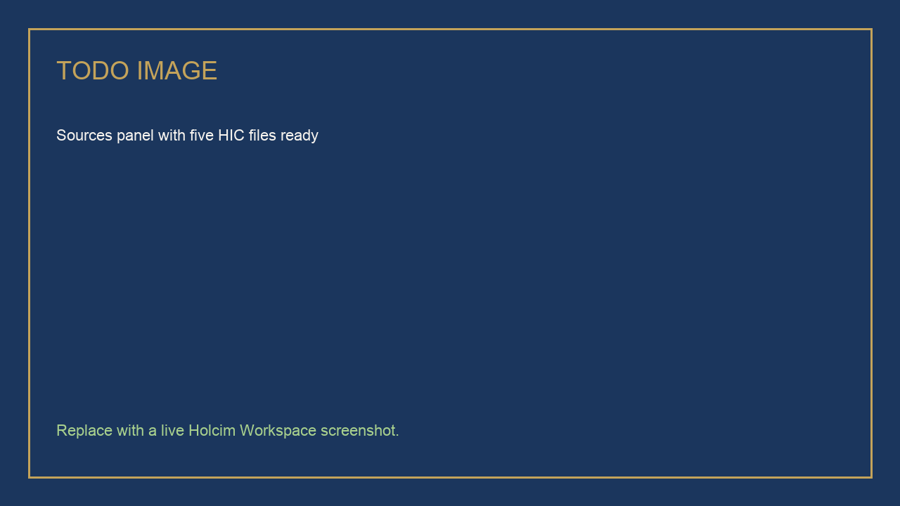
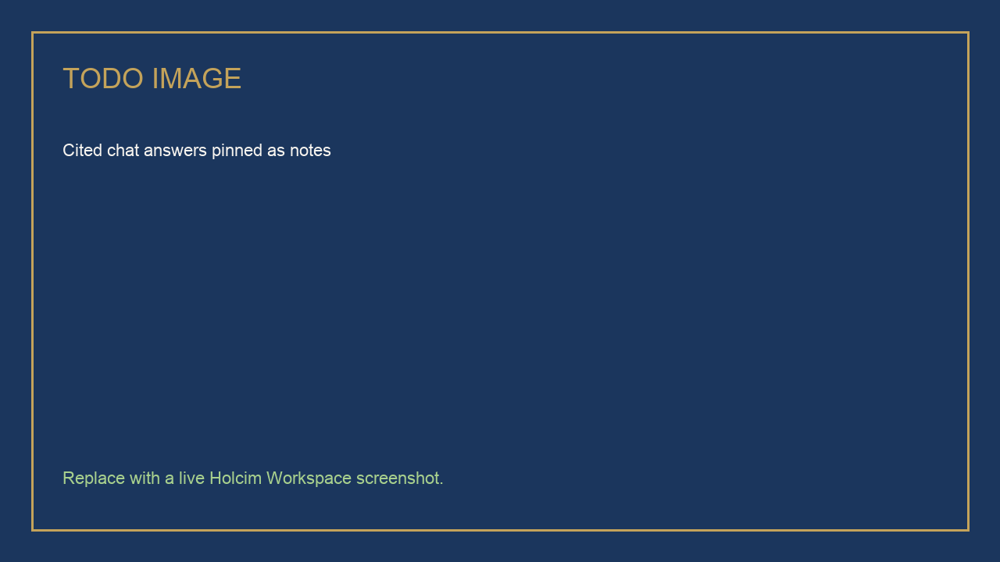
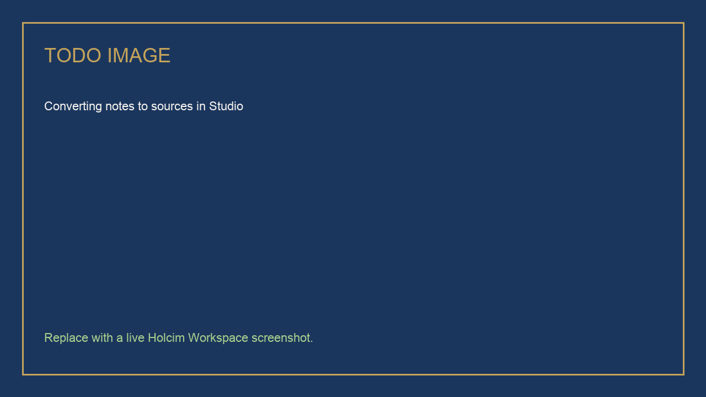
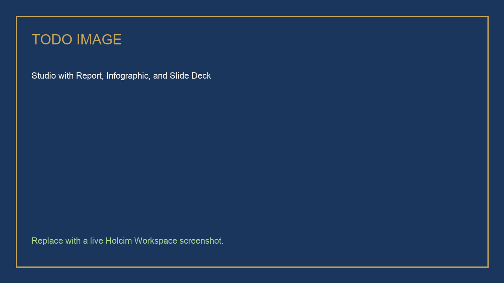

# Advanced Binder Trial Briefing with Gemini Notebook

## Time Required

30 minutes

## Overview

In this lab, you will build an advanced Gemini Notebook (NotebookLM) briefing pack for the HIC-LC3-24 innovation review. You add internal HIC sources, research public LC3 literature with web sources, draft cited answers in chat, convert notes to sources, narrow the set, generate a Report, Infographic, and Slide Deck, then create one Studio extra (Audio Overview, Mind Map, or Quiz) so a colleague can rehearse.

### You learn how to:
- Create a Gemini Notebook and add multiple HIC trial sources from Drive.
- Research public LC3 or calcined-clay binder literature using web sources.
- Draft grounded, cited answers in chat and pin them as notes.
- Convert notes to sources, deselect web pages, and generate Report, Infographic, and Slide Deck.
- Use a Studio extra (Audio Overview, Mind Map, or Quiz) as a required advanced step.

## Scenario


Thursday’s innovation review is not a first tour of Notebook. You already know where Sources, Chat, and Studio sit. The job is discipline: mix an internal trial brief, a literature excerpt, a plant-handover note, a glossary, and a review agenda, then produce a pack a director can read without picking up invented megapascals.

> [!WARNING]
> Every source in this lab is **synthetic training content**, except the public web pages you choose on purpose. Do not attach a live HIC report.

## Lab Instructions

### Task 1: Create a notebook and add HIC sources

In this task, you load the five files that will ground every later answer.

1. Open [https://notebooklm.google.com/](https://notebooklm.google.com/) and sign in with your account.

2. On the home page, select **Create new notebook**.



3. Rename the notebook to:

```text
HIC-LC3-24 Innovation Review
```

4. Download the five HIC sources. For each file in the table, click the link to open it in Google Drive, then click **Download** (the down-arrow icon at the top right of the preview).

| File | What it owns |
| :--- | :--- |
| [hic-lc3-24-trial-brief.pdf](https://drive.google.com/file/d/1nDdt_QtYdP64pK689VAjSOwZwZLsyv2-/view) | HIC numbers for M01, M12, M13, and M21 |
| [hic-lc3-literature-excerpt.pdf](https://drive.google.com/file/d/128z5zcbJ0AR8RiNOkeL7ye44xOCH7lSx/view) | Public LC3 themes. Not HIC results |
| [hic-loire-plant-handover-note.pdf](https://drive.google.com/file/d/1vA6CGOMrW6RB_KIcddDI0DX7eQSBdAjL/view) | Open plant items and quotable HIC numbers |
| [hic-trial-glossary.pdf](https://drive.google.com/file/d/1MFXSX8ROFzIGA7tp2fKUAlc1BQhC4RDE/view) | Definitions of handover ready and spec |
| [hic-innovation-review-agenda.pdf](https://drive.google.com/file/d/12VvcI2UumcjFZLWuUgBCWWr2gt0mBjO4/view) | Review-board agenda and evidence rule |

5. In your notebook, click **Add sources**, then **Upload files**. Select the five PDFs from your **Downloads** folder.

6. Wait until all five sources appear as ready in the **Sources** panel.

<!-- TODO IMAGE: Screenshot of the Sources panel with five HIC files ready -->


> [!WARNING]
> Do not add a real unpublished trial report during class.

### Task 2: Research public LC3 literature with web sources

In this task, you pull public context so the review can tell HIC results from published science. Web pages stay optional later, when you generate Studio outputs.

1. In **Search the web for new sources**, run:

```text
LC3 limestone calcined clay cement clinker factor compressive strength literature review
```

<!-- TODO IMAGE: Screenshot of Search the web for LC3 literature -->


2. Review the results and **Import** two sources you would actually cite in an HIC review (for example a peer-reviewed paper page or a standards overview). Skip blogs with no methods.

3. Run a second search and import one result:

```text
EN 196-1 cement mortar compressive strength test ages 1 7 28 days
```

4. Confirm the **Sources** panel now includes your five HIC files plus the web sources.

### Task 3: Draft cited answers in chat

In this task, you ask sharp questions and pin the answers. You do not generate Studio yet.

1. Ensure all sources are selected.

2. In chat, send:

```text
List the 28-day compressive strengths and clinker factors that appear in the HIC trial brief or the plant-handover note. Cite the source file for each number. If a mix is only in the literature excerpt, do not present it as an HIC result.
```

3. Send a plant question:

```text
From the Loire Plant handover note and the glossary, what must be true before HIC-LC3-24 is handover ready? Cite sources. If the literature excerpt disagrees with the plant note, flag the disagreement. Do not resolve it by inventing a compromise number.
```

4. Send the review-board question:

```text
Using the innovation review agenda, draft talking points for each agenda item. Every talking point must cite an HIC file. If the agenda asks for a number that is not in the HIC files, write Needs data, not a guess.
```

5. For each useful answer, click **Save to note** (pin icon).

<!-- TODO IMAGE: Screenshot of cited chat answers pinned as notes -->


6. Stress-test the notes:

```text
Review my saved notes. Flag any sentence that is not supported by an HIC source, and any place a literature figure could be mistaken for an HIC trial result.
```

7. Save that review as a note as well.

### Task 4: Narrow sources, then generate Report, Infographic, and Slide Deck

In this task, you convert notes to sources, deselect web pages, and build the review pack from HIC-owned facts plus your notes.

1. In **Studio**, open the action menu next to each saved note and convert the notes to sources.

<!-- TODO IMAGE: Screenshot of converting notes to sources -->


2. In **Sources**, deselect all. Then select only:

   - The five original HIC files
   - Your converted notes

   Leave web sources unselected.

> [!TIP]
> Sorting sources by type often groups your uploaded files together.

> [!NOTE]
> Leaving web sources unselected keeps Studio outputs from treating a public LC3 paper as if it were Loire Plant data.

3. In **Studio**, generate a **Report**. Choose a format you would send a manager.

4. Generate an **Infographic** with this description:

```text
Create a one-page executive infographic of HIC-LC3-24 readiness for Loire Plant handover.
Cover: purpose of the trial, 28-day spec status using only HIC-sourced numbers, open plant items, the ask of the review board.
Style: clean corporate, Holcim red, navy, and sand. No neon. No invented percentages.
```

5. Click **Slide Deck**. Choose **Presenter Slides** and paste:

```text
Create a short slide deck to brief the HIC innovation review on HIC-LC3-24.
Cover: why the trial exists, what the HIC files actually show, disagreements with literature, remaining plant items, the decision we need today.
Keep it suitable for a 5-minute update. Do not use web sources.
```

<!-- TODO IMAGE: Screenshot of Studio with Report, Infographic, and Slide Deck generating -->


> [!NOTE]
> Studio generation can take a few minutes each. Start the next one while the previous one generates.

### Task 5: Generate one Studio extra for rehearsal

In this task, you use Notebook as an advanced briefing pack, not a first tour. Pick **one** extra and generate it from the same narrowed HIC sources.

1. Keep web sources deselected.

2. In **Studio**, generate **one** of the following:

   - **Audio Overview**: a short briefing two colleagues could listen to on the way to the review
   - **Mind Map**: trial purpose, evidence, plant gaps, decision
   - **Quiz**: glossary terms plus “which numbers are HIC versus literature”

3. If you choose Quiz, paste:

```text
Quiz a colleague on HIC-LC3-24. Include items that test whether a figure came from the HIC trial brief or from the literature excerpt. Wrong answers should be plausible invented strengths.
```

4. Skim the extra. If it treats a literature number as an HIC result, regenerate with: `Use only HIC files and my notes. Literature is out of scope.`

> [!NOTE]
> If Audio Overview, Mind Map, or Quiz is missing in your tenant, generate whichever Studio extra is available and write its name in your notes. Do not skip Task 5 entirely.

### Bonus Task 6: Rehearse a hostile question

1. Select all sources again, including web.

2. Ask:

```text
A plant manager says LC3 always misses 1-day strength. What do our HIC files actually show at 1 day, and what does the literature excerpt claim? Keep the two sources separate.
```

3. You do not need to pin this unless the answer is strong.

## Congratulations!

In this lab, you have:

- Built a Gemini Notebook with five HIC sources plus chosen web literature.
- Drafted cited talking points and converted notes to sources.
- Narrowed the source set before generating a Report, Infographic, and Slide Deck.
- Generated a Studio extra (Audio Overview, Mind Map, or Quiz) for rehearsal.


