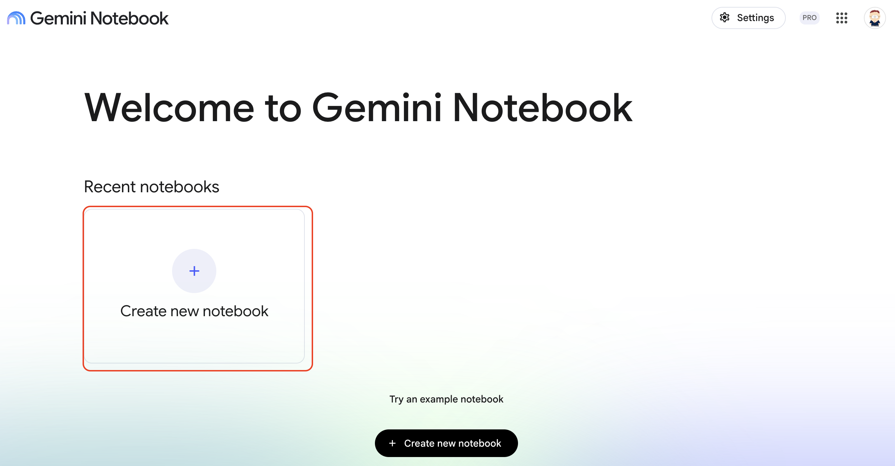
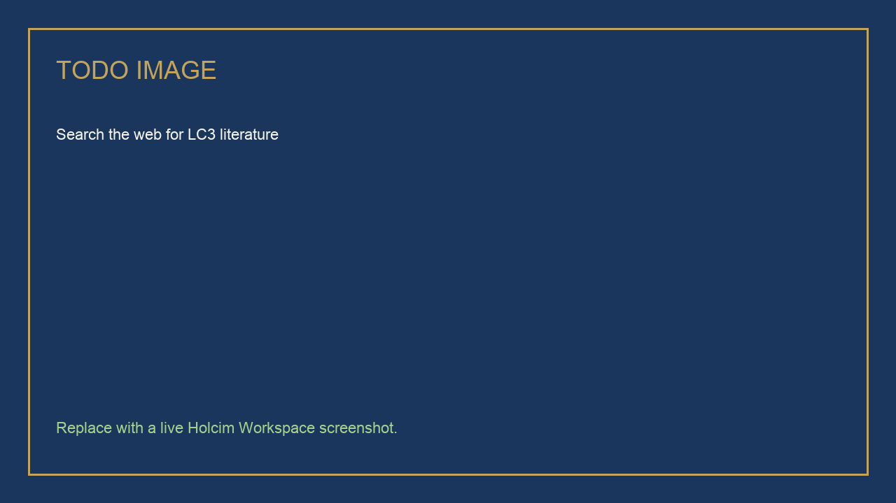
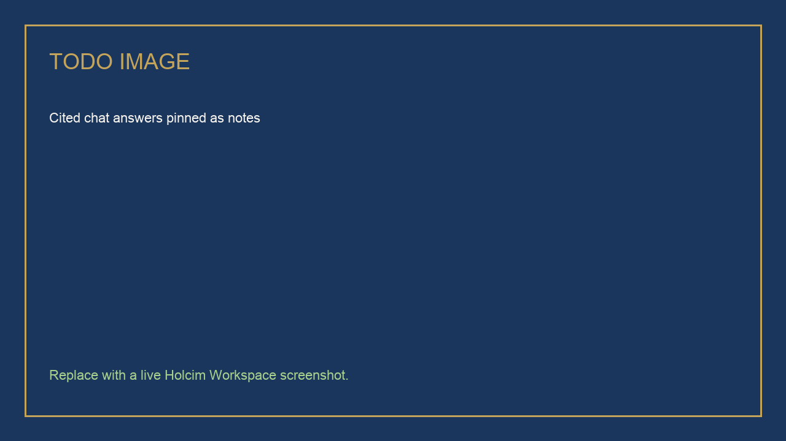
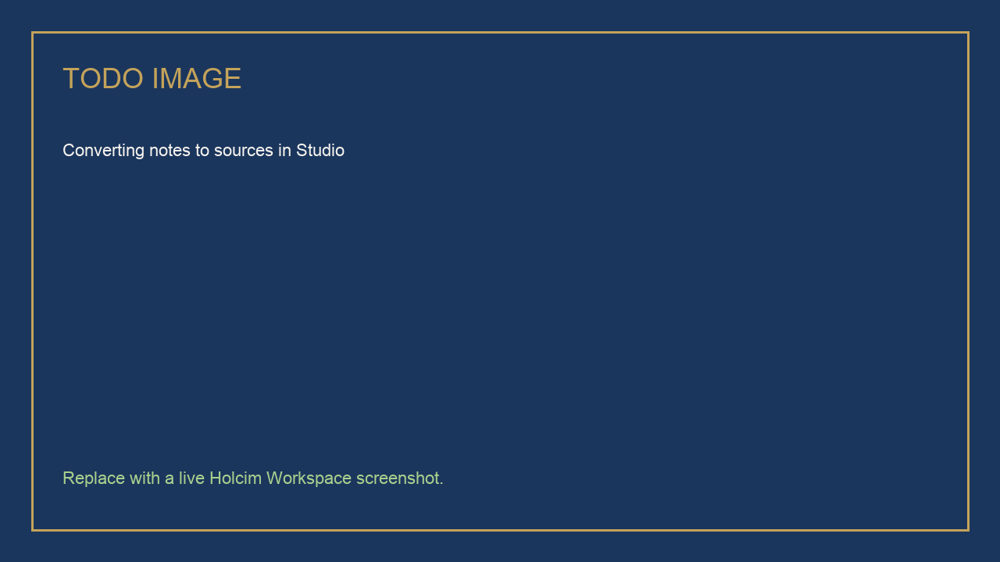
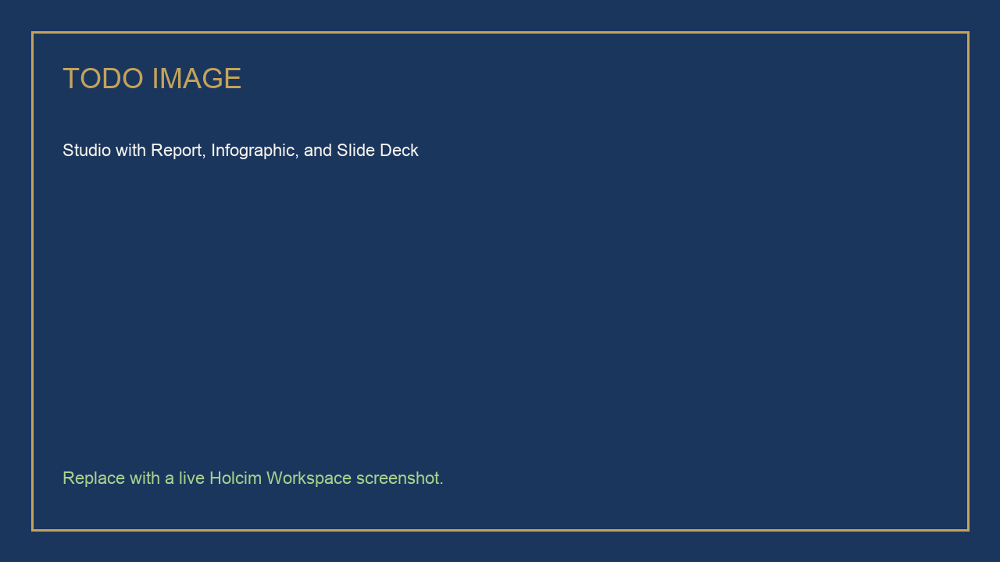

# Binder Trial Briefing with Gemini Notebook

## Time Required

25 minutes

## Overview

In this lab, you will build a Gemini Notebook (NotebookLM) for the HIC-LC3-24 innovation review, ask cited questions, and generate a review pack in Studio.

### You learn how to:
- Create a notebook and add HIC sources.
- Add public literature with a web search.
- Ask cited questions and save the best answer as a source.
- Generate a Report, an Infographic, and a Slide Deck in Studio.

## Scenario


The review board meets on Thursday. You have a trial brief and a plant handover note, and the board wants to know how your results compare with the published literature.

> [!WARNING]
> The HIC files in this lab are **synthetic training content**. Do not add a real trial report.

## Lab Instructions

### Task 1: Create a notebook and add HIC sources

In this task, you create the notebook and add the two HIC files.

1. Open [https://notebooklm.google.com/](https://notebooklm.google.com/) and click **Create new notebook**.



2. Rename the notebook to:

```text
HIC-LC3-24 Innovation Review
```

3. Download the two HIC sources. Click each link to open it in Google Drive, then click **Download** (the down-arrow icon at the top right of the preview).

   - [hic-lc3-24-trial-brief.pdf](https://drive.google.com/file/d/1nDdt_QtYdP64pK689VAjSOwZwZLsyv2-/view)
   - [hic-loire-plant-handover-note.pdf](https://drive.google.com/file/d/1vA6CGOMrW6RB_KIcddDI0DX7eQSBdAjL/view)

4. In your notebook, click **Add sources**, then **Upload files**, and select both PDFs from your **Downloads** folder.

5. Wait until both files show as ready in the **Sources** panel.

### Task 2: Add public literature with a web search

In this task, you add published research so you can compare it with the HIC results.

1. In **Search the web for new sources**, enter:

```text
LC3 limestone calcined clay cement compressive strength clinker factor
```

<!-- TODO IMAGE: Screenshot of Search the web for LC3 literature -->


2. Review the results and **Import** two sources you would cite in a review, such as a peer-reviewed paper. Skip pages with no data or methods.

### Task 3: Ask cited questions

In this task, you ask the questions the board will ask, and keep the best answer.

1. In chat, send:

```text
Which HIC-LC3-24 mixes pass the 28-day spec, and which do not? Give the strength and clinker factor for each, and cite the source file.
```

2. Check the answer: M12 (44.8 MPa) and M21 (47.1 MPa) pass, M13 (41.2 MPa) fails, and M01 is the CEM I control (52.4 MPa). Click a citation number to see the passage it came from.

3. Send:

```text
How do our 28-day LC3 results compare with the published literature? Keep HIC results and literature figures separate, and cite both.
```

4. Click **Save to note** under the comparison answer.

<!-- TODO IMAGE: Screenshot of a cited chat answer with the Save to note button -->


5. In **Studio**, open the note and click **Convert to source**. The comparison is now a source that Studio can use.

<!-- TODO IMAGE: Screenshot of converting a note to a source -->


### Task 4: Generate the review pack in Studio

In this task, you generate three outputs from all your sources. Each one takes a few minutes, so start the next while the last one runs.

1. In **Studio**, click **Report** and choose **Briefing doc**.

2. Click the edit (pencil) icon on **Infographic**, enter this description, and click **Generate**:

```text
One-page summary of HIC-LC3-24 for the review board: the 28-day spec, which mixes pass, the open plant items, and the decision needed. Label any literature figure as published research, not an HIC result.
```

3. Click the edit (pencil) icon on **Slide Deck**, enter this description, and click **Generate**:

```text
A five-slide briefing on HIC-LC3-24 for the review board: why the trial exists, the 28-day results, how they compare with the literature, the open plant items, and the decision needed.
```

<!-- TODO IMAGE: Screenshot of Studio with Report, Infographic, and Slide Deck generating -->


4. Open the Slide Deck when it is ready. Check that every HIC strength matches the trial brief, and that literature figures are not presented as HIC results.

## Congratulations!

In this lab, you have:

- Created a notebook and added HIC sources.
- Added public literature with a web search.
- Asked cited questions and saved the best answer as a source.
- Generated a Report, an Infographic, and a Slide Deck in Studio.


