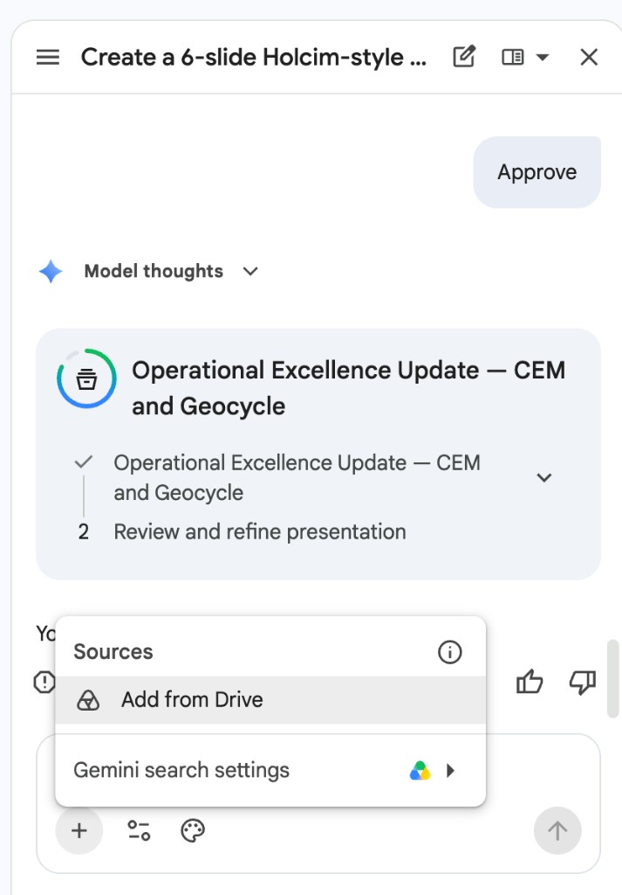
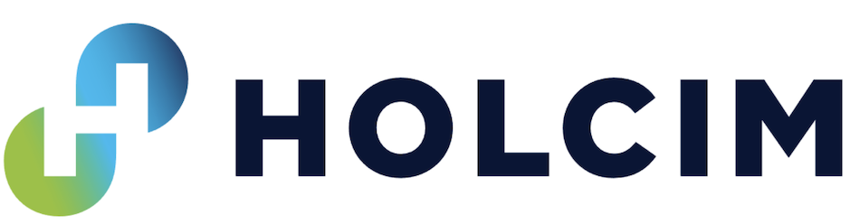

# Creating Holcim-Style Presentations with Gemini in Slides

## Time Required

30 minutes

## Overview

In this lab, you will use Gemini in Google Slides to draft a multi-slide Operational Excellence leadership deck about CEM clinker-factor progress and Geocycle alternative-fuel performance. You write a Holcim-style presentation brief, generate multiple slides, then refine structure, visuals, and speaker notes so the deck is usable in a real OE review.

### You learn how to:

- Open Google Slides and start a blank leadership deck.
- Prompt Gemini for a multi-slide Holcim-style structure (title, agenda, two lever sections, actions).
- Refine slides for the Holcim website look: white space, strong titles, the blue-to-green logo, and no invented KPIs.
- Add speaker notes and a final quality pass before sharing.

## Scenario


Your OE manager wants a short leadership update tomorrow morning: where CEM clinker factor is heading, how Geocycle thermal substitution supports the low-carbon agenda, and what the team should do next. The figures are in a shared Google Drive file you will attach in Task 2. The logo above is the visual reference. Gemini in Slides can draft the deck if you attach both before you send the brief.

## Lab Instructions

### Task 1: Open Slides and start a blank deck

In this task, you create a blank presentation for the leadership update.

1. Open [Google Slides](https://slides.google.com/) and sign in.

2. Click **Blank presentation**.

3. Rename the file to:

```text
Holcim OE Lab 05 — CEM and Geocycle Leadership Update
```

### Task 2: Generate a multi-slide deck with a Holcim-style brief

In this task, you attach the Holcim logo and the Drive source file, then ask Gemini to create several slides from a structured brief.

1. In the toolbar, click the **Ask Gemini** icon. The Gemini chat opens on the right.


> [!NOTE]
> The panel title is **Gemini**. You should see **Refine your slide content**, suggestions such as **Create a presentation**, and an **Ask Gemini** box at the bottom.

2. Copy the Holcim logo below and paste it into the **Ask Gemini** box. Do not send yet.


> [!NOTE]
> If the image does not paste, save the logo and attach the image in the chat. Leave it attached, and do not send yet.

3. Open the shared facts file and confirm you can view it:

[https://drive.google.com/file/d/1XaIhRj1I7zYbf8-5DSCoSftnzY686PaQ/view?usp=sharing](https://drive.google.com/file/d/1XaIhRj1I7zYbf8-5DSCoSftnzY686PaQ/view?usp=sharing)

4. Return to the Gemini chat. Click the **Add sources** icon (**+**), then click **Add from Drive**. Select `holcim-oe-cem-geocycle-facts.md`. Do not send yet.



5. In the **Ask Gemini** box, paste this prompt and send it:

```text
Create a 6-slide Holcim leadership presentation for Operational Excellence.

Use the Holcim logo I pasted and the Drive file I attached.
- Put the logo on the title slide.
- Use only figures from the attached file. If a number is not in that file, leave it out.
- Label 2030 figures as published targets, not as results.
- Keep clinker factor and thermal substitution rate as separate levers.
- Keep ECOPlanet (cement) separate from ECOPact (ready-mix).

Holcim look and feel, based on holcim.com:
- White background and generous whitespace
- Strong short titles and sparse bullets (max 4 per slide)
- Dark navy text, with blue-to-green accents taken from the attached logo
- Do not use a red theme, clip art, icon collages, or stock-photo grids
- Confident and factual. No hype adjectives.

Slide outline:
1. Title: Operational Excellence Update: CEM and Geocycle
2. Agenda
3. CEM lever: clinker factor and ECOPlanet
4. Geocycle lever: thermal substitution
5. How the two levers work together (and what not to confuse)
6. Recommended OE actions
```

6. If Gemini asks clarifying questions, answer them from the attached file. If you are given a plan of steps to create the deck, change it if you need to, or approve it.

7. Wait for the slides to finish, then review them. 

<!-- TODO IMAGE: Screenshot of the generated 6-slide deck overview -->


> [!IMPORTANT]
> If Gemini invents a KPI that is not in `holcim-oe-cem-geocycle-facts.md`, delete that number before you continue.

### Task 3: Refine structure and Holcim look-and-feel

In this task, you use follow-up prompts and manual edits to make the deck presentation-ready.

1. In the same Gemini chat, paste this follow-up:

```text
Rewrite bullets on slides 3–5 to be shorter and more executive. Keep every factual claim limited to the attached Drive file. Remove any hype adjectives. Keep the white background, dark navy text, and blue-to-green logo treatment.
```

2. Manually check each slide:

   - One idea per slide
   - Titles are specific (“CEM: clinker factor and ECOPlanet”, not “Overview”)
   - No more than four bullets
   - White space around the title, with the Holcim logo not colliding with text
   - No red theme and no decorative clip art

3. On the actions slide, keep the next steps operational and grounded in the source file, for example:

   - Report clinker factor and thermal substitution rate as separate KPIs
   - Tie ECOPlanet to the formulations lever, and Geocycle to the energy lever
   - Keep unpublished plant targets out of the deck and out of public AI tools

4. Optional: if the generated theme fights the logo, set the slide background to white and the title text to dark navy. Do not spend the whole lab hunting for a perfect master.

<!-- TODO IMAGE: Screenshot of refined actions slide -->


### Task 4: Add speaker notes and do a final quality pass

1. Open **Speaker notes** on slides 3, 4, and 5.

2. For each, add 2–3 sentences a presenter could say, including one explicit caution not to invent KPIs beyond the Drive source file.

3. If you want help with the wording, paste this into the same Gemini chat:

```text
Draft speaker notes for this slide in 3 short sentences for an OE manager audience. Do not add statistics that are not in the attached Drive file.
```

4. Run a final checklist:

   - [ ] Six slides, white space, navy text, and the Holcim logo
   - [ ] CEM and Geocycle both covered, as separate levers
   - [ ] Every figure appears in the Drive source file
   - [ ] Actions slide is concrete
   - [ ] Speaker notes present on the three content slides

5. Share the deck with a classmate or instructor for a 60-second review.

### Bonus Task 5: Generate an alternate title slide

1. Ask Gemini for two alternate title-slide options that still say **Operational Excellence**, **CEM**, and **Geocycle**.

2. Keep the clearer option; discard anything that looks like generic AI marketing.

## Congratulations!

You generated a multi-slide Holcim leadership deck with Gemini in Google Slides, grounded it in the published CEM and Geocycle source file, and left with speaker notes you can actually present.
