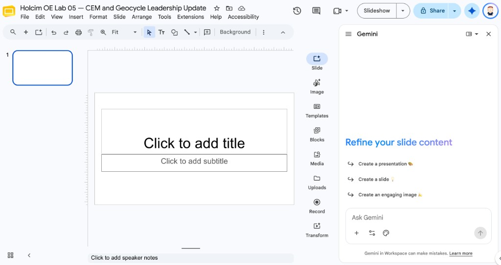
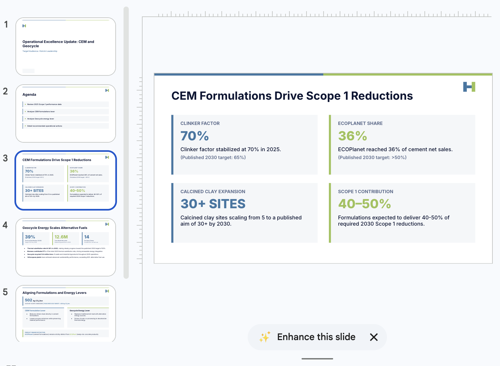

# Creating Holcim-Style Presentations with Gemini in Slides

## Time Required

30 minutes

## Overview

In this lab, you will use Gemini in Google Slides to draft a multi-slide Operational Excellence leadership deck about CEM clinker-factor progress and Geocycle alternative-fuel performance. You write a Holcim-style presentation brief, generate multiple slides, then refine structure, visuals, and speaker notes so the deck is usable in a real OE review.

### You learn how to:

- Open Google Slides and start a blank leadership deck.
- Prompt Gemini for a multi-slide Holcim-style structure (title, agenda, two lever sections, actions).
- Refine slides for the Holcim look: white space, strong titles, and blue-to-green theme.
- Add speaker notes and a final quality pass before sharing.

## Scenario


Your OE manager wants a short leadership update tomorrow morning: where CEM clinker factor is heading, how Geocycle thermal substitution supports the low-carbon agenda, and what the team should do next. The figures are shared in Google Drive. You will attach the data before you generate the slides.

## Lab Instructions

### Task 1: Open Slides and start a blank deck

In this task, you create a blank presentation for the leadership update.

1. Open [Google Slides](https://slides.google.com/) and sign in.

2. Click **Blank presentation**.

3. Rename the file to:

```text
Holcim OE Lab 05 — CEM and Geocycle Leadership Update
```

### Task 2: Generate a multi-slide deck with a Holcim-style brief

In this task, you attach the the Drive source file, then ask Gemini to create several slides from a structured brief.

1. In the toolbar, click the **Ask Gemini** icon. The Gemini chat opens on the right.



> [!NOTE]
> The panel title is **Gemini**. You should see **Refine your slide content**, suggestions such as **Create a presentation**, and an **Ask Gemini** box at the bottom.

2. Click the **Add sources** icon (**+**) again, then click **Add from Drive**. Enter the following URL in the Search bar and then select the file `holcim-oe-cem-geocycle-facts.md` and add it (_do not submit the prompt yet_).

[https://drive.google.com/file/d/1XaIhRj1I7zYbf8-5DSCoSftnzY686PaQ/view?usp=sharing](https://drive.google.com/file/d/1XaIhRj1I7zYbf8-5DSCoSftnzY686PaQ/view?usp=sharing)


3. In the **Ask Gemini** box, paste this prompt and send it:

```text
Create a 6-slide Holcim leadership presentation for Operational Excellence.

Use the Holcim logo and the facts file I attached from Drive.
- Put the logo on the title slide.
- Use only figures from the attached facts file. If a number is not in that file, leave it out.
- Label 2030 figures as published targets, not as results.
- Keep clinker factor and thermal substitution rate as separate levers.
- Keep ECOPlanet (cement) separate from ECOPact (ready-mix).

Holcim theme. Use these colors:
- Background: white, #FFFFFF
- Titles and body text: navy, #0A1433
- Accents: blue #3C76A3 and green #9DC254, matching the attached logo
- Strong short titles, at most 4 bullets per slide, and generous whitespace
- Confident and factual

Slide outline:
1. Title: Operational Excellence Update: CEM and Geocycle
2. Agenda
3. CEM lever: clinker factor and ECOPlanet
4. Geocycle lever: thermal substitution
5. How the two levers work together (and what not to confuse)
6. Recommended OE actions
```

4. If Gemini asks clarifying questions, answer them from the attached file. If you are given a plan of steps to create the deck, change it if you need to, or approve it.

5. Wait for the slides to finish, then review them. 

<!-- TODO IMAGE: Screenshot of the generated 6-slide deck overview -->



### Task 3: Refine structure and Holcim look-and-feel

In this task, you use follow-up prompts and manual edits to make the deck presentation-ready.

1. In the same Gemini chat, paste this follow-up:

```text
Add summary and Q&A slides at the end. In the summary slide reiterate the 3 most important takeaways from the presentation. 
```

2. Manually check each slide:

   - One idea per slide
   - Titles are specific (“CEM: clinker factor and ECOPlanet”, not “Overview”)
   - No more than four bullets
   - White space around the title, with the Holcim logo not colliding with text
   - White background, navy text, and blue and green accents from the logo

3. Ask Gemini to make any changes to each generated slide. 

4. Try clicking the __Enhabce this Slide__ button on any of the slides. If you like the change, click the __Replace__ button. If not, cancel the change. 

5. Click below to see an example slide deck created for this lab.

   [Example Slide Deck](https://docs.google.com/presentation/d/1aHcL2XmBOaahvzaonPab42iQNIkUqVXgkkmkBxAwq9I/edit?usp=sharing)


## Congratulations!

You generated a multi-slide Holcim leadership deck with Gemini in Google Slides, grounded it in the published CEM and Geocycle source file, and left with speaker notes you can actually present.
